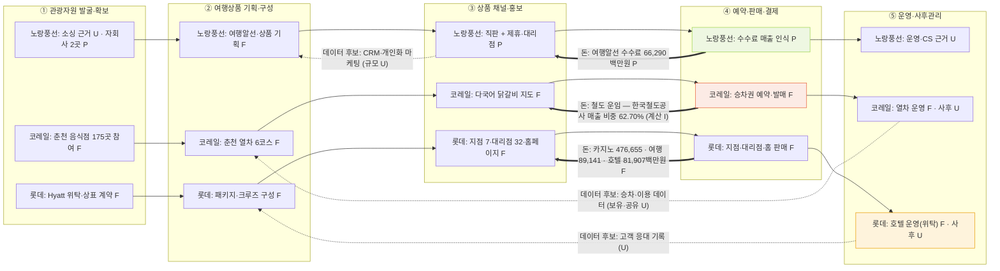

# 밸류체인 v0 — 여행산업 3사 (노랑풍선 · 코레일네트웍스 · 롯데관광개발)

- 기준일: 2026-11-12
- 출처 기반: `여행산업_밸류체인_조사_ver3.md`(정리 기준 2026-11-09, 13·14장 포함), 각 사 원페이저 (노랑풍선 `lifestyle/…/norang/onepager.md`, 코레일네트웍스·롯데관광개발 `11.05_실습/research/company/…/onepager.md`), 롯데관광개발 `valuechain/activities_v0.md`, 코레일네트웍스 `valuechain/activities_v0.md`, 대구 Threads 반응 `review/review_Daegu.md`
- 체인 틀: 여행산업 공통 5단계 (ver3 §4) — ① 관광자원 발굴·확보 → ② 여행상품 기획·구성 → ③ 상품 채널·홍보 → ④ 예약·판매·결제 → ⑤ 여행 운영·사후관리
- 등급: **[P]** DART 원문 대조 완료 · **[F]** 원페이저·저장 자료 확인 (원문 공시 미대조) · **[I]** 해석·배치 · **[U]** 미확인

## 0. 먼저 읽을 규칙 (ver3 기준)

1. **세 기업 사이의 거래선은 그리지 않는다.** 자료에 발신자·수신자·전달물·근거가 없으므로, 아래 도표는 각 사 안의 활동과 돈 흐름만 보여 준다 (ver3 §7).
2. **합병 전·후를 섞지 않는다.** 코레일 재무(2025)는 합병(2026-09-23) 전 값이다. 합병 후 관광사업 실적으로 쓰지 않는다.
3. **롯데 출처 3(2026년 1~10월 잠정 월별 실적)은 쓰지 않는다.** 표지에 사전 서면 승인 없는 배포·수정 금지 문구가 있다. 이 문서의 롯데 수치는 사업보고서 저장본(출처 1)과 IR 보도자료(2026-03-19)에서만 가져왔다.
4. **대구와의 연결은 [I]다.** 세 사의 원페이저에서 확인된 대구 관련 활동은 판매 접점(롯데 대구지점·대구수성점·대구중구점)과 춘천 열차 사례(코레일, 대구 아님)뿐이다. 대구 치킨 상품의 운영 실적은 세 사 모두 [U]다.

## 1. 세 사 한눈에

| 항목 | 노랑풍선 (104620) | 코레일네트웍스 | 롯데관광개발 |
| --- | --- | --- | --- |
| 핵심 사업 | 종합여행업(여행알선) · 항공권·선표 발권 직판 | 철도 승차권 예약·발매 (합병 전) · 합병 후 관광·주차·고객센터 사업 | 카지노 · 그랜드 하얏트 제주 · 여행업 |
| 2025 매출 | 119,705백만원 **[P]** (연결) | 128,285백만원 **[F]** (합병 전) | 653,448백만원 **[F]** (카지노 72.94% · 여행업 13.64% · 호텔 12.53%) |
| 2025 영업이익 | 흑자, 2,238,783,517원 **[P]** | 5,952백만원 **[F]** (합병 전) | 1,433억원 **[F]** (IR 보도자료, 웹 확인) |
| 2025 당기순이익 | 당기순손실 (2,862,746,460)원 **[P]** | 5,619백만원 **[F]** (합병 전) | 276억원 **[F]** (IR 보도자료, 웹 확인) |
| 대구 접점 | [U] 대구 판매 조직 근거 없음 | [U] 대구 운영 근거 없음 (춘천 사례 있음) | 대구지점 · 대구수성점 · 대구중구점 **[F]** |
| 가장 가까운 여행 관광 근거 | 직판·제휴·대리점 판매 구조 **[P]** | 춘천 계모임 열차 6코스, 290명 (목표 대비 107.4%, 회사 발표) **[F]** | 제주 드림타워·호텔·패키지 **[F]** |

## 2. 5단계 배치 (활동 기반)

| 단계 | 노랑풍선 | 코레일네트웍스 | 롯데관광개발 |
| --- | --- | --- | --- |
| **① 관광자원 발굴·확보** | 소싱·계약 근거 [U] · 자회사 노랑풍선시티버스 100%, 일본법인 60% **[P]** (존재만 확인, 소싱 업무 입증 아님) | 춘천 음식점 175곳 사업 참여 **[F]** (상품 포함은 10여 곳) · 음식점·공공기관 협업 **[F]** · 계약 방식 [U] | 그랜드 하얏트 제주 위탁운영·상표 계약(2017-08-28, 각 20년) **[F]** · 제주 지자체 협업 **[F]** · 공급 계약 조건 [U] |
| **② 여행상품 기획·구성** | 여행알선·상품 기획 **[F]** · 실제 구성 분담 [U] | 춘천 열차 코스 6개 **[F]** · 가격 결정·업체 분담 [U] | 패키지·크루즈 구성 **[F]** · 호텔 연계 상품 [U] |
| **③ 상품 채널·홍보** | 직판(방문·홈페이지·모바일앱·신문광고), 제휴(홈쇼핑·온라인 제휴·대리점) **[F]** · 온라인 비중 [U] | 춘천 닭갈비 다국어 지도 배포 **[F]** · 관광상품 판매 채널 [U] | 직영 지점 7곳, 프랜차이즈 대리점 32곳, 홈페이지, Hyatt 공식 홈페이지 **[F]** |
| **④ 예약·판매·결제** | 판매 경로와 매출 인식 **[P]** (여행알선은 수수료만 매출) · 결제·정산 [U] | 승차권 예약·발매 **[F]** · 관광상품 예약·결제 [U] | 지점·대리점·홈페이지 판매 **[F]** · 예약·결제·정산 분담 [U] |
| **⑤ 여행 운영·사후관리** | 여행 전체 운영·환불·CS 근거 [U] (자회사·CRM 기재만 있음) | 춘천 열차 운영 **[F]** · 관광상품 사후관리 [U] · 철도고객센터는 관광상품 CS와 별개로 확인 필요 | 호텔 운영(Hyatt 위탁) **[F]** · 여행 사후관리 [U] |

**필수 구분 (ver3 §4)**: 판매 경로 ≠ 결제 처리 주체 · 승차권 발매 ≠ 관광상품 판매 · 철도고객센터 ≠ 관광상품 CS · CRM 활용 ≠ 후기의 상품기획 환류.

## 3. Mermaid v0 — 사별 활동 흐름 (기업 간 선 없음)

**읽는 법:** 실선 `-->`은 같은 회사 안의 단계 순서다. `==>`는 돈의 흐름이고, 괄호 안은 자료 등급이다. `-.->`는 미확인 데이터 후보다. 회사끼리 이어지는 선은 없다.

## 4. 돈 흐름 (회사별)

| 회사 | 시작점 (결제) | 중간 차감 | 끝점 (회사에 남는 몫) | 근거 |
| --- | --- | --- | --- | --- |
| 노랑풍선 | 고객 결제 (직판·제휴·대리점) | 상품가 − 여행경비 = 수수료 인식 (여행알선 66,290백만원 55.38%) | 항공권 총액 30,155백만원, 항공권판매수입 등 11,505백만원, 기타 11,755백만원 | **[P]** 사업보고서 대조 (ver3 §12). 매출 합 119,705백만원 |
| 코레일네트웍스 | 승차권·철도 서비스 이용료 | 한국철도공사 거래 80,433백만원 (2025, 합병 전) | 영업이익 5,952백만원 (합병 전) | **[F]** 감사보고서 주석. 62.70%는 계산 **[I]** |
| 롯데관광개발 | 카지노 고객 · 호텔 투숙 · 여행 고객 | 카지노 위탁·호텔 위탁 수수료 (금액 **[U]**) | 영업이익 1,433억원 | **[F]** 사업보고서 저장본 + IR 보도자료 |

**돈 흐름 주의:** 롯데 카지노 매출은 대구 치킨 관광과 무관한 수익 구조다. ver3 §9에 따라 카지노 수익 구조를 음식 관광에 그대로 옮기지 않는다.

## 5. 데이터 흐름 (회사별)

| 회사 | 생성 데이터 | 보유자 | 표기 |
| --- | --- | --- | --- |
| 노랑풍선 | 고객 CRM·개인화 마케팅 | 노랑풍선 | 원문 주장 **[F]**, 규모 **[U]**, DART 없음 **[U]** |
| 코레일네트웍스 | 승차권·열차 예약 데이터 | 코레일네트웍스 | 존재 **[I]**, 보유·공유 **[U]** |
| 롯데관광개발 | 호텔 예약·고객 응대 | Hyatt 위탁 주체 포함 **[U]** | 주체 분리 확인 필요 (ver3 §9) |
| 공통 | 리뷰·재방문 | 플랫폼·소비자 | **[U]** — 세 사 모두 확인 못 함 |

## 6. 병목·비용·기회 후보 (관측 사실과 해석 분리)

| 구분 | 단계 | 후보 | 관측 근거 | 해석 | 상태 |
| --- | --- | --- | --- | --- | --- |
| 병목 B1 | ① | 대구 상품 재료 (지역 공급자 확보) | 롯데 대구 판매 조직 확인 · 대구 공급자 이름 [U] | 판매망은 있으나 팔 상품 재료가 확인되지 않음 | [I] |
| 병목 B2 | ⑤ | 노랑풍선 운영·환불·CS 담당 | 자회사·CRM 기재만 있음 **[P]** · 운영 담당 [U] | 여행 전 과정 운영 주체가 특정되지 않음 | [U] |
| 비용 C1 | ④ | 코레일 한국철도공사 거래 의존 | 매출 비중 62.70% **[I]** · 합병 후 비중 [U] | 매출이 모회사 물량에 기댐 | [I] |
| 비용 C2 | ③ | 여행사 수수료 (롯데 대리점·여행사 판매) | 대리점 32곳·중소 여행사 판매 **[F]** · 수수료율 [U] | 모객 대가이나 금액을 알 수 없음 | [U] |
| 기회 O1 | ② | 대구 1박 일정 (낮 관광 + 저녁 치킨) | 노랑풍선 직판·제휴 구조 **[P]** · 상품 존재 [U] | 판매 구조에 대구 상품을 넣을 수 있는지 미검증 | [I] |
| 기회 O2 | ② | 열차 + 식사 + 체험 묶음 | 춘천 계모임 열차 290명 **[F]** (회사 발표) | 대구에 같은 방식 적용 가능성 | [I] |
| 기회 O3 | ③ | 대구 치맥 축제 연계 판매 | 노랑풍선 제휴 채널 **[F]** · 제휴 상품 목록 [U] | 축제 기간 상품화 가능성 | [U] |

## 7. 확인 필요 (발표 전)

1. **코레일 합병 후 정식 명칭·관광상품 판매자·예약 창구·결제·정산 주체** (ver3 §3 P2)
2. **노랑풍선 대구 상품의 존재와 공급자** (ver3 P1 — 대표 상품 1개 확보 필요)
3. **롯데 Hyatt 위탁·상표 수수료 조건, 호텔 소유·운영 주체** (ver3 P1, P3)
4. **노랑풍선 지분 감소 경위 (위시빈 51% → 10.4%)** — 사업보고서 본문에 설명 없음 **[U]**
5. **노랑풍선 2025 매출 감소 원인 (131,914 → 119,705백만원)** **[U]**
6. **코레일 음식점 수 기준 (의사 조사 230곳 / 참여 175곳 / 상품 포함 10여 곳)** — 보고 시 구분 필수
7. **롯데 출처 3 배포 제한 확인** — 외부 공유 전 원문 사용 조건 확인 (ver3 P0)
8. **대구 현장 자료:** 평화시장 VOC와 Threads 반응은 개인 게시글이며 표본이 작다. 대구 전체 평가나 비율로 쓰지 않는다.

## 8. 근거 한계

- 이 파일은 **세 사의 활동 목록과 돈 흐름의 정리**다. 기업 간 거래, 대구 운영 실적, 고객 만족도는 확정하지 않는다.
- 노랑풍선 원페이저의 수치는 DART 사업보고서와 대조했다 (ver3 §12). 그 밖의 원페이저 내용은 [F]다.
- 코레일 재무는 합병 전 값이다. 합병 후 실적을 추정하지 않는다.
- 롯데의 수치는 사업보고서 저장본 + IR 보도자료(웹 확인)에서 가져왔다. DART 원문 접수번호와 직접 대조한 것은 아니므로 [P]를 붙이지 않는다.
