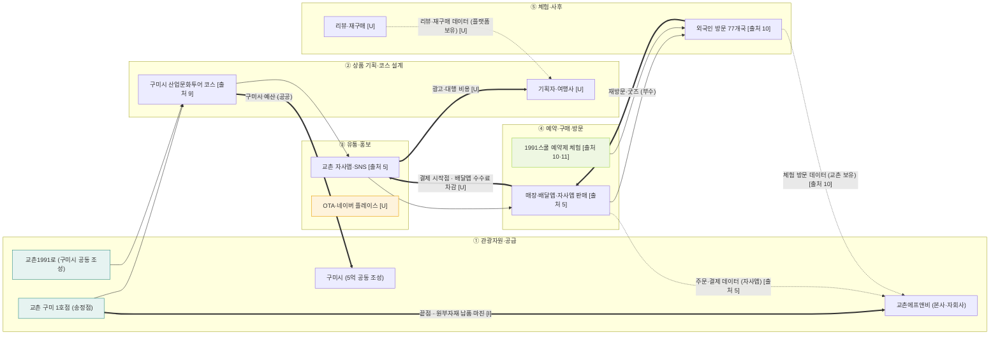

# 밸류체인 v0 — 교촌에프앤비 (치킨 관광상품 체인)

- 기준일: 2026-11-12
- 체인 틀: 1109 산업 분석 자료(Day10 네 층 맵) 치킨 관광상품 5단계 — ① 관광자원·공급 → ② 상품 기획·코스 설계 → ③ 유통·홍보 → ④ 예약·구매·방문 → ⑤ 체험·사후
- 근거 표기: `[출처 n]` = 교촌 원페이저 출처 1~18 (`onepager_교촌에프앤비.pdf` 8쪽 목록). `[F]` 사실 · `[I]` 해석 · `[U]` 미확인
- 실명: 교촌에프앤비 원페이저 기준. 원페이저에 없는 이름은 유형명 + `[U]`

## 1. Mermaid

## 2. 단계별 근거

| 단계 | 하는 사람 (영향 주는 사람) | 근거 | 표기 |
|---|---|---|---|
| ① 관광자원·공급 | 교촌에프앤비 (구미시 · 지자체 지원) | 구미 1호점·교촌1991로 — 시외버스터미널~동아백화점 약 500m, 구미시 5억 + 교촌 13억 공동 조성 [출처 8·9] | F |
| ② 상품 기획·코스 | 기획자·여행사 [U] (구미시 산업문화투어 코스 포함) | 교촌1991로가 구미 산업문화투어 코스에 포함 [출처 9] | F (기획 주체 U) |
| ③ 유통·홍보 | 교촌 자사앱·SNS (노출 알고리즘 · 플랫폼 정책) | 자사앱 가입자 약 733만, 앱 매출 비중 12% [출처 5] | F |
| ④ 예약·구매·방문 | 소비자·관광객 (결제사) | 매장·배달앱·자사앱 판매 경로 [출처 5]. 1991스쿨 예약제 체험 [출처 10·11] | F |
| ⑤ 체험·사후 | 매장 직원·안내 인력 (리뷰 플랫폼) | 1991스쿨 6개월 약 9,600명, 77개국 외국인 [출처 10·11]. 리뷰·재구매 데이터 현황 없음 | F / 리뷰 U |

## 3. 돈 흐름 (소비자 → 원천)

- **시작점:** 관광객·소비자 결제 (매장·배달앱·자사앱) [출처 5] · 공공 예산 (구미시 공동 조성) [출처 9]
- **중간 차감:** 배달앱 수수료 [U] · 광고·대행비 [U]
- **끝점:** 본사에 남는 원부자재 납품 마진 [I, 원페이저 2칸 해석 · 출처 2·15]
- **부수 흐름:** 재방문 소비·굿즈 [U]
- **금액·비율:** 이 파일에는 적지 않음 (원문 확인분만 원페이저에 있음)

## 4. 데이터 흐름

| 생성 지점 | 보유자 | 표기 |
|---|---|---|
| 주문·결제 (자사앱·배달앱) | 교촌 자사앱 / 배달앱 | 자사앱 F [출처 5], 배달앱 U |
| 체험 방문 (1991스쿨) | 교촌 | F [출처 10] |
| 리뷰·재구매 | 플랫폼 | U |

피드백 화살표: 리뷰·재구매 → ① 자원 · ② 기획 은 근거 없음 [U].

## 5. 마커 후보

| 구분 | 마커 | 근거 | 표기 |
|---|---|---|---|
| 비용 C1 | 원재료·운반비 증가로 영업이익 압박 | 3Q 원가 부담 설명 [출처 6] | F (해석 I) |
| 병목 B1 | 해외 매장 84 → 79개 감소, 미국 법인 순손실 40억 | [출처 3] | F (해석 I) |
| 비용 C2 | 해외 법인 손실 (미국 매출 34억 · 순손실 40억) | [출처 3] | F |
| 병목 B2 | 본사 소재지 확인 필요 → 로열티 역외 유출 마커 보류 | 원페이저 2칸 "본사 소재지 [U]" | U |
| 기회 O1 | 1991스쿨 외국인 체험 데이터를 코스 기획에 연결 | [출처 10·11] | I |
| 기회 O2 | 자사앱 데이터 기반 코스 추천 | [출처 5] | I |

- 마커는 단계당 최대 2개 (①과 ③에 2개씩, 나머지 1개 이하) — 최종 확정은 검토 후.
- 우선 기회 후보: O2 (자사앱 데이터 · 팀 Claude Code로 구현 가능성은 미검증 [I]).

## 6. 확인 필요 항목

- 본사 소재지 (원페이저 2칸 [U]) — 공시로 확인 후 B2 확정
- 배달앱 수수료율, 광고비 — 원문 확인 전까지 금액 미기재
- 리뷰·재구매 데이터 소스
- 기획자·여행사 실명 (구미 관광 기획 주체)
