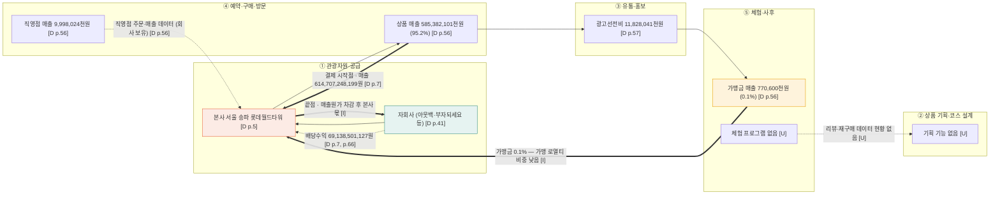

# 밸류체인 v0 — 다이닝브랜즈그룹 (bhc) (치킨 관광상품 체인)

> 재무 근거용 보조 자료 — 활동·이해관계자는 미확인 [U]

- 기준일: 2026-11-12
- 체인 틀: 1109 산업 분석 자료 치킨 관광상품 5단계 — ① 관광자원·공급 → ② 상품 기획·코스 설계 → ③ 유통·홍보 → ④ 예약·구매·방문 → ⑤ 체험·사후
- 근거 표기: `[D p.n]` = 다이닝브랜즈그룹 제22기 **별도**재무제표 감사보고서 (`[다이닝브랜즈그룹]감사보고서(2026.04.10).pdf`) 하단 쪽 번호. `[F]` 사실 · `[I]` 해석 · `[U]` 미확인
- 기준 주의: 별도재무제표 기준. 연결 기준 수치와 다름.

## 1. Mermaid

## 2. 단계별 근거

| 단계 | 하는 사람 (영향 주는 사람) | 근거 | 표기 |
|---|---|---|---|
| ① 관광자원·공급 | 다이닝브랜즈그룹 본사 · 자회사 (지배기업 글로벌고메이서비시스) | 본사 서울 송파구 올림픽로 300 [D p.5] · 종속기업 10개사 [D p.41, p.66] | F |
| ② 상품 기획·코스 | 해당 없음 [U] | 감사보고서에 관광 기획 기재 없음 | U |
| ③ 유통·홍보 | 광고 대행·플랫폼 [U] | 광고선전비 11,828,041천원 [D p.57] | F |
| ④ 예약·구매·방문 | 가맹점·직영점 소비자 | 상품 매출 585,382,101천원 (95.2%), 직영점 9,998,024천원 [D p.56] | F |
| ⑤ 체험·사후 | 해당 없음 [U] (가맹금 0.1%) | 가맹금매출 770,600천원 [D p.56] | F / 체험 U |

## 3. 돈 흐름 (소비자 → 원천)

- **시작점:** 가맹점·직영점 매출 614,707,248,199원 [D p.7]
- **중간 차감:** 매출원가 387,041,903,154원 (63.0%, 계산) [D p.8] · 판매비와관리비 63,143,723,119원 [D p.8]
- **끝점:** 본사 영업이익 164,521,621,926원 [D p.8] — 자회사 배당으로 추가 유입 [D p.7]
- **부수 흐름:** 배당금수익 69,138,501,127원, 그중 (유)아웃백스테이크하우스코리아 62,137,421천원 [D p.66]
- **금액 원칙:** 원문 표기 그대로, 비율은 계산값
- **본사 소재지 (로열티 역외 유출 판단 근거):** 서울 송파. 가맹금 비중 0.1%로 로열티 흐름은 작음 [D p.5, p.56] — 해석 [I]

## 4. 데이터 흐름

| 생성 지점 | 보유자 | 표기 |
|---|---|---|
| 매출·매입 (본사 ERP) | 다이닝브랜즈그룹 | F (재무 항목으로 존재) [D p.56] |
| 직영점 매출 | 본사 | F [D p.56] |
| 자회사 배당 | 본사 · 자회사 | F [D p.66] |
| 리뷰·재구매 | 플랫폼·소비자 | U |

피드백 화살표: 리뷰·재구매 → 기획 은 근거 없음 [U].

## 5. 마커 후보

| 구분 | 마커 | 근거 | 표기 |
|---|---|---|---|
| 비용 C1 | 본사 수도권 · 가맹금 비중 0.1% → 지역 소비 잔존 낮음 (역외 유출 판단) | 본사 소재지 [D p.5], 가맹금 770,600천원 [D p.56] | F (해석 I) |
| 병목 B1 | 해외 법인 순손실 (미국 2,391,620천원 · 캐나다 655,312천원 · 홍콩 450,202천원) | 종속기업 요약재무 [D p.43] | F |
| 비용 C2 | 광고선전비 증가 (+30.4%, 2024 9,071,513천원 → 2025 11,828,041천원) | [D p.57] (계산) | F |
| 기회 O1 | 직영점 데이터 (9,998,024천원) 활용 — 지역 직영 접점 | [D p.56] | I |

- 단계당 최대 2개 — ①에 C1, ⑤에 B1 후보.
- 우선 기회 후보: O1 (실현 가능성 미검증 [I]).

## 6. 확인 필요 항목

- 연결 기준 매출·영업이익 (별도 기준과 다름) [U]
- 대구 매장 현황 (지역 접점) [U]
- 자회사별 역할 (아웃백 · 부자되세요 · 보강엔터프라이즈 등) — 실명 사용 가능 여부 확인 [U]

## 7. 보강 근거 (Aside 조회, 2026-11-12)

활동·데이터 칸을 보강하는 공개 자료입니다. 모두 보도 또는 회사 공개 자료이며, 사업보고서 원문은 확인하지 못했습니다(미확인 [U]).

| 단계 | 확인된 활동 | 날짜 | 출처 | 표기 |
|---|---|---|---|---|
| ① 관광자원·공급 | 해외 10개국 53개 매장 운영 (10월 기사 기준, 9월 기사는 51개) | 2026-10-26 | https://thetracker.co.kr/View.aspx?No=4278486 | F |
| ① 관광자원·공급 | 베트남 마스터 프랜차이즈 계약 (향후 10년 50개 매장 목표) | 2026-05-08 | https://bhcchicken.global/bhc-accelerates-expansion-into-the-vietnamese-market-through-master-franchise-agreement | F |
| ② 상품 기획·코스 | 해외 관광객 3박 4일 '뿌링클 데이 투어' (태국·대만·인도네시아·말레이시아, 강남역 플래그십 매장 방문, 서울 관광 포함) | 2026-10-26 | https://mobile.newsis.com/view/NISX20261026_0003841607 , https://thetracker.co.kr/View.aspx?No=4278486 | F |
| ③ 유통·홍보 | 신메뉴 '콰삭킹' 프로모션 (앱 0원 래플, 7월 2~8일), 누적 판매 950만개 언급 | 2026-07-08 | https://www.greened.kr/news/articleView.html?idxno=344625 | F |
| ④ 예약·구매·방문 | 강남역 플래그십 스토어 개장 | 2026년 8월 (기사 표기) | https://mobile.newsis.com/view/NISX20261026_0003841607 | F |
| ⑤ 체험·사후 | 매장 리뷰: 매장 식사 (골드킹 순살 22,000원, 포장 시 약 3,000원 할인 언급) | 2026-02-27 | https://m.blog.naver.com/heun106/224198548401 | F (개인 리뷰) |
| ⑤ 체험·사후 | 매장 리뷰: 포장 방문, 매장 청결·직원 응대 긍정 | 2026-07-22 | https://choeseunggu.tistory.com/1678 | F (개인 리뷰) |
| 지역 접점 | 지자체·지역 상권 협업 기사 확인 못 함 | - | - | U |
| 데이터 | 앱 래플 이벤트 운영 → 앱 회원 데이터 보유 추정 | 2026-07-08 | https://www.greened.kr/news/articleView.html?idxno=344625 | I |

**돈 흐름 보강:** 2025년 매출 614,707,248,199원, 영업이익 164,521,621,926원의 보도 확인 — 2026-04-10 (https://www.ftoday.co.kr/news/articleView.html?idxno=357541 , https://www.srtimes.kr/news/articleView.html?idxno=200937) · 가맹점 상생 지원 8억 2,000만원, 동반성장 전담조직 운영 (2026-11-12, https://www.straightnews.co.kr/news/articleView.html?idxno=315193) — 상생 지원은 본사 비용 차감으로 볼 수 있음 [I].

**미확인 [U]:** 사업보고서 원문, 최신 가맹점·직영점 수, 네이버 지도 리뷰 원문.
