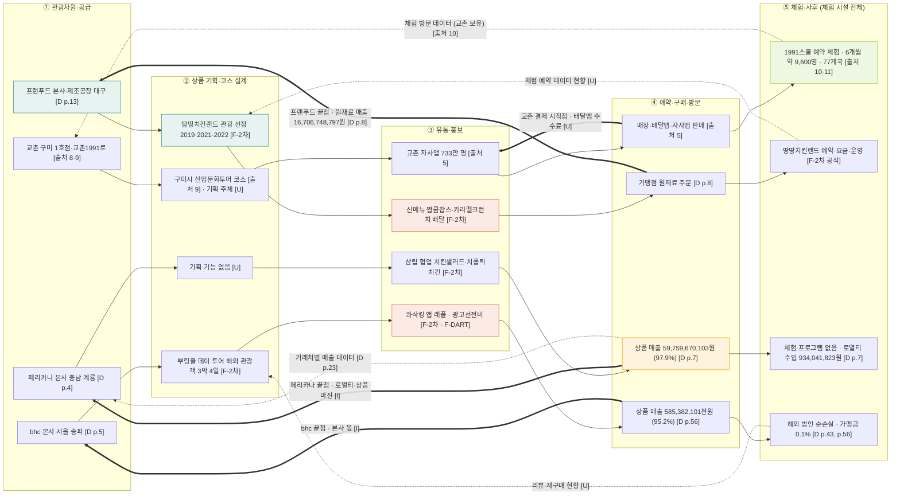

# 밸류체인 v0 통합 — 치킨 기업 4곳 비교 (치킨 관광상품 체인)

> 팀 내부 공유용. 4사를 한 장에 놓고 단계별로 비교합니다. 개별 근거는 기업별 파일(`valuechain_교촌.md`, `valuechain_프랜푸드.md`, `valuechain_페리카나.md`, `valuechain_다이닝브랜즈그룹.md`)과 `근거등급표.md`를 따릅니다.

- 기준일: 2026-11-12
- 체인 틀: 1109 산업 분석 자료 치킨 관광상품 5단계 — ① 관광자원·공급 → ② 상품 기획·코스 설계 → ③ 유통·홍보 → ④ 예약·구매·방문 → ⑤ 체험·사후
- 등급 표기: **[F-DART]** 감사보고서 원문 · **[F-2차]** 보도·공식·공공기관 자료 · **[I]** 해석·계산 · **[U]** 미확인
- 쪽 번호 표기: 프랜푸드 `[D p.n]` (제19기 감사보고서) · 페리카나 `[D p.n]` (제36기 감사보고서) · bhc `[D p.n]` (제22기 별도재무제표 감사보고서) · 교촌 `[출처 n]` (원페이저 출처 1~18)

## 0. 적용한 기준 (확정)

| 항목 | 기준 | 이유 |
|---|---|---|
| 범위 | 4사 한 장 비교. 기업별 레인으로 나눔 | 사용자 선택 |
| 등급 표기 | 교촌 재무는 **보도 기준 [F-2차]**로 표시하고 포함. 나머지 3사는 [F-DART] | 사용자 선택 |
| 체험 시설 귀속 | 땅땅치킨랜드·1991스쿨 등 **체험 시설은 예약·요금·운영 포함 전체를 ⑤**에 둠 | 사용자 선택 (예약 단계 ④에 두는 기준과 다름) |
| 지역 귀속 판단 | **본사 소재지** 기준 | 사용자 선택 |
| 재무 기준 | 연결이 아닌 것은 명시. bhc는 **별도 기준** | 자료 기준 |
| 금액 표기 | 원문 표기 그대로. 비율은 계산값으로만 표시 | CLAUDE.md |

## 1. Mermaid

## 2. 단계별 비교표

| 단계 | 교촌 | 프랜푸드 | 페리카나 | bhc |
|---|---|---|---|---|
| ① 관광자원·공급 | 구미 1호점, 교촌1991로 (구미시 5억 + 교촌 13억 공동 조성) [F-2차 · 출처 8·9] | 본사·제조공장·물류센터 (대구 동구·북구) [F-DART · D p.13] | 본사 충남 계룡 [F-DART · D p.4] | 본사 서울 송파 롯데월드타워 [F-DART · D p.5] |
| ② 상품 기획·코스 | 구미시 산업문화투어 코스 포함 [F-2차 · 출처 9], 기획 주체 [U] | 땅땅치킨랜드 관광 선정 2019 대구 10대 체험관광지, 2021 대구웰니스, 2022 우수 인바운드 안심관광지 [F-2차 공식 선정] | 기획 기능 기재 없음 [U] | 해외 관광객 3박 4일 뿌링클 데이 투어 (태국·대만·인도네시아·말레이시아) [F-2차 · 뉴시스 2026-10-26] |
| ③ 유통·홍보 | 자사앱 가입자 약 733만 명, 앱 매출 비중 12% [F-2차 · 출처 5] | 짭콤찹스 (2026-07-24), 카라멜크런치치킨 (2026-01-19) 배달 출시 [F-2차] | 삼립 협업 치킨샐러드 (2026-07-21), 치폴릭치킨 (2026-06-30) [F-2차] · 판촉비 1,935,525,061원 [F-DART · D p.7] | 콰삭킹 앱 0원 래플 (2026-07-08) [F-2차] · 광고선전비 11,828,041천원 (+30.4%) [F-DART · D p.57] |
| ④ 예약·구매·방문 | 매장·배달앱·자사앱 판매 경로 [F-2차 · 출처 5] | 가맹점 원재료 주문, 상품 매출 12,013,962,070원 · 제품 매출 4,596,288,908원 [F-DART · D p.8] | 상품 매출 59,759,670,103원 (97.9%) [F-DART · D p.7] | 상품 매출 585,382,101천원 (95.2%) [F-DART · D p.56] · 강남역 플래그십 스토어 (2026년 8월) [F-2차] |
| ⑤ 체험·사후 | 1991스쿨 예약제 체험, 6개월 약 9,600명, 77개국 외국인 [F-2차 · 회사 발표 · 출처 10·11] | 땅땅치킨랜드 예약 053-721-7599 (10:00~16:00), 치킨 체험 22,000원 · 치킨+버거 28,000원, 화~일 10:00~18:00, 월요일·신정·설·추석 휴장 [F-2차 · 공식 홈페이지 2026-11-09, 요금 변동 가능] | 체험 프로그램 없음 [U] · 로열티 수입 934,041,823원 (1.5%) [F-DART · D p.7] | 가맹금 770,600천원 (0.1%) [F-DART · D p.56] · 체험 프로그램 없음 [U] |

**체험 시설 귀속 메모:** 땅땅치킨랜드와 1991스쿨의 예약·요금·운영은 사용자 기준에 따라 ⑤에 넣었습니다. 기업별 파일의 ④ 표기와 다릅니다. 파일을 정리할 때 맞춰야 합니다.

## 3. 근거 등급 요약 (재무)

| 항목 | 교촌 | 프랜푸드 | 페리카나 | bhc |
|---|---|---|---|---|
| 기준 | 보도 기준 (감사보고서 없음) | 감사보고서 제19기 (2025) | 감사보고서 제36기 (2025) | 감사보고서 제22기 별도재무제표 (2025) |
| 2025 매출 | 5,174억 원 (+7.6%) [F-2차 · 출처 3·4] | 16,706,748,797원 (-7.4%) [F-DART · D p.8] | 61,029,929,032원 (+4.5%) [F-DART · D p.7] | 614,707,248,199원 (+19.9%, 별도) [F-DART · D p.7] |
| 2025 영업이익 | 349억 원 (+126%) [F-2차 · 출처 3, 350억 보도도 있음] | 영업손실 (2,330,170,797)원 [F-DART · D p.8] | 4,191,298,487원 (+7.1%) [F-DART · D p.7] | 164,521,621,926원 (26.8%) [F-DART · D p.8] |
| 2025 당기순이익 | [U] | 당기순손실 (2,685,547,950)원 [F-DART · D p.9] | 3,817,677,220원 [F-DART · D p.8] (처분계산서와 불일치 — 아래 확인 항목) | 201,362,086,173원 (+39.6%) [F-DART · D p.8] |
| 계속기업 | 해당 없음 [U] | 강조사항 있음 [F-DART · D p.3] | 해당 없음 | 해당 없음 |

**규모 비교 주의:** 4사의 매출은 기준(연결·별도·보도)이 다릅니다. 교촌 매출은 보도 수치라서 감사보고서 기준과 직접 비교할 수 없습니다. bhc는 별도 기준입니다. 규모 순서만 읽고 비율로 비교하지 않습니다.

## 4. 돈 흐름 비교

| 기업 | 시작점 (결제) | 중간 차감 | 끝점 (본사에 남는 몫) | 지역에 남는 몫 (본사 기준) |
|---|---|---|---|---|
| 교촌 | 매장·배달앱·자사앱 결제 [F-2차 · 출처 5] | 배달앱 수수료·광고비 [U] | 원부자재 납품 마진 [I, 출처 2·15] | 본사 소재지 [U] → 판단 보류 |
| 프랜푸드 | 가맹점 매장 매출 [U] | 광고선전비 2,943,537,229원 [F-DART · D p.9] | 원재료 납품 매출 16,706,748,797원 [F-DART · D p.8] (영업손실 상태) | 대구 본사 [F-DART · D p.13] → 지역 잔존 있음 [I] |
| 페리카나 | 지사·특수관계 거래처 상품 구매 [F-DART · D p.7, p.23] | 판관비 7,122,103,809원 · 판촉비 1,935,525,061원 [F-DART · D p.7] | 로열티·상품 마진, 영업이익 4,191,298,487원 [F-DART · D p.7] [I] | 충남 계룡 [F-DART · D p.4] → 수도권 밖, 지역 잔존 판단 [I] |
| bhc | 가맹점·직영점 매출 614,707,248,199원 [F-DART · D p.7] | 매출원가 63.0% [I, D p.8] · 판관비 63,143,723,119원 [F-DART · D p.8] | 본사 영업이익 164,521,621,926원 + 자회사 배당 69,138,501,127원 [F-DART · D p.7, p.66] | 서울 송파 [F-DART · D p.5] → 로열티 흐름 작음 (가맹금 0.1%) [I] |

## 5. 데이터 흐름 비교

| 기업 | 생성 데이터 | 보유자 | 표기 |
|---|---|---|---|
| 교촌 | 자사앱 주문·결제, 1991스쿨 방문 | 교촌 | [F-2차] |
| 프랜푸드 | 원재료 주문, 체험 예약 | 프랜푸드 | 원재료 [I] · 체험 예약 [U] |
| 페리카나 | 거래처별 매출 | 페리카나 | [F-DART · D p.23] |
| bhc | 직영점 매출, 자회사 배당, 앱 래플 회원 | 본사 | 직영점·배당 [F-DART] · 앱 회원 [I] |
| 4사 공통 | 리뷰·재구매 | 플랫폼·소비자 | [U] |

**데이터 판단:** 4사 모두 리뷰·재구매 데이터를 확인하지 못했습니다. "데이터 단절"은 근거가 부족합니다. 발표 전 확보가 필요합니다.

## 6. 마커 후보

기업별 파일에서 단계당 최대 2개 규칙을 지켰습니다. 통합 도표는 **단계당 최대 2개를 기업 구분 없이 세지 않고, 기업별로 적용**한다고 가정했습니다. 이 가정이 맞는지 확인이 필요합니다.

| 단계 | 기업 | 마커 | 근거 | 표기 |
|---|---|---|---|---|
| ① | 교촌 | 비용 C1 원재료·운반비 증가 | 3Q 원가 부담 [출처 6] | [F-2차] (해석 [I]) |
| ① | 프랜푸드 | 병목 B2 계속기업 불확실성 (유동부채 초과 10,897,757천원) | 주석 17 [D p.29] · 강조사항 [D p.3] | [F-DART] |
| ① | bhc | 비용 C1 본사 수도권 · 가맹금 0.1% → 지역 소비 잔존 낮음 (역외 유출 판단) | 본사 소재지 [D p.5], 가맹금 770,600천원 [D p.56] | [F-DART] (해석 [I]) |
| ③ | 프랜푸드 | 비용 C1 광고선전비 증가 (배달 주문 전환) | 주석 17 [D p.29] · 광고선전비 2,943,537,229원 [D p.9] | [F-DART] (해석 [I]) |
| ③ | 페리카나 | 비용 C1 판촉비 증가 (+8.7%) | 판촉비 1,935,525,061원 [D p.7] | [F-DART] |
| ③ | bhc | 비용 C2 광고선전비 증가 (+30.4%) | 광고선전비 9,071,513천원 → 11,828,041천원 [D p.57] | [F-DART] (계산) |
| ④ | 페리카나 | 병목 B1 특수관계 거래처 집중 (매출의 48.9%) | 주석 14 [D p.23] | [F-DART] (계산 · 해석 [I]) |
| ⑤ | 교촌 | 기회 O1 1991스쿨 외국인 체험 데이터 → 코스 기획 | [출처 10·11] | [I] |
| ⑤ | bhc | 병목 B1 해외 법인 순손실 (미국 2,391,620천원 · 캐나다 655,312천원 · 홍콩 450,202천원) | 종속기업 요약재무 [D p.43] | [F-DART] |

**우선 기회 후보:** 교촌 O2 자사앱 데이터 기반 코스 추천 [I] — 실현 가능성 미검증.

## 7. 확인 필요 항목 (발표 전)

1. **교촌 감사보고서(또는 사업보고서) 확보** — 교촌 재무를 F-2차에서 F-DART로 올리기 위해 필요합니다.
2. **교촌 본사 소재지** [U] — 지역 귀속 판단이 "보류"로 남습니다. 공시로 확인해야 합니다.
3. **페리카나 당기순이익 불일치** — 손익계산서 3,817,677,220원과 처분계산서 3,853,399,412원 (35,722,192원 차이). 원문 확인 필요.
4. **프랜푸드 2026 가맹점 수, 공장 가동 현황** [U].
5. **bhc 수치는 별도 기준** — 연결 기준과 혼동하지 않도록 표기.
6. **리뷰·재구매 데이터** — 4사 모두 근거 부족. 발표에서 "데이터 단절"을 주장하려면 보강 필요.
7. **땅땅치킨랜드 임시휴무(신정·설·추석 외), 단체 할인율** [U].
8. **1991스쿨 체험 데이터의 출처** — 회사 발표 기준이므로 외부 발표 전 원문 확인 필요.

## 8. 다음 단계

1. 이 통합 파일을 팀 내부 공유 (근거등급표·보고용_요약과 함께)
2. 확인 필요 1~8 처리
3. 개별 기업 파일의 ④·⑤ 체험 시설 귀속을 통합 기준에 맞춰 정리
4. 외부 발표용으로 다듬기 (F 등급 수치만 본문, I·U는 각주)
5. 커밋·푸시는 요청 시 진행 (이예진 브랜치, `11월 9일/다시_자료/`)
