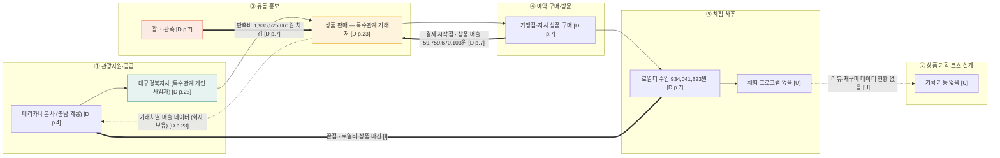

# 밸류체인 v0 — 페리카나 (주) (치킨 관광상품 체인)

> 재무 근거용 보조 자료 — 활동·이해관계자는 미확인 [U]

- 기준일: 2026-11-12
- 체인 틀: 1109 산업 분석 자료 치킨 관광상품 5단계 — ① 관광자원·공급 → ② 상품 기획·코스 설계 → ③ 유통·홍보 → ④ 예약·구매·방문 → ⑤ 체험·사후
- 근거 표기: `[D p.n]` = 페리카나 제36기 감사보고서 (`[페리카나]감사보고서(2026.04.06).pdf`) 하단 쪽 번호. `[F]` 사실 · `[I]` 해석 · `[U]` 미확인
- 역할: 본사 충남 계룡 소재. 상품 매출이 대부분이고 로열티 수입이 있으며, 대구경북·부산경남 지사를 특수관계 개인사업자로 둔다.

## 1. Mermaid

## 2. 단계별 근거

| 단계 | 하는 사람 (영향 주는 사람) | 근거 | 표기 |
|---|---|---|---|
| ① 관광자원·공급 | 페리카나 본사 · 대구경북지사 (식품 표시 규정) | 본사 충남 계룡시 두마면 왕대로 77 [D p.4, p.12] · 대구경북지사 매출 3,181,352천원 [D p.23] | F |
| ② 상품 기획·코스 | 해당 없음 [U] | 감사보고서에 관광 기획 기재 없음 | U |
| ③ 유통·홍보 | 특수관계 거래처 (피아이에스 12,768,205천원 등) | 특수관계 매출 29,847,661천원, 매출의 48.9% [D p.23] (계산) | F |
| ④ 예약·구매·방문 | 가맹점·지사 (구매) | 상품 매출 59,759,670,103원 (97.9%) [D p.7] | F |
| ⑤ 체험·사후 | 해당 없음 [U] (로열티 수입은 있음) | 로열티수입 934,041,823원 [D p.7] | F / 체험 U |

## 3. 돈 흐름 (소비자 → 원천)

- **시작점:** 지사·가맹 거래처의 상품 구매 [D p.7, p.23]
- **중간 차감:** 판매비와관리비 7,122,103,809원 [D p.7] · 판촉비 1,935,525,061원 [D p.7]
- **끝점:** 본사에 남는 로열티·상품 마진 (영업이익 4,191,298,487원) [D p.7] — 마진 구조는 [I]
- **부수 흐름:** 이자수익 591,021,780원 [D p.9]
- **금액 원칙:** 원문 표기 그대로, 비율은 계산값

## 4. 데이터 흐름

| 생성 지점 | 보유자 | 표기 |
|---|---|---|
| 거래처별 매출 | 페리카나 | F (주석 14 특수관계 거래) [D p.23] |
| 가맹점 매출·재고 | 가맹점 | U |
| 리뷰·재구매 | 플랫폼·소비자 | U |

피드백 화살표: 가맹점 반응 → 기획 은 근거 없음 [U].

## 5. 마커 후보

| 구분 | 마커 | 근거 | 표기 |
|---|---|---|---|
| 병목 B1 | 특수관계 거래처 집중 (매출의 48.9%) | 주석 14 [D p.23] (계산) | F (해석 I) |
| 비용 C1 | 판촉비 증가 (전년 대비 +8.7%) | 판매촉진비 1,935,525,061원 [D p.7] | F |
| 비용 C2 | 광고선전비는 감소 (-41.6%) — 비용 구조 전환 | 광고선전비 532,483,801원 [D p.7] | F |
| 기회 O1 | 대구경북지사 채널 활용 (대구 접점) | 지사 매출 3,181,352천원 [D p.23] | I |

- 단계당 최대 2개 — ③에 B1·C1, ①에 O1 후보.
- 우선 기회 후보: O1 (실현 가능성 미검증 [I]).

## 6. 확인 필요 항목

- 치킨 브랜드 체인 구조 (가맹점 수, 로열티 요율) — 감사보고서에 없음 [U]
- 대구경북지사의 운영 주체·위치 (개인사업자 명의) [U]
- 실제 부담율 18.60% (주석 13-3) vs 법인세 계산값 19.4% — 차이 확인 [U]
- 당기순이익 차이 35,722,192원 (손익계산서 vs 처분계산서) [D p.8, p.22]

## 7. 보강 근거 (Aside 조회, 2026-11-12)

활동·데이터 칸을 보강하는 공개 자료입니다. DART 사업보고서 원문은 열지 못해 미확인 [U]입니다. 아래 수치는 2차 자료라서 감사보고서와 대조가 필요합니다.

| 단계 | 확인된 활동 | 날짜 | 출처 | 표기 |
|---|---|---|---|---|
| ① 관광자원·공급 | 공식 소개: 1979년 대전역 앞 치킨집에서 시작, 1981년 프랜차이즈 개시. 뉴욕·런던 매장 | 공식 사이트 | https://www.pelicana.co.kr/brand/intro | F |
| ① 관광자원·공급 | 해외 7개국 50개 매장, 태국 방콕 시암스퀘어 1호점 | 2025-04-18 | https://www.speconomy.com/news/articleView.html?idxno=326271 | F (2차) |
| ② 상품 기획·코스 | 관광 연계 기사 확인 못 함 | - | - | U |
| ③ 유통·홍보 | 삼립 '피그인더가든' 협업 치킨샐러드 2종 (전국 편의점) | 2026-07-21 | https://www.kpinews.kr/newsView/1065576141024831 , https://www.yna.co.kr/view/AKR20260721134400030 | F |
| ③ 유통·홍보 | 신제품 '치폴릭치킨' 출시, 배달의민족 최대 5,000원 할인, 시식단 '닭터' 100명 모집 | 2026-06-30 | https://www.lawissue.co.kr/view.php?ud=202606301047104180204ead0791_12 | F |
| ④ 예약·구매·방문 | 배달 주문 비중 높음 (블로그 리뷰 언급) | 2026-10-22 | 네이버 블로그 (작성자 ID 생략) | F (개인 리뷰) |
| ⑤ 체험·사후 | 매장 리뷰: "옛날 통닭 같으면서도 튀김옷이 적당해서 닭고기와의 비율도 좋았고", 치즈볼 서비스 | 2026-10-22 | 네이버 블로그 (작성자 ID 생략), 수원 북문점 | F (개인 리뷰) |
| 지역 접점 | 계룡 지역 협업 확인 못 함 | - | - | U |
| 가맹점 추이 | 가맹점 2023년 1,019개 → 2025년 971개, 점포당 평균 매출 1억 3,229만원 → 1억 6,744만원 | 2026-10-08 | http://www.leadersfact.co.kr/news/articleView.html?idxno=23612 | I (2차) |

**돈 흐름 보강 (2차 자료, 감사보고서와 대조 필요):** 2024년 매출 584억, 영업이익 39억 1,232만원 (2025-04-18, 2025-04-14 기사) · 2025년 매출 610억(전년 대비 +4.5%), 영업이익 42억 (핀보드, 2026-08-25 기준 2차 자료). 감사보고서 수치(매출 61,029,929,032원, 영업이익 4,191,298,487원)와 대략 일치합니다.

**자료끼리 어긋난 부분:** 2023년 영업이익이 37억(핀보드)과 39억(스페셜경제)으로 다릅니다. 설립일도 기사마다 다릅니다(1982.04.27, 1990.07.26, "1982년 창립"). 대표자 표기도 기사와 홈페이지가 다릅니다.

**미확인 [U]:** 사업보고서 원문, 계룡 지역 협업·관광 연계, 네이버 지도 리뷰 원문.
