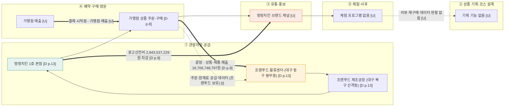

# 밸류체인 v0 — 프랜푸드 (주) (치킨 관광상품 체인)

> 재무 근거용 보조 자료 — 활동·이해관계자는 미확인 [U]

- 기준일: 2026-11-12
- 체인 틀: 1109 산업 분석 자료 치킨 관광상품 5단계 — ① 관광자원·공급 → ② 상품 기획·코스 설계 → ③ 유통·홍보 → ④ 예약·구매·방문 → ⑤ 체험·사후
- 근거 표기: `[D p.n]` = 프랜푸드 제19기 감사보고서 (`[프랜푸드]감사보고서(2026.04.10).pdf`) 하단 쪽 번호. `[F]` 사실 · `[I]` 해석 · `[U]` 미확인
- 역할: 프랜푸드는 치킨 가맹점에 육계·소스를 공급하는 원재료 공급 본사. 관광객을 상대하지 않으므로 체인의 **공급 쪽 끝**에 들어간다.

## 1. Mermaid

## 2. 단계별 근거

| 단계 | 하는 사람 (영향 주는 사람) | 근거 | 표기 |
|---|---|---|---|
| ① 관광자원·공급 | 프랜푸드 (땅땅치킨 가맹점 · 식품 표시 규정) | 본사 대구 동구 팔공로 220-2, 제조공장 대구 북구 산격동, 물류센터 대구 동구 봉무동 · 경기 안성 · 경남 양산 [D p.13] | F |
| ② 상품 기획·코스 | 해당 없음 [U] | 프랜푸드 감사보고서에 관광 상품 기획 기재 없음 | U |
| ③ 유통·홍보 | 땅땅치킨 브랜드 채널 [U] | 감사보고서에 홍보 채널 기재 없음 | U |
| ④ 예약·구매·방문 | 가맹점 (프랜푸드 원재료 주문) | 상품 매출 12,013,962,070원 · 제품 매출 4,596,288,908원 [D p.8] | F |
| ⑤ 체험·사후 | 해당 없음 [U] | 체험·사후 서비스 기재 없음 | U |

## 3. 돈 흐름 (소비자 → 원천)

- **시작점:** 가맹점의 매장 매출 (소비자 결제) [U]
- **중간 차감:** 광고선전비 2,943,537,229원 [D p.9] · 판매비와관리비 7,240,554,179원 [D p.8]
- **끝점:** 프랜푸드의 원재료 납품 매출 16,706,748,797원 [D p.8]
- **부수 흐름:** 가맹점수익 35,500,000원 · 수수료수익 39,100,171원 · 음식 매출 21,897,648원 [D p.8] (합계 0.6% 수준)
- **금액 원칙:** 원문 표기를 그대로 쓰고, 비율은 계산값으로만 표기

## 4. 데이터 흐름

| 생성 지점 | 보유자 | 표기 |
|---|---|---|
| 원재료 주문·공급 | 프랜푸드 | I (주문 데이터 현황은 감사보고서에 없음) |
| 생산 로트·품질 | 프랜푸드 | U |
| 가맹점 매출 | 가맹점 | U |
| 리뷰·재구매 | 플랫폼·소비자 | U |

피드백 화살표: 가맹점 매출 → 프랜푸드 주문 계획 은 근거 없음 [U].

## 5. 마커 후보

| 구분 | 마커 | 근거 | 표기 |
|---|---|---|---|
| 병목 B1 | 가맹점 지속 폐업으로 물량·매출 감소 | 주석 17 "최근 가맹점들의 지속적인 폐업으로 인한 매출감소" [D p.29] | F |
| 비용 C1 | 광고선전비 증가 (배달 주문 전환) | 주석 17 "광고선전비가 급증되어 손실이 급증" [D p.29] · 광고선전비 2,943,537,229원 [D p.9] | F (해석 I) |
| 병목 B2 | 계속기업 불확실성 — 유동부채가 유동자산 초과 10,897,757천원 | 주석 17 [D p.29] · 강조사항 [D p.3] | F |
| 기회 O1 | 원재료 주문·가맹점 수요 예측 | 원재료 공급 구조 [D p.13] · 데이터 보유 [I] | I |

- 단계당 최대 2개 — ①에 C1, ④에 B1 배치는 검토 후 확정.
- 우선 기회 후보: O1 (실현 가능성 미검증 [I]).

## 6. 확인 필요 항목

- 땅땅치킨 브랜드 운영 주체와 관광 연결 (1호 본점 위치·운영시간) [U]
- 가맹점 수 현황 (감사보고서는 "180여 개", 2025년 말 기준 [D p.13])
- 관계사 원재료 매입 552,765천원 (주석 15) — 조달 의존으로 볼지 여부 [I]
- 배달 주문 전환 규모 [U]

## 7. 보강 근거 (Aside 조회, 2026-11-12)

활동·데이터 칸을 보강하는 공개 자료입니다. DART 사업보고서 원문은 열지 못해 미확인 [U]입니다. 재무 수치는 제3자 요약 사이트 기준이라 감사보고서와 대조가 필요합니다.

| 단계 | 확인된 활동 | 날짜 | 출처 | 표기 |
|---|---|---|---|---|
| ① 관광자원·공급 | 땅땅치킨랜드 (체험 테마파크, 본사 건물 내) 2018년 9월 개장 · 공식 소개 "세계 최초·최대 치킨 체험 테마파크" | 2018~ | https://ttangttang.co.kr/brand01_x | F (공식) |
| ① 관광자원·공급 | 물류센터 4곳 (대구, 안성, 양산, 제주) | 2024-01-11 기준 | https://ttangttang.co.kr/brand01_x | F (공식) |
| ② 상품 기획·코스 | 땅땅치킨랜드 관광 선정: 2019 대구 10대 체험관광지 (한국관광공사), 2021 대구웰니스체험관광지 (대구관광재단), 2022 우수 인바운드 안심관광지 (한국관광공사) | 2019~2022 | https://access.visitkorea.or.kr/ms/detail.do?cotId=c15153c4-ab85-434d-acc7-535a55f9a96c | F (공식 선정) |
| ② 상품 기획·코스 | 2019년 연간 약 6만 명 방문 (한국관광공사 안내문) | 2019 | 위 한국관광공사 안내 | F (공식 안내) |
| ③ 유통·홍보 | 신메뉴 '짭콤찹스' 출시, 배달 판매 시작 | 2026-07-24 | https://www.beyondpost.co.kr/view.php?ud=2026072418585230509aeda69934_30 | F |
| ③ 유통·홍보 | 2026년 첫 신메뉴 '카라멜크런치치킨' 배달의민족 선출시 | 2026-01-19 | https://www.edaily.co.kr/News/Read?mediaCodeNo=257&newsId=03283286645319360 | F |
| ③ 유통·홍보 | 신규 가맹점 인테리어·간판 지원 프로모션 | 2020-03-02 | https://www.imaeil.com/page/view/2020030212000375992 | F |
| ④ 예약·구매·방문 | 땅땅치킨랜드 예약제 (전화 053-721-7599, 체험 예약 10:00~16:00). 요금: 치킨 체험 22,000원 (13세 이하 19,000원), 치킨+버거 28,000원 (13세 이하 25,000원), 미체험 입장 10,000원 | 2026-11-09 | 땅땅치킨랜드 공식 홈페이지 "이용안내" 발췌 (정리 파일 출처 1~3) | F (공식, 요금 변동 가능) |
| ④ 예약·구매·방문 | 운영: 화~일 10:00~18:00, 매주 월요일·신정·설·추석 휴장. 체험 예약 가능 시간 10:00~12:00, 13:00~14:00, 15:00~16:00 | 2026-11-09 | 공식 홈페이지 (정리 파일 출처 1·3) | F (공식), 임시휴무는 U |
| ⑤ 체험·사후 | 체험 후기: "직원분들 친절하고 예약금은 없고 재미있게 잘 체험함" | 2026-03-08 | https://www.tripinfo.co.kr/info.html?content_id=2581263&content_type_id=12 | F (개인 후기) |
| ⑤ 체험·사후 | 체험 후기: 아이들 체험 만족, "치킨 가루 묻혀 버무리는 과정" 아쉬움 | 2026-08-04, 2026-08-31 | 네이버 블로그 (작성자 ID 생략), 방문자 후기 | F (개인 후기) |
| 지역 접점 | 대구 동구 효목2동 소목골 마을관리사회적협동조합과 지역상생 업무협약 · 효목점 개점 | 2024-07-26 | https://digitalchosun.dizzo.com/site/data/html_dir/2024/07/26/2024072680200.html | F |
| 지역 접점 | 대구 동구 본사·땅땅치킨랜드가 같은 건물 (팔공로 220-2) | 2026 | 위 공식 페이지 | F |
| 데이터 | 체험 예약·방문 데이터: 전화 예약 중심, 데이터 보유 현황 확인 못 함 | - | - | U |
| 가맹점 추이 | 가맹점 220개(2023) → 168개(2025), 점포당 매출 증가 | 2026-10-08 | http://www.leadersfact.co.kr/news/articleView.html?idxno=23612 | I (2차) |

**돈 흐름 보강 (2차 자료, 감사보고서와 대조 필요):** 2023 매출 206억 / 영업이익 11억 · 2024 매출 180억 / 영업손실 22억 · 2025 매출 167억 / 영업손실 23억 (zpzg.kr 요약, DART 감사보고서 인용). 감사보고서 수치(2025 매출 16,706,748,797원, 영업손실 2,330,170,797원)와 대략 일치합니다. 계속기업 불확실성 문단도 감사보고서와 일치합니다.

**표기 불일치:** 대표 이름이 옥재석(공식 사이트)과 옥광세(2012·2020년 기사)로 다르게 나옵니다. 제주 물류센터 주소가 양산과 같게 표기된 자료가 있습니다. 설립일 등 연혁이 자료마다 다릅니다.

**미확인 [U]:** DART 사업보고서 원문, 최신 가맹점·직영점 수, 공장 현재 가동 현황 (2026 블로그에서 "공장과 함께 있는 건물" 묘사만 확인), 네이버 지도 리뷰 원문, 땅땅치킨랜드 임시휴무 여부(신정·설·추석 외).

**이 결과로 바뀌는 점:** ② 기획 칸은 [U]에서 F(한국관광공사·대구관광재단 선정)로 채워졌습니다. ⑤ 체험·사후 칸도 개인 후기로 F가 됐습니다. 프랜푸드는 체험 테마파크를 가진 공급자이므로, 교촌처럼 관광 연결이 있는 쪽으로 볼 수 있습니다 [I].

**땅땅치킨랜드 체험 조건 (공식 홈페이지, 코스 설계 규칙 후보):**
- 1회 이용 1시간 30분 (체험 50분, 식사·자유시간 40분), 1회 최대 70명
- 36개월 이상 가능, 13세 이하는 보호자 1인과 동반. 어린이 단독 체험 불가
- 20명 이상 단체 할인, 6인 이상 외국인 단체 할인 (할인율은 자료에 없음, 전화 확인 필요)
- 월요일 휴장, 체험 예약은 16:00까지 → 평일 낮 코스에서 월요일 제외, 16:00 마감 규칙 필요 [I]
