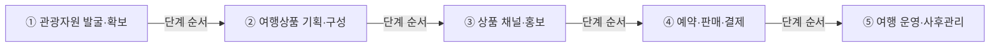
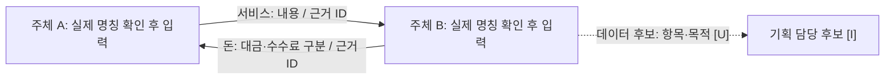

# 여행산업 밸류체인 — 세 기업 조사 요약과 실행 체크리스트 (ver2)

> **버전:** ver2 (2026-11-10). v1 기준 파일은 `여행산업_밸류체인_조사.md`입니다.
> **ver2 변경 내역:** 13장 추가 — 관광산업 7단계, 산업 구조 특징 5가지, 돈의 시작점 2개(관광객 결제 + 공공 예산), 단계별 데이터 표, 참고 사례 유형 구분. 1~12장 내용은 v1과 같습니다.

> **핵심 판단 `[I]`**: 기업을 늘리기보다 **노랑풍선·코레일네트웍스·롯데관광개발의 실제 활동과 연결 근거를 먼저 보강**한다. 세 기업은 5단계 구조를 설명하는 출발점이다. 세 기업이 서로 거래한다거나 모든 단계를 검증했다는 뜻은 아니다.
>
> **지금 할 일**: 출처 대장 확보 → 활동 추출 → 이해관계자 배치 → 병목·AI 후보 기록 → Mermaid v0 → 근거 보완·v1 → 분석·HTML.

- 정리 기준일: **2026-11-09**
- 검토 자료: 업로드된 원페이지 3개(모두 2026-11-05 작성)와 연결된 이전 대화 전체 반환분.
- 분석 범위: **여행산업의 공통 5단계**, 대구 치킨 미식관광은 적용 가능성을 검토하는 사례로 취급한다.
- 이 파일은 **조사 요약 및 후속 작업 안내서**다. 아래의 후속 파일·도표는 아직 완성된 산출물이 아니다.

## 1. 먼저 읽기 — 확인 수준과 근거 사용 규칙

| 표기 | 의미 | 사용 규칙 |
| --- | --- | --- |
| `[F1]`·`[F2]`·`[F3]` | 해당 원페이지에 내용이 실제로 기재됨 | **원페이지 내용 확인**이며, 원문 공시까지 검증했다는 뜻은 아님 |
| `[P]` | 공식 1차 자료의 해당 문장·표를 직접 대조 완료 | URL·문서명·쪽/절·기준일이 있어야 부여. 본문 기업 주장에는 일괄 부여하지 않음 |
| `[I]` | 자료를 바탕으로 한 해석·배치·제안 | 사실과 같은 칸에 섞지 말고 근거와 추론을 구분 |
| `[U]` | 현재 검토 자료에서 미확인 또는 원문 재검증 미완료 | **없다는 뜻이 아님**. 확인 질문·찾을 자료·완료 조건을 함께 기록 |

**필수 원칙**

- **주장 단위로 출처를 붙인다.** 파일 전체에 출처 하나만 달지 않는다.
- **원페이지의 사실 기재와 사실의 진위 검증을 구분한다.** 원페이지의 `[I]`·`[U]`를 요약하면서 사실로 승격하지 않는다.
- 파일마다 `[출처 1]`이 서로 다르다. `F2:출처 1`, `F3:출처 1`처럼 기업 식별자를 함께 쓴다.
- 공식 원문을 못 찾으면 `[U]`로 남긴다. 근거 문장·페이지·계약 조건·기업 간 거래를 만들어 넣지 않는다.
- **모든 화살표도 주장이다.** 발신자·수신자·전달물·근거가 없으면 확정된 거래선으로 그리지 않는다.

## 2. 자료와 검증 범위

| ID | 검토한 파일·위치 | 검토 결과와 한계 |
| --- | --- | --- |
| F1 | `onepager.md` — 노랑풍선, 1~8절·우리 자산과의 접점 | 파일 전체 확인. `N-01`, `N-02` 등 출처 대장과 공시 원문은 첨부되지 않음 |
| F2 | `onepager_korail.md` — 사업 모델·재무·동향·충돌 항목 | 파일 전체 확인. 출처 4~6은 원문이 아닌 사실 요약이라고 명시됨 |
| F3 | `onepager_lotte.md` — 사업 모델·재무·동향·충돌 항목 | 파일 전체 확인. 출처 대장·세부 파일 부재. 출처 3은 잠정·배포 제한 주의가 있음 |
| C1 | [이전 대화](chatgpt-conversation://6aed1d8b-a530-83ec-a76a-53aea0e0a58d) | 5단계 배치·보완 우선순위·파일 순서의 맥락. 기업 사실의 독립 근거로 사용하지 않음 |

**웹 대조 기록 (2026-11-09 재시도 후)**: 롯데 IR 보도자료(2026-03-19, i=140)와 코레일 보도자료 목록은 재시도에서 열렸다. 롯데 보도자료의 매출·카지노·영업이익 수치는 저장본과 일치한다. 코레일 목록에서 2026.11.03 "계모임 열차" 보도자료(448번)는 확인했지만 개별 고유 주소는 아직 찾지 못했다. 국토교통부 자회사 통합 발표는 검색 결과의 제목·날짜만 확인했고 본문은 열리지 않았다. 따라서 합병 세부 내용은 웹 검증 완료로 표시하지 않았다. 노랑풍선은 DART 사업보고서 원문으로 확인했다(12장).

- [롯데 IR 보도자료 (i=140)](http://ir.lottetour.com/kor/PressDetail?i=140&p=1) — 확인 완료
- [코레일 보도자료 목록 — 448번 항목, 개별 주소 미확보](https://www.korailnetworks.com/kn/2021/sub05/sub05300.jsp)
- [국토교통부 자회사 통합 발표 검색 결과 경로 — 본문 미확인](https://www.molit.go.kr/USR/NEWS/m_71/dtl.jsp/dtl.jsp?id=95092449&lcmspage=1)

## 3. 세 기업 핵심 비교

| 기업 | 원페이지에 기재된 사업·활동 | 분석에서 맡길 역할 `[I]` | 먼저 보강할 부분 `[U]` |
| --- | --- | --- | --- |
| **노랑풍선** | 종합여행업·여행알선, 항공권·선표 발권 판매. 방문·홈페이지·앱·신문광고 및 홈쇼핑·온라인 제휴·대리점 경로 `[F1:1·3절]` | 상품 기획·판매 흐름의 중심 사례 | 항공·숙박·체험 소싱 계약, 일정·가격 결정, 현지 운영 분담, 환불·후기 관리 |
| **코레일네트웍스** | 합병 전 승차권 예약·발매 등 철도 서비스. 합병 후 자료에 춘천 미식열차·주차장·철도고객센터 사례 `[F2:A·C]` | 철도와 지역 미식관광을 결합한 구성·운영 사례 | 합병 후 정식 명칭, 관광상품 판매자·예약 창구·결제·정산·CS 주체 |
| **롯데관광개발** | 카지노·그랜드 하얏트 제주·여행업. 패키지·크루즈·항공권·철도·전세버스와 지점·대리점·홈페이지 경로 `[F3:A]` | 여행상품 유통 및 숙박·복합관광 서비스 공급 사례 | 호텔 소유·사업·운영 주체, 여행사업과 호텔의 실제 연계, 공급 계약·비용·정산 |

### 노랑풍선: 매출과 판매채널은 출발점, 운영 구조는 추가 조사

| 항목 | 원페이지 기재 | 해석 시 주의 |
| --- | --- | --- |
| 2025년 매출 | 119,705백만원 `[F1:1·2절, N-01]` | DART 원문 대조 완료. N-02 영업수익 119,704,117,734원과의 차이는 반올림 차이다 (12장) |
| 매출 구성 | 여행알선 55.38%, 항공권 총액매출 25.19%, 항공권판매수입 등 9.61%, 기타 9.82% `[F1:2절]` | 채널별 매출 비중이 아님 |
| 매출인식 | 여행알선은 상품가에서 여행경비를 뺀 수수료, 일부 항공권·숙박권은 총액 인식 `[F1:2절, N-01 II-4]` | 고객 결제액 전체와 회계상 매출을 동일시하지 않음 |
| 데이터·CRM | 개인화 마케팅에 활용한다고 원문이 주장한다는 기재 `[F1:4절]` | 데이터 규모·기업 간 공유·후기 기반 상품 개선·AI 사용은 별도 검증 |
| 해외 거점·자회사 | 일본 법인·지사, 태국사무소, 시티버스 등 `[F1:4·5절]` | 존재만으로 소싱·현지 운영 업무를 입증하지 못함 |

### 코레일네트웍스: 합병 시점과 춘천 수치의 범위를 분리

| 항목 | 원페이지 기재 | 반드시 구분할 점 |
| --- | --- | --- |
| 합병 | 2026-09-23 코레일관광개발 흡수합병 `[F2:머리말]` | 합병 원문·정식 법인명·효력일은 재확인 필요. 보도 명칭과 법인명을 동일시하지 않음 |
| 2025년 재무 | 매출 128,285백만원, 영업이익 5,952백만원(반올림 표) `[F2:B]` | **합병 전 수치**. 합병 후 관광사업 실적으로 사용 금지 |
| 한국철도공사 거래 | 2025년 매출 비중 약 62.70%는 원페이지의 계산·해석 `[F2:B, I]` | 합병 후 비중이나 관광상품 매출 비중이 아님 |
| 춘천 계모임 열차 | 2026-11-03 자료에 6개 코스·290명·목표 270명 대비 107.4% `[F2:C, 출처 4]` | 회사 발표를 정리한 값. 독립 검증 여부 미확인 |
| 음식점 | 의사 조사 약 230곳 / 사업 참여 175곳 / 상품 포함 10여 곳 `[F2:충돌 10]` | **175곳 모두가 열차상품에 포함됐다고 쓰지 않음** |
| 음식점 매출 | 10월 16일 하루 약 700만원의 음식점 직접 매출 `[F2:C]` | 회사 매출·사업 전체 매출·연간 효과가 아님 |

**대구 적용은 `[I]`**: 철도·관광·식사·체험 조합과 다국어 안내 방식을 참고할 수 있다. 대구 운영 실적, 평화시장 사업 참여, 실제 제휴·상품 출시는 `[U]`다.

### 롯데관광개발: 카지노 중심이라는 점과 여행·호텔 역할을 함께 표시

| 2025년 부문 | 매출(백만원) | 비중 | 근거 |
| --- | ---: | ---: | --- |
| 카지노 | 476,655 | 72.94% | `[F3:B, 출처 1]` |
| 여행업 | 89,141 | 13.64% | `[F3:B, 출처 1]` |
| 호텔업 | 81,907 | 12.53% | `[F3:B, 출처 1]` |

- **위 3개는 전체 부문이 아니다.** 비중 합계는 99.11%, 금액 합계는 647,703백만원이다. 원페이지의 전체 합계 653,448백만원에는 다른 부문이 포함된다. 차액을 반올림만으로 설명하지 않는다.
- 원페이지에는 Hyatt 위탁운영·상표 계약(2017-08-28, 각 20년)이 기재돼 있다 `[F3:A]`. **법적 소유자, 사업 주체, 위탁운영사, 예약·고객 응대 주체는 계약·공시로 각각 확인**한다.
- 대구지점·대구수성점·대구중구점 기재는 판매 접점의 근거다 `[F3:A]`. **대구 치킨 관광상품의 존재나 협업 의향까지 입증하지 않는다.**
- 코레일관광개발 지분 39.20%는 **2025년 말 기준** 기재다 `[F3:A; F2:프로젝트 시사점]`. 합병 후 지분 처리와 현재 협력관계는 `[U]`다.
- 호텔 연간 매출과 월·분기 발표 수치, 2026년 1분기 부문 합계 등은 원페이지 자체의 충돌 목록에 있다. **총액·순액, 연결·별도, 내부거래 등 차이 원인을 확인하기 전 추세를 연결하지 않는다.**

## 4. 여행산업 5단계 잠정 배치

> **모든 기업을 모든 단계에 채울 필요는 없다.** 아래 기업 배치는 `[I]`이며, 근거가 있는 활동과 추가 확인이 필요한 활동을 나눠 적었다.

| 단계·핵심 질문 | 노랑풍선 | 코레일네트웍스 | 롯데관광개발 |
| --- | --- | --- | --- |
| **① 관광자원 발굴·확보** — 무엇을 누구에게 확보하는가? | 거점 정보는 있으나 소싱·계약은 `[U]` | 춘천 음식점·공공기관 협업 기재 `[F2:A]`; 계약 방식 `[U]` | 호텔·리조트 서비스 기재 `[F3:A]`; 외부 자원 확보·공급 계약 `[U]` |
| **② 여행상품 기획·구성** — 일정·가격·구성은 누가 정하는가? | 여행알선·상품 기획 관련 기재 `[F1:1·7절]`; 실제 구성 분담 `[U]` | 춘천 코스·열차 상품 기재 `[F2:C]`; 가격 결정·업체 분담 `[U]` | 패키지·크루즈 등 기재 `[F3:A]`; 자체 구성·호텔 연계 `[U]` |
| **③ 상품 채널·홍보** — 어디서 고객에게 알리는가? | 방문·홈페이지·앱·광고·제휴 채널 `[F1:3절]` | 지도 배포·홍보 사례 `[F2:D]`; 관광상품 판매 채널 `[U]` | 지점·대리점·홈페이지·Hyatt 경로 `[F3:A]`; 상품별 역할 `[U]` |
| **④ 예약·판매·결제** — 판매·수납·정산 책임자는 누구인가? | 판매 경로·매출인식 기재 `[F1:2·3절]`; 결제·정산 `[U]` | 승차권 예약·발매 `[F2:A]`; 관광상품 예약·결제 `[U]` | 판매 경로 기재 `[F3:A]`; 예약·결제·정산 업무 분담 `[U]` |
| **⑤ 여행 운영·사후관리** — 누가 현장을 운영하고 문제를 해결하는가? | 자회사·CRM 기재만으로 여행 전체 운영·환불·CS는 입증 불가 `[U]` | 미식열차 운영 기재 `[F2:C]`; 관광상품 사후관리 `[U]` | 숙박 서비스·위탁운영 계약 기재 `[F3:A]`; 여행 사후관리 `[U]` |

**필수 구분**: 상품 판매 경로 ≠ 결제 처리 주체 / 승차권 발매 ≠ 관광상품 판매 / 철도고객센터 ≠ 관광상품 CS / CRM 활용 ≠ 후기의 상품기획 환류.

### 기업 추가 판단 `[I]`

| 대상 | 현재 판단 | 추가 조사로 전환할 조건 |
| --- | --- | --- |
| 기존 세 기업 | 유지·보완 | 활동과 연결 근거를 먼저 확보 |
| 호텔신라·파르나스호텔 | 우선 보류 | 롯데 사례만으로 숙박 공급·운영 역할을 설명하기 어려울 때 한 곳 검토 |
| 하나투어·모두투어 | 동일 역할 보강 목적의 추가는 보류 | 기존 기업으로 해결할 수 없는 비교 질문이 생겼을 때 |
| 땅땅치킨랜드 등 지역 자원 | 필요시 조사 | 대구 체험 공급자의 실제 운영 법인·프로그램·예약 구조가 필요할 때 |

지역 자원은 반드시 상장기업일 필요가 없다. 음식점·상인회·축제 주최기관·지자체도 이해관계자가 될 수 있다. **이는 후보 분류이며 실제 참여·계약을 뜻하지 않는다.**

## 5. 우선순위별 상세 실행 체크리스트

### P0 — 출처·시점·공유 조건 정리: 다른 작업의 선행 조건

- [ ] 세 기업의 `sources.md`, `A_bm.md`, `B_fin.md`, `C_news.md`, `D_industry.md`와 관련 공식 원문을 확보한다.
- [ ] 각 주장에 `기업:출처ID`, 문서명, 발행일, 대상기간, 쪽/절, URL, 짧은 근거 문장, 확인일을 붙인다.
- [ ] 코레일 합병 공고·공식 발표로 명칭·합병 주체·효력일을 확인하고 합병 전후 행을 분리한다.
- [ ] 롯데의 호텔 매출·분기 합계·연결/별도 등 충돌은 해결 전까지 별도 행으로 유지한다.
- [ ] 배포 제한 자료의 원문·표·이미지·가공 내용에 대한 사용 가능 범위를 확인한다. 불명확하면 공유본에서 제외하고 공개 자료로 대체한다.

**완료 조건**: 핵심 주장마다 원문까지 추적 가능하거나 `[U]` 사유·후속 확인 계획이 있다. 파일을 열어 본 것만으로 `[P]`를 부여하지 않는다.

### P1 — 관광자원 소싱·계약 구조

- [ ] 노랑풍선·롯데관광개발에서 대표 여행상품을 각각 1개 고른다. 실제 판매 안내를 확보하지 못하면 사례 선정도 `[U]`로 둔다.
- [ ] 항공·철도·숙박·식사·체험 중 무엇이 포함되는지 구분한다.
- [ ] 공급자 법인, 계약 당사자, 자체 구성/외부 조달, 가격 결정·재고 확보 주체를 확인한다.
- [ ] 직접 계약·현지사 경유·대행 여부, 선매입·위탁·수수료 조건은 명시된 범위만 기록한다.
- [ ] 상품 안내로 알 수 없는 계약·정산 조건은 사업보고서·주석·공식 제휴 자료에서 보완한다.

**찾을 자료**: DART 사업보고서·주석, 공식 상품 상세·약관, 공식 제휴 발표. **완료 조건**: ①→② 연결을 최소 한 사례에서 설명하거나 미확인 필드를 명시한다.

### P2 — 코레일 관광상품 판매·예약·결제

- [ ] 춘천 계모임 열차 보도자료의 고유 주소·원문과 당시 모집·예약 공지를 찾는다.
- [ ] 홍보 게시자, 판매 계약자, 예약 접수자, 결제 수취자, 환불 책임자를 각각 확인한다.
- [ ] 일반 승차권 창구와 관광상품 예약 창구를 별도 기록한다.
- [ ] 지자체·음식점·운영사 사이 정산·지원금·수수료는 공개된 근거가 있는 범위만 기록한다.
- [ ] 230곳·175곳·10여 곳, 290명, 당일 음식점 매출의 모집단·기간을 확인한다.

**찾을 자료**: 공식 모집 공고·예약 화면·상품약관·보도자료. **완료 조건**: ③→④→⑤의 주체가 이어지거나, 끊기는 지점이 질문으로 남아 있다.

### P3 — 여행 운영·사후관리

- [ ] 노랑풍선 대표 상품에서 출발 전 안내, 현지 일정 조율, 비상 연락, 변경·취소·환불 담당을 찾는다.
- [ ] 여행사·현지사·가이드·공급자의 역할과 책임을 분리한다.
- [ ] 고객 불만 접수·처리, 후기 수집, 만족도 조사 유무를 각각 확인한다.
- [ ] 롯데 호텔의 사업 주체·위탁운영사·예약/응대 주체를 구분하고 여행상품의 CS와 분리한다.
- [ ] 코레일 철도고객센터가 해당 관광상품까지 지원하는지 별도 확인한다.

**완료 조건**: ⑤를 단순한 ‘고객센터 존재’가 아닌 구체적인 업무·담당·책임·근거로 설명한다.

### P4 — 돈·데이터 흐름과 AI 기회 후보

- [ ] 고객 결제액, 여행사 매출, 공급자 정산액, 수수료, 지원금을 별도 항목으로 구분한다.
- [ ] 검색·예약·결제·이용·후기 데이터의 수집 주체·이용 목적·제공 대상·보유기간을 확인한다.
- [ ] 개인정보 처리방침의 위탁/제3자 제공과 실제 서비스 운영 흐름을 구분한다. 방침만으로 실제 전송 실적을 단정하지 않는다.
- [ ] 후기→상품기획 환류, 기업 간 공유, 담당자 수작업 여부는 직접 근거가 없으면 `[U]`로 둔다.
- [ ] 병목·비용 주장은 관측 사실과 추론을 분리한다. 처리시간·건수·비용이 없으면 임의 수치를 넣지 않는다.
- [ ] AI 후보마다 필요한 데이터·사용자·검증 방법·측정 지표를 제안하고 ‘도입 검토안’으로 표시한다.

**완료 조건**: ‘데이터 단절·고비용·AI 효과’를 확정하기 전에 검증할 질문과 측정 계획이 있다.

## 6. 후속 파일 제작 순서와 필수 요소

> 아래 구조는 **권장 작업안 `[I]`**이다. 이번 전달물은 이 요약 `.md` 한 개이며 아래 파일들을 생성·검증했다고 표시하지 않는다.

```text
valuechain/
  sources.md
  activities_v0.md
  stakeholders.md
  signals.md
  valuechain_v0.mmd
  valuechain_v1.mmd
  analysis.md
  index.html
```

| 순서·파일 | 구체적으로 할 일 | 반드시 들어갈 요소 | 완료 기준 |
| --- | --- | --- | --- |
| 1. `sources.md` | 기업별 출처 번호를 통합하되 원래 번호 보존 | 문서명·URL·쪽/절·기간·확인일·원문 접근 여부·공유 조건 | 핵심 주장과 출처가 연결됨 |
| 2. `activities_v0.md` | 원페이지 문장에서 실제 업무를 추출하고 5단계 분류 | 활동 ID·기업/부문·시점·행동·입력/출력·출처·근거 문장·상태 | ‘누가 무엇을 한다’ 형태. 추론은 별도 칸 |
| 3. `stakeholders.md` | 활동 수행자·고객·공급자·영향 주체 배치 | 주체 ID·법인명·역할·단계·활동 ID·계약/운영 책임·확인 질문 | 실명과 역할 후보 구분. 회사/브랜드 혼동 없음 |
| 4. `signals.md` | 병목·비용·데이터·AI 후보 정리 | 신호 ID·활동 ID·관측 근거·해석·미확인·검증 방법·우선순위 | 근거 없는 문제를 확정하지 않음 |
| 5. Mermaid v0 | 공통 5단계와 확보된 활동의 초벌 지도 | 단계·활동/주체 ID·범례·미확인 목록 | 단계 흐름과 실제 기업 간 거래를 구분 |
| 6. Mermaid v1 | 추가 조사 반영, 연결선별 근거·상태 확정 | 서비스/돈/데이터 구분·방향·내용·근거ID·v0 대비 변경 | 연결선마다 추적 가능한 근거 또는 `[U]` 표시 |
| 7. `analysis.md` | 역할·병목 후보·AI 검증안·한계 해석 | 근거/해석 분리·중복/공백·우선 조치·보류 사유·측정 지표 | 도표와 모순 없이 실행 순서 설명 |
| 8. `index.html` | 검토된 표·도표·분석을 한 화면으로 구성 | 제목·범위·기준일·요약·범례·출처·미확인·표 대체 설명 | 좁은 화면·링크·Mermaid 렌더·공유 조건 확인 |

### `activities_v0.md` 작성 예시

| 활동 ID | 기업·시점 | 단계 | 원페이지에서 추출한 내용 | 확인 수준·출처 | 남은 질문 |
| --- | --- | --- | --- | --- | --- |
| A-N-01 | 노랑풍선·원페이지 기재 기준 | ③ `[I]` | 홈페이지·앱·홈쇼핑·대리점 등 판매 경로 | `[F1:3절, N-01 II-4]`; 공식 원문 `[U]` | 상품별 판매 주체·온라인 매출 비중은? |
| A-K-01 | 코레일 사례·2026년 발표 | ②·⑤ `[I]` | 춘천 미식열차 6개 코스 운영 | `[F2:C, 출처 4]`; 보도 원문 `[U]` | 예약·수납·운영 분담은? |
| A-L-01 | 롯데관광개발·계약 기재 기준 | ①·⑤ `[I]` | 호텔 서비스와 Hyatt 위탁운영·상표 계약 | `[F3:A, 출처 1]`; 계약 원문 `[U]` | 자산 소유·운영·고객 응대 주체는? |

**문장 이동 방법**: 원문 문장 보존 → 행동 추출 → 단계 배치 이유를 `[I]`로 기록 → 없는 계약·데이터 정보를 `[U]`로 분리. 여러 단계에 걸친 활동은 세부 활동으로 나누거나 중복 이유를 기록한다.

### `stakeholders.md` 최소 양식

| 주체 ID | 법인/기관·브랜드 | 역할 | 연결 활동 ID | 전달물·상대방 | 근거·상태 | 확인 질문 |
| --- | --- | --- | --- | --- | --- | --- |
| 작성 예정 | 정식 명칭/가칭 구분 | 기획·공급·판매·운영·고객·지원 중 해당 역할 | A-… | 서비스/돈/데이터 구분 | 출처ID + 확인 수준 | 책임·계약·시점 질문 |

### `signals.md`의 AI 후보 예시 — 실제 문제·도입 사실 아님

| 후보 `[I]` | 현재 모르는 점 `[U]` | 필요한 근거·데이터 | 검증 계획·지표 제안 |
| --- | --- | --- | --- |
| 지역 자원을 조합한 일정 초안 지원 | 수작업 부담·제약조건·수요 존재 | 운영시간·이동시간·가격·수용인원·기존 기획 절차 | 담당자 검토로 기획시간·일정 오류·수정 횟수 비교 |
| 예약 후 안내·문의 응대 보조 | 문의량·반복 비율·담당 범위 | 약관·상품 안내·익명화 문의 유형 | 정답률·잘못된 안내·담당자 이관율 측정 |
| 후기 분류·상품 개선 제안 | 후기 수집 권한·기획 환류 여부 | 이용 허용 후기·분류 기준·담당자 판단 | 분류 정확도·검토시간·실제 반영 여부 확인 |

예상 절감률·ROI·매출 효과는 자료 없이 기입하지 않는다. 개인정보나 비공개 고객 데이터를 예시 파일에 넣지 않는다.

## 7. Mermaid v0 → v1 제작 규칙

### v0: 먼저 산업 단계의 뼈대만 확인

아래는 **산업 단계 순서의 예시**다. 기업 간 거래나 데이터 이동을 입증하는 도표가 아니다. 활동·이해관계자 파일을 작성한 뒤 구체화한다.



- [ ] 기업 이름만 줄 세우지 않고 실제 활동을 단계 안에 배치한다.
- [ ] 같은 기업이 여러 단계에 참여할 수 있게 한다.
- [ ] 현재 세 기업이 서로 공급·판매·정산한다는 선은 근거 없이 추가하지 않는다.
- [ ] ⑤→② 데이터 환류는 자동으로 그리지 않는다. 실제 활용 근거부터 확인한다.

### v1: 조사 결과로 서비스·돈·데이터 연결을 구분

아래는 **표기 문법 예시**다. 특정 기업 관계를 나타내지 않는다.



**범례**: 실선은 검증된 관계를 표시하는 용도로, 점선은 미확인 후보를 표시하는 용도로 사용한다. 실선만으로 서비스·돈·데이터가 구분되지 않으므로 **선 라벨에도 흐름 종류를 적는다**. 원페이지만 확인한 관계는 라벨에 `[F]·원문 [U]`를 명시하거나 검증 전까지 후보로 유지한다.

**v1 연결선 대장 필수 열**: 연결 ID / 발신 주체 / 수신 주체 / 서비스·돈·데이터 / 전달 내용 / 시점 / 근거 ID / `[P]·[F]·[I]·[U]` / 확인 질문.

- [ ] 활동 ID와 주체 ID가 도표·표에서 동일하다.
- [ ] 서비스 이동과 대금 이동 방향이 실제 근거와 맞는다.
- [ ] 수수료율·금액·데이터 항목·이용 목적은 확인된 범위만 표시한다.
- [ ] v0→v1에서 추가·삭제·수정한 선과 이유를 `analysis.md`에 남긴다.
- [ ] Mermaid 렌더링을 실제 확인한다. 문법 오류나 글자 겹침이 있으면 수정한다.

## 8. `analysis.md`와 HTML 마무리 체크리스트

### 분석 문서

- [ ] 분석 범위·기준일·검토 파일과 미확보 자료를 밝힌다.
- [ ] 기업별 핵심 역할, 중복 활동, 설명하지 못하는 연결을 구분한다.
- [ ] ‘기업 부재’와 ‘활동 근거 부족’을 구분한다.
- [ ] 병목마다 관측 사실 → 해석 → 미확인 → 확인 방법 순서로 쓴다.
- [ ] AI 후보는 사용자·업무·입력 데이터·기대 산출·검증 지표로 구체화한다.
- [ ] 다음 행동에 우선순위·담당자·완료 조건을 붙인다. 담당자·기한은 팀에서 정하고 임의로 확정하지 않는다.

### HTML

- [ ] 검증된 최신 표·도표·분석만 반영하고 내용 차이를 점검한다.
- [ ] 각 주장과 연결선의 출처·미확인을 확인할 수 있게 한다.
- [ ] Mermaid 원본과 표 형태의 대체 설명을 함께 제공한다.
- [ ] 인터넷 연결이 필요한 라이브러리를 쓰면 오프라인에서 도표가 보이는지 확인한다.
- [ ] 모바일 폭·긴 표의 가로 스크롤·링크·인쇄 화면·한글 표시를 점검한다.
- [ ] 외부 공개 전 제한 자료·개인정보·로컬 임시 경로를 제거하고 공개 가능 근거로 대체한다.

## 9. 반드시 피해야 할 해석

| 금지할 단정 | 올바른 처리 |
| --- | --- |
| 세 기업이 5단계에 있으니 실제로 서로 거래한다 | 역할 배치와 거래관계를 분리하고 연결별 근거 확보 |
| 합병 전 재무가 합병 후 미식관광 실적이다 | 시점·사업 범위 분리 |
| 철도고객센터가 미식열차 환불·후기를 관리한다 | 관광상품 담당 여부 별도 확인 |
| 참여 음식점 175곳이 모두 상품에 포함됐다 | 사업 참여 175곳과 상품 포함 10여 곳 구분 |
| 음식점 당일 매출은 회사 매출이다 | 수익 귀속 주체·기간·집계 범위 표기 |
| 호텔 사업이 있으니 롯데가 모든 현장 운영을 직접 한다 | 소유·사업·위탁운영·응대 주체 분리 |
| 회사 내 호텔과 여행사업이 자동으로 통합상품을 만든다 | 실제 상품·예약·연계 운영 근거 확인 |
| 해외 거점·CRM이 있으니 소싱·데이터 공유·AI가 구현돼 있다 | 각 활동의 실제 수행 근거를 따로 확보 |
| 공개된 자료가 없으니 데이터가 단절돼 있다 | `[U]`로 기록하고 인터뷰·공식 자료로 검증 |
| 제주 카지노의 수익 구조를 대구 음식관광에 적용할 수 있다 | 사례의 참고 범위와 사업모델 차이 명시 |
| 초안의 모든 재무 수치는 바로 비교할 수 있다 | 연결/별도·총액/순액·기간·합병·회계기준 확인 |
| 파일을 Markdown으로 바꾸면 배포 제한이 사라진다 | 원자료의 사용 조건 확인, 공유본은 공개 가능 근거로 재작성 |

## 10. 현재 완료 상태와 바로 다음 행동

| 항목 | 상태 |
| --- | --- |
| 원페이지 3개와 이전 대화 확인 | **완료** |
| 기업별 요약·5단계 잠정 배치·주의점 정리 | **이 파일에 작성** |
| 각 기업의 공시·계약·보도 원문 전체 검증 | **미완료 — 출처 대장·원문 필요** |
| 활동·이해관계자·신호 후속 파일 | **작성 예정** |
| 실제 관계를 반영한 Mermaid v0/v1·분석·HTML | **작성·검증 예정** |

**바로 시작할 작업**

1. **P0 출처 대장을 확보**하고 기업별 출처 번호를 구분한다.
2. **`activities_v0.md`에 원페이지의 활동부터 추출**한다. 위 예시처럼 기재 내용·해석·미확인을 분리한다.
3. P1~P4 질문을 해당 활동에 붙이고, 답이 필요한 연결부터 조사한다.
4. `stakeholders.md`·`signals.md`를 작성한 뒤 Mermaid v0를 만들고, 검증 결과로 v1을 갱신한다.
5. `analysis.md`와 HTML에서 **도표·표·출처·미확인 표시가 일치하는지** 마지막으로 점검한다.

## 11. 실행 결과 (2026-11-09)

**P0 — 출처·시점 정리**

- [x] 코레일네트웍스 `sources.md` 6건, 롯데관광개발 `sources.md` 6건과 저장본 파일을 확인했다. 위치: `11.05_실습\research\company\`
- [x] 핵심 수치를 저장본과 대조했다. 저장본 기준 일치:
  - 코레일 2025년 매출 128,285백만원, 영업이익 5,952백만원 (`03_ir_실적자료.md`)
  - 코레일 합병일 2026-09-23 (감사보고서 저장본 01·02에서 "합병 전 자료" 명시)
  - 춘천 계모임 열차 290명, 목표 대비 107.4%, 음식점 230곳 중 175곳 참여, 10월 16일 음식점 매출 약 700만 원 (`04_pr_…계모임열차.md`)
  - 롯데 카지노 476,655 / 여행업 89,141 / 호텔업 81,907 / 계 653,448백만원 (`01_dart_사업의내용.md`)
- [x] 롯데 IR 보도자료(2026-03-19, i=140)를 웹에서 열어 확인했다. 매출 6,534억원, 카지노 4,766억원, 영업이익 1,433억원으로 위 저장본과 일치한다. 앞서 "접근 실패"로 적었던 항목은 재시도에서 열렸다.
- [ ] **미완:** DART 원문 공시(접수번호 20260319000832, 20260401001354)를 직접 대조하지 않았다. 저장본 일치만으로 `[P]`를 부여하지 않는다.
- [ ] **미완:** 코레일 "계모임 열차" 보도자료의 고유 주소는 목록 페이지(2026.11.03, 448번)에서 찾지 못했다. 다른 페이지에 있을 가능성이 있다.
- [ ] **확인 불가:** 노랑풍선 `onepager.md`가 이 PC에 없다. 바탕화면과 다운로드를 깊이 6까지 검색했지만 찾지 못했다. 노랑풍선 항목은 모두 `[F1]` 재확인이 되지 않은 상태다.
- [ ] 국토교통부 자회사 통합 발표 본문은 이번에도 확인하지 못했다.

**P1–P4 — 진행 상황**

| 항목 | 상태 | 비고 |
| --- | --- | --- |
| P1 관광자원 소싱·계약 | 미착수 | 노랑풍선·롯데의 대표 상품과 계약 원문이 필요하다 |
| P2 코레일 상품 판매·예약·결제 | 일부 | 보도자료 목록 확인. 고유 주소·모집 공고·정산 근거는 미확보 |
| P3 여행 운영·사후관리 | 미착수 | 환불·CS 담당 확인 자료 필요 |
| P4 돈·데이터 흐름·AI 후보 | 미착수 | 개인정보처리방침 확인부터 시작 |

**다음으로 할 일:** 노랑풍선 원페이지를 찾거나 다시 받아 `F1` 항목을 저장본과 대조한다. 그다음 P1 대표 상품 1개씩을 고른다.

## 12. 노랑풍선 DART 사업보고서 대조 (2026-11-09)

출처: [노랑풍선 사업보고서 (2025.12), DART 접수 2026-03-18, rcpNo 20260318001206](https://dart.fss.or.kr/dsaf001/main.do?rcpNo=20260318001206)

| 원페이지 항목 | DART 원문 | 판정 |
| --- | --- | --- |
| 2025년 매출 119,705백만원 | 매출실적 합계 119,705 (백만원, 연결) | **일치** `[P]` |
| 매출 구성: 여행알선 55.38%, 항공권 총액 25.19%, 판매수입 등 9.61%, 기타 9.82% | 동일 (66,290 / 30,155 / 11,505 / 11,755) | **일치** `[P]` |
| N-02 영업수익 119,704,117,734원 과의 차이 | 영업수익 119,704,117,734원 = 119,704.1백만원. 구성 항목을 더한 합계는 119,705백만원 | **DART 내부 반올림 차이**, 원페이지의 `[U]`는 해소 |
| 당기순손실 (2,862,746,460)원 | 연결 당기순손실 (2,862,746,460)원 | **일치** `[P]` |
| 영업이익 흑자 | 연결 영업이익 2,238,783,517원 (전기 영업손실 6,546,408,621원) | **일치** `[P]` |
| 위시빈 2021년 51% 인수 | 사업보고서에 "위시빈 지분 51% 인수" 기재 | **일치** `[P]` |
| 위시빈 2025.12.31 기준 10.4% 관계기업 | 관계기업 투자주식: 위시빈 10,253주, 소유지분율 10.4%. 지분율 20% 미만이나 유의적 영향력 판단으로 관계기업 포함. 취득원가 전액 손상으로 장부금액 0 | **일치** `[P]` |
| 종속회사 지분 (시티버스 100%, 일본법인 60%) | 종속기업 투자주식: 노랑풍선시티버스 100%, Yellow Balloon Japan 60% | **일치** `[P]` |

**남은 `[U]`**
- **지분 감소 경위(51% → 10.4%)**: 사업보고서 본문에서는 이유가 나오지 않았다. 감소 경위는 여전히 확인되지 않는다.
- **2025년 매출 감소 원인**: 전년 대비 감소 자체는 DART 표에서 확인된다(131,914 → 119,705백만원). 원인은 본문에 설명이 없어 `[U]`다.
- **온라인 판매 비중, 고객군 비중, 판관비·인건비 구조, 일본지사·태국사무소 실제 활동**: 사업보고서 본문에 수치가 없어 여전히 `[U]`다.
- **원페이지 기재 "CRM 데이터 규모"**: DART에 없다. `[U]`로 유지한다.

**판정 요약**: 원페이지의 노랑풍선 수치는 DART 원문과 일치한다. 원페이지의 `[U]` 중 하나(매출 차이)는 반올림 차이로 확인됐다. 그 밖의 `[U]`는 그대로 남는다.

## 13. ver2 추가: 산업 구조 보완 (2026-11-10)

출처: 팀 내부 분석 덱 `산업구조_밸류체인_분석.pdf` (2026-11-09, 치킨 관광상품 에이전트 기준). 이 덱의 분류와 판단은 **[I] 참고 틀**로 쓰며, 각 항목의 사실 확인은 별도로 해야 합니다.

### 13-1. 관광산업 7단계 (v1 5단계와 대응)

| 7단계 (덱 기준) | 설명 | v1 5단계 대응 | 우리 조사 상태 |
| --- | --- | --- | --- |
| ① 수요·동기 | 관광객이 여행을 결심 | (없음) | **추가 필요.** 대구 관광 수요 자료(관광데이터랩 등) 미확보 |
| ② 정보·영감 | SNS·블로그·유튜브 | ③ 채널·홍보 | 플레이스·블로그 리뷰는 확보. 관광 콘텐츠 채널 미조사 |
| ③ 상품 기획·패키징 | 코스·일정·가격 | ② 상품 기획 | 노랑풍선·롯데 구성 기재 확인. 가격 결정 주체 `[U]` |
| ④ 유통·예약 | OTA·여행사·앱 예약 | ④ 예약·판매·결제 | 판매 경로 기재 확인. 플랫폼 점유율 `[U]` |
| ⑤ 이동 | KTX·버스·렌터카 | (없음) | **추가 필요.** 이동시간은 평화시장 기준으로 일부 확보 |
| ⑥ 현지 체류 | 숙박·식음·체험·야간 소비 | ① 자원 확보 · ⑤ 운영 | 치킨집·체험·골목 리뷰 확보. 체류 시간 데이터 `[U]` |
| ⑦ 사후 | 리뷰·재방문·효과 측정 | ⑤ 사후관리 | 리뷰 수집 진행. 재방문 데이터 `[U]` |

- v1의 5단계는 ②·③·④·⑥·⑦을 합친 것입니다. ver2에서는 **① 수요·동기와 ⑤ 이동 단계를 추가**해야 합니다.

### 13-2. 산업 구조의 특징 5가지 (덱 [I])

| 특징 | 내용 | 우리 자료에서의 근거 | 상태 |
| --- | --- | --- | --- |
| 1. 공급이 잘게 쪼개짐 | 식당·숙박·교통·축제가 각각 소규모 사업자 | 땅땅치킨랜드, 평화시장 여러 가게(고인돌, 똥집대통령 등) | 확인됨 (골목 내 가게 다수) |
| 2. 노출·예약은 플랫폼 과점 | 정보(네이버)·예약(OTA)이 플랫폼에 집중 | 노랑풍선은 OTA·네이버 경로 기재 | **플랫폼 점유율 `[U]`** |
| 3. 상품 기획은 공공 주도 | 지역 관광상품은 지자체·DMO 예산 사업 성격 | 코레일 춘천 열차: 지자체 협업 기재 | **공공 예산 규모 `[U]`** |
| 4. 수요가 이벤트·계절에 묶임 | 축제 기간에 몰리고 평시에 비어 있음 | ver5의 치맥페스티벌 (2025년 약 115만 명, 대구시 뉴스룸 2025.11.5) | 축제 수치는 확인, 평시 수요 `[U]` |
| 5. 음식은 저단가·단시간 소비 | 치킨 한 끼로는 지역 매출이 작음. 숙박·야간 소비로 체류를 늘려야 함 | ver5 체류시간 −17.2%, 야간 소비 약 28% (한국관광데이터랩) | 수치 확인. 인과관계 `[U]` |

### 13-3. 돈의 시작점 2개 (v1 맵 수정)

- **시작점 ① 관광객 결제:** 패스·패키지 결제, 현장 소비
- **시작점 ② 공공 예산:** 지자체 관광진흥 예산, 축제 보조금, 기획 용역비 (덱 기준)
- v1 맵은 ①만 있었습니다. ver2에서는 **공공 예산 흐름을 추가**합니다.
- 공공 예산 규모와 발주 기관별 집행 내역은 `[U]`입니다. 조사 대상: 문체부, 한국관광공사, 대구시, 대구관광재단, 축제 조직위.
- 금액·비율은 기재하지 않습니다 (v1 규칙 유지).

### 13-4. 단계별 데이터 표 (덱 15칸 형식)

| 단계 | 생성되는 데이터 | 보유자 | 피드백 | 우리 상태 |
| --- | --- | --- | --- | --- |
| ① 수요·동기 | 검색·관심 키워드 | 네이버 데이터랩·구글 트렌드 (공개) | 기획 방향 | `[U]` 미수집 |
| ② 정보·영감 | 조회·저장·해시태그 | SNS 플랫폼 | 콘텐츠 기획 | 플레이스 리뷰 일부 확보 |
| ③ 상품 기획 | 코스·일정·가격표 | 기획자(팀) | — | 4개 코스 설계 완료 (치킨여행 문서) |
| ④ 유통·예약 | 예약·결제·취소 | OTA (지역 미공유) | 수수료 차감 | `[U]` |
| ⑤ 이동 | 승차·이동 경로 | 교통사·통신사 | 동선 설계 | 평화시장 기준 이동시간 확보 (이동소요시간_정보.md) |
| ⑥ 현지 체류 | 카드 소비·체류·운영시간 | 카드사·매장·관광데이터랩 | 체류 효과 측정 | 운영시간 불일치 확인 (땅땅치킨랜드). 카드 데이터 `[U]` |
| ⑦ 사후 | 리뷰·재방문 | 리뷰 플랫폼 | 1~3단계로 피드백 | VOC 표 작성 (평화시장 통합표, 중구 치킨 표) |

- 덱의 지적: 단계 ②~④ 데이터는 소스가 없습니다. analysis.md에 `[U]`로 남기고 파트너 확보 후 재검토합니다.

### 13-5. 참고 사례 유형 구분 (덱 [I])

| 사례 | 유형 | 특징 | 우리 기획에 주는 시사점 |
| --- | --- | --- | --- |
| 춘천 닭갈비 | 음식 자체가 목적지인 유형 | 음식관광 도시 브랜드 | 음식 중심 코스 설계 |
| 구미 치킨 | 브랜드 발상지 스토리를 자원화한 유형 | 교촌 등 브랜드 스토리 | 치킨 브랜드 스토리 소재 |
| 대구 치맥 | 축제·이벤트형 | 치맥페스티벌, 평화시장 골목 | 축제 연계 + 평시 수요 확보 과제 |

- 우리 기획은 이 셋을 **"코스"로 묶는 기획 레이어**입니다 (덱 [I]).

### 13-6. ver2 기준 다음 조사 목록

1. 관광산업 7단계 중 ① 수요·동기, ⑤ 이동 자료 확보 (관광데이터랩, 교통 데이터)
2. 플랫폼 과점 구조: 네이버·OTA 점유율과 수수료 (공시·보도자료)
3. 공공 예산: 문체부·한국관광공사·대구시·대구관광재단 관광 사업 예산과 용역 발주
4. 교촌 원페이지 `onepager_교촌에프앤비.pdf`로 본사 소재지와 로열티 구조 확인 (로열티 역외 유출 가설 검증)
5. 카드 소비·체류 데이터 접근 가능 여부 (효과 지표 실측 연결)

> **최종 제출 기준**: 보기 좋은 도표보다 먼저, **모든 활동과 연결이 어디서 나왔는지 설명할 수 있어야 한다.** 확인하지 못한 항목을 정직하게 `[U]`로 남기는 것도 조사 결과다.
