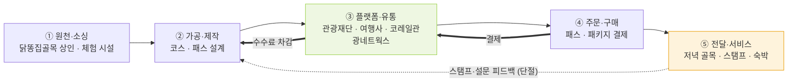

# 치킨의 수도, 하룻밤 머무는 도시로 — 산출물 예시 (ver2)

> **버전:** ver2 (2026-11-10). v1 기준 파일은 `치킨여행_산출물_예시.md`입니다.
> **ver2 변경 내역:** 2장에 "2-6 ver2 추가"를 넣었습니다 — 관광산업 7단계, 공공 예산 시작점, 단계별 데이터, 참고 사례 유형. 1·3·4·5장은 v1과 같습니다.

기준 문서: `치킨의 수도, 하룻밤 머무는 도시로 ver5` (이하 ver5)
수업 기준: Day05(아카이빙) · Day06(인벤토리) · Day07(페르소나·스킬) · Day08(스토리보드) · Day09(산업 리서치) · Day10(밸류체인) · Day11(페인포인트)

## 읽는 법

- **사실**은 ver5에 적힌 출처만 썼다. ver5에서 "확인 필요"로 남긴 항목은 그대로 두었다.
- **[창작]** 은 팀이 정하는 항목이다. 근거 파일이 없다.
- **[가설]** 은 데이터로 확인하지 않은 값이다. 설문이나 리뷰 수집 뒤에 바꾼다.
- 수업 예시(북성로 공구골목, 서문시장 야시장)는 가져오지 않았다. 우리 주제 기준으로 새로 썼다.
- **현재 없는 것:** 리뷰·댓글 VOC, 관광지 수요 자료, 패스 가격. 그래서 고객 쪽 근거는 ver5 수치와 가설로 채웠다.

---

## 1. 페르소나

### 1-1. 브랜드 페르소나 (persona_sheet 9항목)

| 항목 | 내용 |
| --- | --- |
| 브랜드명(가칭) | **해 질 녘 대구** [창작] (후보: 치킨 하룻밤, 골목 저녁) |
| 핵심 자산 | 평화시장 닭똥집골목 (ver5 3장: 1972년 막걸리 안주로 시작, K-치킨벨트 치킨명소. 출처: 한식진흥원 (B)) |
| 정체성 한 줄 | 낮에 본 대구를 저녁 골목까지 이어 주는 안내자 [창작] |
| 성격 형용사 3 | 느긋한 · 담백한 · 호기심 많은 [창작] (서로 다른 결) |
| 말투 | 존댓말, 한 문장 하나의 정보, 감탄사 금지, 이모지 금지 [창작] |
| 가치와 약속 | 골목의 시간을 과장하지 않고 그대로 보여 준다 [창작] |
| 금칙어 (5개 이상) | 핫플 · 인생샷 · 역대급 · 감성 · 힐링 · 유일한 · 세계 최고 [창작] |
| 핵심 메시지 3 | ① 낮에 본 대구가 저녁에 완성됩니다 [창작] ② 닭똥집은 1972년 골목의 안주였습니다 (사실, ver5 3장) ③ 멀리서 왔다면 하룻밤이 있습니다 [창작] |
| 비주얼 키워드 | 오후 빛 · 골목 간판 · 기름 종이 · 저녁 불빛 · 좁은 길 (사실 근거: 시각 자료 수집 필요) |

### 1-2. 고객 페르소나 (코스 4개 중 대표 2명 상세)

ver5 4장의 네 조합 중 **근거리 커플·친구**(①)와 **원거리 가족**(④)을 대표로 쓴다. 나이·직업은 설문에서 기록하므로 비워 둔다.

**P1. 근거리 친구 둘 (코스 ①)**

| 층 | 내용 | 근거 |
| --- | --- | --- |
| 상황 | 대구 근처에서 당일로 온다. 낮에 관광지를 돌고 저녁 전에 귀가할 생각이다 | ver5 4장 · [가설] |
| 행동 | 낮 관광지 2~3곳 → 저녁 식사 → 귀가. 저녁을 따로 정하지 않는다 | [가설] 설문 A안으로 확인 |
| 동기 | 하루를 마무리할 한 끼. 분위기보다 가볍게 먹을 곳 | [가설] |
| 불만·장벽 | 저녁에 갈 곳과 이유가 안 보인다. 역과 골목 사이 이동이 불명확하다 | ver5 4장 · 이동시간 확인 필요 |
| 대표 한 문장 | [수집 필요] 리뷰·설문 주관식에서 가져온다. 지어내지 않는다 | — |

**P2. 원거리 가족 (코스 ④)**

| 층 | 내용 | 근거 |
| --- | --- | --- |
| 상황 | 아이와 함께 1박으로 온다. 오전에 KTX로 도착해 낮에 관광, 저녁은 술 없이 먹는다 | ver5 4장 · 부록2 "가족과 술" |
| 행동 | 낮 관광 → 닭요리 저녁 → 야경 또는 야간 프로그램 → 숙소 → 다음 날 오전 | ver5 4장 |
| 동기 | 여행 중 아이가 질리지 않을 저녁 | [가설] |
| 불만·장벽 | 치맥 중심 일정에서 빠진다. 직접 짜기 어렵다 (원거리 공통) | ver5 6장 · [가설] |
| 대표 한 문장 | [수집 필요] | — |

**나머지 두 조합 요약**

| 코스 | 핵심 차이 | 재사용할 것 |
| --- | --- | --- |
| ② 근거리 가족 | 낮 체험(땅땅치킨랜드 선택) → 이른 닭요리 저녁 → 귀가 | 가족 규칙: 술 없음 |
| ③ 원거리 커플·친구 | 골목 저녁 겸 치맥 → 야경 → 숙소 | P1의 저녁 흐름 + 숙박 |

---

## 2. 밸류체인 맵 (Day10 네 층)

### 2-1. 활동 5단계

| 단계 | 활동 | 하는 사람 (굵게) · 영향 주는 사람 (괄호) |
| --- | --- | --- |
| ① 원천·소싱 | 골목 저녁 가게 확보, 체험 시설 연결, 관광지 목록 | **닭똥집골목 상인** · (상인회, 동구청 [확인 필요]) / **땅땅치킨랜드** (운영 정보 불일치 — ver5 3장) |
| ② 가공·제작 | 코스 설계, 패스(스탬프·시식권) 설계, 패키지 구성 | **팀(제안) · 관광재단** (대구시 · 문체부 정책 기준) |
| ③ 플랫폼·유통 | 패스 현장·온라인 판매, 패키지 판매, 열차 연계 | **관광재단** · **여행사 · 코레일관광네트웍스** (ver5 7장 제안) |
| ④ 주문·구매 | 패스·패키지 결제, 출발 시·도 기록 | **관광객** (근거리 · 원거리, 가족 · 친구) · (결제 수단 [확인 필요]) |
| ⑤ 전달·서비스 | 코스 이용, 스탬프 완료, 저녁 골목 방문, 숙박·재방문 | **상인** · **관광재단 현장 부스** · (숙소 [확인 필요]) |

### 2-2. 돈 흐름 (소비자 → 원천, 금액·비율은 적지 않음)

```
관광객 결제 (패스·패키지) ──▶ 여행사·열차 수수료 차감 ──▶ 관광재단 운영 ──▶ 상인 시식권 정산 (끝점)
```

- 시작점: 관광객 결제
- 중간 차감: 여행사 수수료 · 열차 연계 비용 · 관광재단 운영비 [확인 필요]
- 끝점: 상인에게 남는 몫. 작을수록 상생 기회가 크다
- 정산 구조(시식권 단가, 정산 주기)는 **사용자 몫**이다

### 2-3. 데이터 흐름

| 데이터 | 생기는 지점 | 보유자 | 상인에게 돌아가는가 |
| --- | --- | --- | --- |
| 패스 발급 기록(출발 시·도) | 패스 발급 | 관광재단 | 아니오 → **단절** |
| 스탬프 기록(낮·저녁) | 현장 스탬프 | 관광재단 | 아니오 |
| 시식권 교환 기록 | 골목 가게 | 상인 | 예 (가게 단위) |
| 숙박 전환 | 패키지 예약 | 여행사 | 아니오 |

피드백 화살표: 스탬프·설문 결과 → 코스 설계. **현재 경로 없음 → 단절 마커**.

### 2-4. 마커 (병목 2 · 비용 2 · 기회 3, 단계당 최대 2개)

| 마커 | 단계 | 근거 (출처) | 상태 |
| --- | --- | --- | --- |
| 병목: 저녁 골목까지 이동 시간 | ⑤ | ver5 "평화시장 → 동성로 이동시간 확인 전" | 확인 필요 |
| 병목: 땅땅치킨랜드 운영·휴무 정보 불일치 | ① | ver5 3장 ("사이트마다 다름, 전화 확인") | 확인 필요 |
| 비용: 시식권 단가와 정산 | ② | 사용자 몫 | 미정 |
| 비용: 여행사 수수료 중첩 | ③ | [가설] | 확인 필요 |
| 기회: 저녁 스탬프 패스 | ③·⑤ | ver5 7장 "저녁 스탬프" | 우선 후보 |
| 기회: 시식 해설 투어 | ⑤ | ver5 7장 (운영 주체: 관광재단·상인회 후보) | 제안 |
| 기회: 원거리 패키지 열차 연계 | ③ | ver5 6장 (춘천·구미 방식) | 제안 |

**우선 기회: 저녁 스탬프 패스** — 체류 목표(저녁까지 남는가)에 직접 닿고, 공공 채널로 시작할 수 있다. [가설] 점수는 아래 4장에서 같이 본다.

### 2-5. Mermaid (GitHub에서 그림으로 보임)



---

### 2-6. ver2 추가 (2026-11-10)

출처: 팀 내부 분석 덱 `산업구조_밸류체인_분석.pdf` (2026-11-09). 덱의 분류는 [I] 참고 틀입니다.

**관광산업 7단계와 v1 맵의 대응**

| 7단계 | 설명 | 이 맵에서의 위치 | 상태 |
| --- | --- | --- | --- |
| ① 수요·동기 | 여행 결심 | 없음 | 추가 필요: 대구 치맥·낮 관광 수요 자료 |
| ② 정보·영감 | SNS·블로그 | 플랫폼·유통 | 리뷰 확보, 관광 콘텐츠 채널 미조사 |
| ③ 상품 기획 | 코스·가격 | 가공·제작 | 4개 코스 설계 |
| ④ 유통·예약 | OTA·여행사·앱 | 플랫폼·유통, 주문·구매 | `[U]` 점유율 |
| ⑤ 이동 | 교통 | 없음 | 추가: 평화시장 기준 이동시간 확보 (이동소요시간_정보.md) |
| ⑥ 현지 체류 | 숙박·식음·체험 | 전달·서비스 | 운영시간 불일치 확인 (땅땅치킨랜드) |
| ⑦ 사후 | 리뷰·재방문 | 전달·서비스 | VOC 표 작성 |

**돈의 시작점 2개 (맵 수정)**
- 시작점 ① 관광객 결제: 패스·패키지, 현장 소비
- 시작점 ② 공공 예산: 지자체 관광진흥, 축제 보조, 기획 용역비
- 공공 예산 규모는 `[U]`. 조사 대상: 대구시, 대구관광재단, 축제 조직위, 문체부, 한국관광공사.

**산업 구조 특징이 치킨 기획에 주는 것**
- 공급이 잘게 쪼개짐: 평화시장 골목에 가게가 여럿 (고인돌, 똥집대통령, 똥집본부 등). 하나로 묶는 주체가 없음 → 패키징 자체가 가치.
- 예약·노출은 플랫폼 과점: 네이버·OTA 의존 `[U]`. 지역 가게는 데이터를 받지 못함.
- 수요가 축제에 몰림: 치맥페스티벌 (2025년 약 115만 명, 대구시 뉴스룸 2025.11.5). 평시 수요 `[U]`.
- 저단가 단시간 소비: 치킨 한 끼로는 지역 매출이 작음 → 숙박·야간 소비로 체류 연장이 핵심.

**참고 사례 유형 (덱 [I])**
- 춘천 닭갈비: 음식 자체가 목적지인 유형
- 구미 치킨: 브랜드 발상지 스토리를 자원화한 유형
- 대구 치맥: 축제·이벤트형 → 우리 코스는 이 셋을 묶는 기획 레이어

**단계별 데이터 (v1 데이터 흐름 보완)**
- ② 정보·영감: 조회·저장 데이터는 SNS 플랫폼 보유
- ④ 유통·예약: 예약·결제 데이터는 OTA 보유, 지역에 미공유 → `[U]`
- ⑥ 현지 체류: 카드 소비·체류는 카드사·관광데이터랩 보유 → 효과 측정 연결 필요
- ⑦ 사후: 리뷰는 플랫폼 보유 → 1~3단계로 피드백

## 3. 스토리보드 (숏폼 6컷, 근거리 P1 기준)

크리에이티브 트랙 기본 채널은 숏폼이다. 훅 1컷 · 전환 1컷 · 행동유도 1개 규칙을 따른다. 장소·사실은 ver5 출처만 쓴다.

| 컷 | 단계 | 장면 (누가·어디서·무엇을) | 샷 사이즈 | 카메라 무빙 | 대사 · 자막 | 사운드 | 생성 도구 · 소스 |
| --- | --- | --- | --- | --- | --- | --- | --- |
| 1 | 훅 | 골목 입구, 저녁 전 시간. 간판을 보는 두 사람 | 롱샷 | 고정 | 자막: "이 닭똥집은 1972년 막걸리 안주에서 시작됐습니다" (출처: 한식진흥원) | 시장 소음 → 정적 | ChatGPT 이미지 (기준 캐릭터 첨부) |
| 2 | 전개 | 낮 관광지 걷기 (근대골목 등, 확정 전) | 미디엄 | 트래킹 (전진) | 자막: "낮에는 대구를 걷습니다" | 발소리 · BGM | Kling 무빙 테스트 |
| 3 | 전개 | 저녁 전 시간 귀가 고민 (지도 앱 화면) | 클로즈업 | 고정 | 자막: "그런데 저녁을 어디서 먹을지 정하지 못했습니다" | 휴대폰 알림음 | 화면 캡처 |
| 4 | 전개 | 골목 닭똥집 접시 클로즈업 | 클로즈업 | 달리 인 (천천히) | 자막: "골목은 지금도 그 자리에 있습니다" | 기름 소리 | archive 레퍼런스 (공공누리 확인 전까지 대체) |
| 5 | 전환 | 낮 장면과 저녁 골목을 같은 구도로 전후 대비 (시간대·색 변화) | 버즈아이 | 고정 | 자막: "낮에 본 대구가, 저녁에 완성됩니다" (핵심 메시지 1) | 주방 소리 → 정적 | 전후 편집 |
| 6 | 행동유도 | 스탬프 패스 화면 | 미디엄 | 고정 | 자막: "저녁 스탬프 패스 받기 — 관광재단 현장" (행동 1개) | BGM 페이드 | 디자인 화면 |

**변형**
- 원거리(③·④): 6컷 뒤에 야경 1컷과 숙소 문구 1컷을 붙인다. 행동유도는 "패키지 보기" 하나만 남긴다.
- 가족(②·④): 4컷의 술 장면을 빼고 닭요리 장면으로 바꾼다. 자막의 "맥주" 표현도 뺀다.

**일관성 점검 (review 항목)**
- 톤·금칙어: 컷 1~6 자막에 금칙어 없음 (확인 필요)
- 전환 컷 = 핵심 메시지 1: 컷 5 ✔
- 사실 묘사 출처: 컷 1은 한식진흥원, 컷 2는 장소 확정 전 → 장소 확정 뒤 출처 붙일 것
- 행동유도 1개: 컷 6 ✔

---

## 4. 페인포인트 (가설 Top 3)

**주의:** VOC 수집 전이다. 점수는 모두 [가설]이다. 리뷰·댓글을 모은 뒤 `빈도 × 강도 × 해결 가능성`으로 다시 계산한다.

| ID | 진술문 | 단계 | 근거 | 빈도 | 강도 | 해결 가능성 | 점수 |
| --- | --- | --- | --- | --- | --- | --- | --- |
| F1 | 낮 관광을 마친 근거리 관광객이, 저녁에 갈 곳과 이유를 찾지 못해 저녁 전에 귀가한다 | ⑤ 저녁 | ver5 2장 (체류 −17.2%), 4장 (상시 동선 없음) | 3 | 3 | 5 | **45** |
| F2 | 근거리 관광객이 땅땅치킨랜드 운영·휴무를 사이트마다 다르게 보고 방문 계획이 어긋난다 | ① 소싱 | ver5 3장 | 2 | 2 | 5 | **20** |
| F3 | 가족 관광객이 치맥 중심 저녁에서 빠져 저녁 선택지가 없다 | ⑤ 저녁 | ver5 부록2 "가족과 술" | 2 | 3 | 4 | **24** |
| F4 | 원거리 관광객이 여러 장소를 직접 엮지 못해 1박 대신 당일 일정을 택한다 | ③ 유통 | ver5 4장·5장 | 2 | 2 | 3 | **12** |
| F5 | 하루 치킨 식사가 반복되어 질린다 | ⑤ 저녁 | ver5 부록2 "질림" | 2 | 2 | 4 | **16** |

**Top 3 (가설):** F1 (45) · F3 (24) · F2 (20)

- F1은 체류 목표와 직접 닿는다. 저녁 스탬프 패스로 풀 수 있다.
- F3은 "술 없는 저녁"을 코스 ②·④ 설계로 풀 수 있다.
- F2는 점수는 낮지만 운영 정보만 확인하면 바로 고칠 수 있는 항목이다. 점수 순위와 다르게 Top 3에 넣었다. 결정 이유는 "확인 한 번으로 해결되는 가장 싼 문제"다.
- **보류:** F4 (원거리 연결 — 패키지 설계 후 재검토), F5 (질림 — 설문의 "하루 닭요리 횟수" 문항으로 측정)

---

## 5. 다음으로 채울 것 (수집 필요)

| 항목 | 채우는 방법 | 담당 (제안) |
| --- | --- | --- |
| 땅땅치킨랜드 운영·휴무 | 전화 확인, 확인일 기록 | 팀원 B |
| 평화시장 → 동성로 · 동대구역 이동시간 | 지도 앱 실측 | 팀원 B |
| 닭똥집골목 리뷰 VOC 20건 | 지도 앱 리뷰, 출처·날짜 기록, 개인정보 제외 | 팀원 A |
| 관광지 수요 자료 | 한국관광데이터랩 · 대구관광데이터랩 | 팀원 B |
| 고객 한 문장 (P1·P2) | 설문 주관식 응답에서 인용 | 민지 |
| 페인포인트 점수 재계산 | VOC 수집 후 4장 표 갱신 | 민지 |
