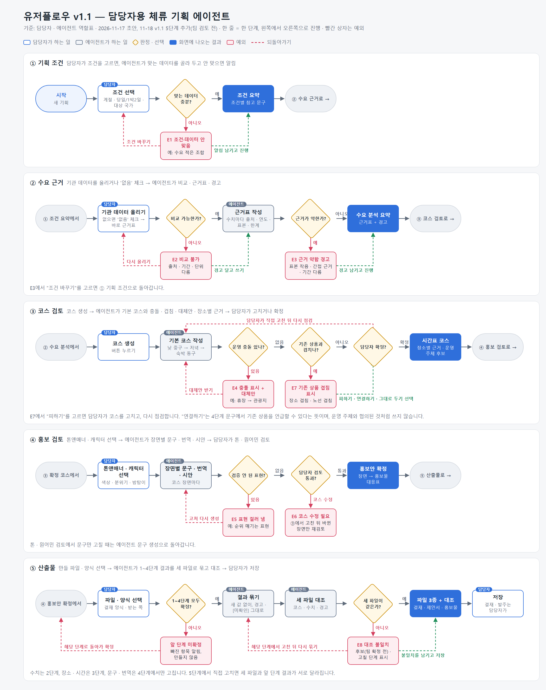

# 유저플로우 v1.2 — 담당자용 체류 기획 에이전트

## 2026-11-24 앱 자율 이용 초안 경로

사용자 요청으로 앱의 `기획모드=자율이용`에는 `지침/공통/자율이용_기획.md`를 적용한다. 당일·1박2일 선택은 유지한다. 아래의 기존 판매 확정·홍보·산출물 경로와 구분하며 팀 공통 운영 정책의 최종 합의를 뜻하지 않는다.

1. 총괄 실행기가 처음부터 관리한다. 자료 선택·표·경고는 코드, 요약과 A/B 구성은 AI, 전달·형식·시간표 검사는 코드가 맡는다. 정해진 전이는 AI에게 묻지 않는다.
2. A는 내 요청 우선, B는 이동·운영 부담을 줄이도록 희망·구성을 조정한 안이다. 필수 지역·언어권·계절·기간은 자동 변경하지 않는다. 실질적으로 다른 B가 없으면 그 이유를 표시한다.
3. 일정 시각은 권장·가정이며 관광·식사에 자유 구간을 제안한다. 실제 예약·이용권에 정해진 시간은 지킨다. 미정인 사용처·유효시간·혜택·예약을 생성하지 않는다.
4. 집결·해산·객실·체크인·오전 구성·E7 처리 미입력은 이 초안의 선행 조건이 아니다. 기존 입력과 확인 기록은 보존하고 자동 확정하지 않는다. 실제 이동·휴무·예약 충돌은 검사한다.
5. 기획자 화면은 비교·권장 일정·자율 구간·짧은 보완 설명을 제공한다. `/admin/`은 서비스 제공자의 읽기 전용 운영 로그다. 기획자를 관리자 수정 폼으로 보내지 않는다.

2026-11-25 사용자 요청으로 앱의 코스 비교와 지도 탐색 보기를 분리했다. 비교 화면의 '지도 크게 보기'에서 화면 전체의 지도 탐색으로 이동하며 왼쪽 일정·지도 선택·오른쪽 장소 설명을 연동한다. 대표 위치 안내는 지도 공통 안내로 한 번 표시한다. 장소 설명은 보유 자료 기준이며 미생성 B안·미정 장소를 생성 완료로 바꾸지 않는다.

지도 분위기는 선택한 일정 시각과 재생 중 일정 시각의 보간을 기준으로 낮·오후·저녁으로 바뀐다. 현재 시각·실제 일몰·실제 이동시각 검증은 아니다. 시각 미정은 낮 기준이라고 표시한다. 도보 경로는 작은 꺾임을 줄인 코스 이해용 동선으로 표시한다. 선과 캐릭터는 같은 정리 좌표를 사용하고 이동시간은 원본 기준을 유지한다. 크림 테두리의 청록색 선으로 표시하고 지나온 경로와 예정 경로(연한 청록색)를 구분한다. 대중교통은 보유 자료의 시간·노선을 별도로 표시하며 캐릭터가 걷지 않는다. 실제 대중교통 경로 자료가 없으면 선을 만들지 않고 '도착지로 넘어가기'로 이어 본다. 방향 꺾쇠·발자국은 표시하지 않는다. 작은 방문 번호·식사 아이콘은 표시용이며 장소·식당의 확정 상태를 바꾸지 않는다.

기존 HTML·PNG 흐름 그림은 v1.2 확정 경로이며 이 자율 이용 초안 경로는 아직 그림에 반영하지 않았다. 현재 앱 경로는 위 설명과 공통 지침을 기준으로 한다. 실제 AI 품질·전체 소요시간은 별도 시험 전이며 2분 완료를 보장하지 않는다.

- 상태: 초안 (v1.2). 팀 검토 전.
  - 2026-11-18 v1.1: 이번 범위를 1~5단계로 넓히고 ⑤ 산출물 레인, E7 · E8(후보) 예외를 추가함.
  - 2026-11-19: 5장 S2 → S3 넘김 갱신과 5-1 추가 (근거 ID · 경고 ID · 담당자 선택이 S3 진입).
  - 2026-11-22 v1.2: `inventory/참고/1120_유저플로우_보완안_사람1.md`(이하 보완안) 반영. 1단계 조건에 지역 · 대상 언어권 · "추천받기" 추가(지역 기본값 없음), 3단계의 "낮 중구 · 숙박 동구" 고정 제거, 3단계 코스 생성 · 확정 규칙(시작 · 종료, E7 선택) 추가, 출입국 경로 가정값 규칙 교체, 4장 "변경 후 다시 확인" 규칙과 진행 · 대기 표([제안 · 팀 확정 전]) 추가, 4-1 단계별 화면 정의 추가, 7장 미정 정리. 같은 날 HTML · PNG도 v1.2 기준으로 갱신(조건 누락 · 시작 · 종료 확인 분기, 번역 검토, 다시 확인 필요 표). 같은 날 1-2(시간표 가정값 · 2일차 오전 · 식사 구성 · 음식 중복 검사), 노선 겹침 "판정 불가" 처리, 4단계 식당 후보 안내 · 수요 근거 없는 공식 운영정보 사용, 5단계 자유식 · 식비 대조 추가(팀 검토 전).
- 작성 기준일: 2026-11-17 (v1.2 갱신 2026-11-22)
- 기준 문서: **담당자 · 에이전트 역할표** (1~5단계). 이 문서와 역할표가 다르면 역할표를 따른다.
- 그림: `유저플로우_v1.png` — v1.2 화면 캡처 (2026-11-22). 원본 `유저플로우_v1.html`, ①~⑤ 단계별 가로 흐름 다섯 줄. 그림과 본문이 다르면 본문을 따른다. 파일 이름은 v1을 유지한다.
- 이전 버전: `발표/1113_유저플로우.md` (v0, 2026-11-13). 달라진 점은 6장에 정리했다.
- 범위: 1~5단계 (2026-11-18 사람1 결정, 팀 확인 전). 5단계(산출물)의 상세 규칙은 `지침/5_산출물/`에 있다.
- 고객 여정과 세부 방향은 아직 확정되지 않았다. 확정되면 이 문서를 고친다.

## 1. 한눈에 보기

| 단계 | 담당자가 하는 일 | 에이전트가 하는 일 | 화면에 나오는 결과 |
|---|---|---|---|
| 1. 기획 조건 | 시기(계절) · 대상 언어권 · 지역 · 체류 기간(당일 / 1박2일 / 추천받기)을 고른다 | 고른 조건에 맞는 데이터만 골라 둔다. 조건이 데이터와 안 맞으면 알린다. 필수 조건이 빠지면 알리며, 지역을 중구로 자동 지정하지 않는다 | 조건 요약 + 조건별 참고 문구 |
| 2. 수요 근거 | 기관이 가진 데이터가 있으면 올린다. 없으면 "없음"에 체크하고 우리 데이터만 쓴다 | 올린 데이터의 출처 · 기간 · 대상 · 단위를 확인해 우리 데이터와 비교할 수 있는지 본다. 조건에 맞는 수치로 근거표를 만들고, 근거가 약하면 경고를 단다 | 수요 분석 요약 + 근거표 + 경고 |
| 3. 코스 검토 | 코스 생성 버튼을 누르고, 시작 · 종료 장소와 시각을 정하거나 제안을 확인하고, 나온 코스를 고치거나 확정한다 | 선택한 지역 · 계절 · 언어권 · 확정 체류 기간과 수요 근거를 바탕으로 코스 초안을 만든다. 관광 · 저녁 · 숙박 장소의 지역을 미리 고정하지 않는다. 당일형에는 숙박을 넣지 않는다. 휴무 · 영업시간 · 이동 시간을 대조해 충돌을 표시하고 대체안을 낸다. 기존 상품과 장소 · 노선이 겹치면 표시하며(E7), 장소마다 넣은 이유와 운영 주체 후보를 붙인다 | 시간표 형태의 코스(시작 · 종료 포함, 가정값 표시) + 식사시간 · 권역별 식당 후보 + 충돌 표시 + 대체안 + 장소별 근거 (1-2) |
| 4. 홍보 검토 | 문구 톤을 확인하고, 번역 검토를 맡겨 결과를 넣고(업체 · 재단 · 본인), 색상 · 분위기(톤앤매너)를 고른다 | 확정된 코스의 장면별 문구 초안과 언어별 번역 초안을 만든다. 고른 톤앤매너로 홍보물 시안을 만들고 캐릭터(너구리 · 족제비 2인 고정, 고르는 항목 아님)를 시안에 자동 배치한다. 검증되지 않은 스토리 표현을 걸러 낸다. 식당 후보를 필수 방문처럼 쓰지 않고 자유 선택임을 안내한다. 수요 근거가 없는 장소도 공식 운영정보는 이용 안내로 쓰되 출처 · 확인일과 "수요 근거 없음" 경고를 유지한다. 코스가 바뀌면 바뀐 장면의 홍보물을 표시한다 | 장면 → 홍보물 대응표 + 문구 · 번역 초안 + 시안 |
| 5. 산출물 | 만들 파일 · 결재 양식(기관 양식 올리기 / 기본 양식) · 제안서 받는 쪽을 고르고, 결과를 저장한다 | 1~4단계 결과를 받는 사람에 맞게 결재 파일 · 제안서 · 홍보물 묶음으로 **묶기만** 한다. 새 수치 · 장소 · 문구를 만들지 않고, E1~E7 경고와 [미확인] 표시를 세 파일에 그대로 붙인다. 세 파일의 코스 · 수치 · 경고가 같은지, 일정표 · 홍보물 · 전달 문서의 일정 · 자유식 안내 · 식비 포함 여부 · 경고가 같은지 대조한다 | 파일 3종 + 대조 결과. 형태 후보 `[팀 확정 전]`: 결재 파일 = 기관 양식(HWP 등)에 옮겨 쓰는 초안(MVP는 복사해 붙이기 쉬운 문서 · 표) · 제안서 = PDF(가격 · 수수료 칸 없음) · 홍보물 묶음 = 언어별 문구표 + 시안 이미지 |

### 1-1. 3단계 코스 생성 · 확정 규칙 (2026-11-20 사람2 합의, 보완안 0장)

- 코스 시작 · 종료 장소와 시각은 담당자가 지정하거나, 에이전트가 제안한 후보를 확인한다. 미정이어도 초안은 생성한다.
- 공항 · 역을 기본값으로 두지 않는다. 현재 기획에 없는 픽업 · 교통편 제공을 추가하지 않는다. 향후 교통 연계 가능성은 열어 둔다.
- 코스 확정 전 시작 · 종료 정보를 확인한다.
- 노선 겹침(E7)이 발생했다면 "피하기 / 연결하기 / 그대로 두기" 중 하나를 선택해야 한다.
- 장소 겹침만 있는 경우는 보완안의 합의대로 미선택 시 "그대로 두기"로 기록한다.
- 기존 상품과 노선 겹침 판정 결과별 처리: **없음** → 해당 확정 조건 충족 / **있음** → 담당자 선택(위) / **판정 불가**(기존 상품 자료 부족 등) → 코스를 초안 상태로 유지한다.

### 1-2. 3단계 시간표 · 식사 구성 규칙 (2026-11-22 추가)

| 부분 | 규칙 |
|---|---|
| 시간표 생성 | 체류시간 · 저녁 시작 시각 등은 **가정값**으로 표시하고 담당자가 확인 · 수정한다 |
| 2일차 오전 | 장소가 미정이면 임의로 채우지 않는다. 담당자가 **일정 추가 / 자유시간 / 종료 장소로 이동** 중에서 정한다 |
| 식사 구성 | 1 · 2일차 모두 식사시간과 권역을 확보한다. 2단계 선호 음식 자료 + 동선 + 운영정보를 바탕으로 **여러 식당 후보**를 제공한다 |
| 관광객의 식사 선택 | 관광객은 추천 후보를 이용하거나 다른 음식 · 식당을 고를 수 있다. 찜갈비는 테스트 선택값이며 고정 메뉴가 아니다 |
| 음식 중복 검사 | **고정 메뉴만** 같은 날 중복을 확인한다. 자유식은 실제 식사 중복을 검사하지 않고 추천 후보의 다양성을 확인한다. 식사 이력 수집은 넣지 않는다 |
| 코스 확정 | 담당자가 시작 · 종료, 일정 구성, 식사 · 자유시간, 남은 경고를 확인하고 4단계로 넘긴다. 자유식은 식당 한 곳을 지정하지 않아도 확정할 수 있다 |

식사 흐름:

1. 2단계: 선호 음식 근거를 넘긴다.
2. 3단계: 식사시간 · 권역과 다양한 식당 후보를 구성하고 담당자가 확인한다.
3. 4단계: "추천 후보 참고, 다른 식당도 선택 가능"으로 안내한다.
4. 5단계: 일정표와 안내문에 같게 반영한다.

- 관광객 A팀이 찜갈비, B팀이 치킨을 먹어도 된다. 시스템은 실제로 먹은 음식을 추적하거나 중복 없는 식사를 보장하지 않는다.
- 테스트용 식당 · 시간은 모든 상품의 고정값으로 쓰지 않는다.

## 2. 기호

| 기호 | 뜻 |
|---|---|
| 둥근 상자 | 시작 · 끝 |
| 흰 상자 (담당자 표시) | 담당자가 하는 일 |
| 회색 상자 (에이전트 표시) | 에이전트가 하는 일 |
| 파란 상자 | 화면에 나오는 결과 |
| 빨간 상자 | 예외 (E 번호) |
| 마름모 | 분기 (담당자의 선택 또는 에이전트의 판정) |
| 실선 화살표 | 정상 진행 |
| 점선 화살표 | 예외에서 되돌아가거나(빨강) 그대로 진행(초록) |

## 3. 순서도 (단계별 가로 흐름)

한 줄이 한 단계이고, 왼쪽에서 오른쪽으로 진행한다. 빨간 상자는 예외, 점선은 되돌아가기다. 원본은 `유저플로우_v1.html`(브라우저로 열기)이고, 아래 그림은 그 화면을 캡처한 것이다. 그림을 고칠 때는 HTML을 고친 뒤 다시 캡처한다.

> 그림은 v1.2 본문 기준으로 갱신했다 (2026-11-22). `[팀 확정 전]` 표시는 그림에도 그대로 남겼다. 그림과 본문이 다르면 본문을 따른다.

## 4. 예외 경로

| 번호 | 발생 지점 | 상황 | 담당자 선택지 |
|---|---|---|---|
| E1 | S1 기획 조건 | 고른 조건에 맞는 데이터가 적거나 없음 (역할표 예시: 겨울 당일형은 무박 비율이 낮아 수요가 적음) | 조건 바꾸기 → S1 / 알림을 남기고 진행 |
| E2 | S2 수요 근거 | 올린 기관 데이터가 우리 데이터와 출처 · 기간 · 대상 · 단위가 달라 바로 비교할 수 없음 | 다시 올리기 / 경고를 달고 함께 쓰기 / 기관 데이터 빼기 |
| E3 | S2 수요 근거 | 근거가 약함 — "표본 작음", "간접 근거", "기관 데이터와 기간 다름" 경고 | 조건 바꾸기 → S1 / 경고를 남기고 진행 |
| E4 | S3 코스 검토 | 휴무 · 영업시간 · 이동 시간 충돌 (역할표 예시: 월요일 체험 시설 휴장 → 관광지로 대체) | 대체안 받기 / 직접 고치기 |
| E5 | S4 홍보 검토 | 검증되지 않은 스토리 표현이 걸림 (역할표 예시: 순위를 매기는 표현) | 고침(→ 표현 필터 다시 거침) / 그대로 둠(기록 남김) / 미처리 |
| E6 | S4 홍보 검토 | 홍보를 보다가 코스를 바꿔야 함 | S3에서 수정 → 바뀐 장면의 홍보물만 표시 → S4 재검토 |
| E7 | S3 코스 검토 | 코스의 장소 · 노선이 기존 상품(스탬프 투어 · 골목 투어 등)과 겹침 (사람2 브랜치 `지침/3_코스검토/8_기존_상품_겹침.md`) | 피하기(코스 고치기) / 연결하기 / 그대로 두기. 노선 겹침은 선택해야 확정, 장소 겹침은 미선택 시 "그대로 두기"로 기록 (1-1) |
| E8 (후보, `[팀 확정 전]`) | S5 산출물 | 대조 불일치 — 세 파일의 코스 · 수치 · 경고 · 미확인 표시가 서로 다름 (예: 한 파일에만 경고가 빠짐) | 해당 단계(2 · 3 · 4)에서 고친 뒤 다시 묶기 / 불일치를 남기고 저장 |
| (번호 없음) | S5 산출물 | 1~4단계 중 확정되지 않은 단계가 있음 | 만들지 않음. 해당 단계로 돌아가 확정 |

- 에이전트는 **표시와 제안만** 하고, 진행할지는 담당자가 정한다. 경고 · 충돌 자체만으로 차단하지 않지만, 이미 합의한 담당자 선택과 확정 조건(1-1 · 5-1)은 충족해야 한다. 역할표에 차단 기능이 없으므로 차단 여부는 7장 미정 항목으로 둔다 (구체안은 아래 진행 · 대기 표, [제안 · 팀 확정 전]).
- 경고 · 알림은 다음 단계로 따라간다. 예: S2의 "표본 작음" 경고는 S3 코스의 해당 장소 근거, S4 홍보 문구 검토 화면, S5 세 파일에 모두 남는다.

### 변경 후 다시 확인 (보완안 3-1)

| 바뀐 내용 | 다시 확인할 결과 |
|---|---|
| 1단계 조건 | 2 · 3 · 4 · 5단계 |
| 2단계 근거 · 확정 체류 기간 | 3 · 4 · 5단계 |
| 3단계 코스 · 시작 · 종료 | 관련 홍보 장면 · 안내와 5단계 |
| 4단계 문구 · 번역 | 5단계 |

- 변경된 장면의 번역은 기존 검토 완료 상태를 유지하지 않고 AI 초안으로 되돌린다.
- 이 절은 업무 규칙이며, 앱에 구현됐다는 뜻은 아니다.

### 진행 · 대기 구분 [제안 · 팀 확정 전] (보완안 3-3)

| 상황 | 예 | 처리 |
|---|---|---|
| (a) 필요한 입력이 빠짐 | 1단계 조건 누락, 제안서 받는 쪽 미선택 | 입력을 요청한다. 단 3단계 시작 · 종료는 초안 전 미정이어도 됨 |
| (b) 자료가 없거나 약함 | 자료 없음, 표본 작음, 비교 불가, 대구 도착 · 출발 지점 자료 미확보 | 멈추지 않는다. [자료 필요] · 경고를 달고 진행, 세 파일까지 따라간다 |
| (c) 앞 단계 미확정 | 2단계 "미선택", 시작 · 종료 미확정 상태로 코스 확정, 5단계에서 1~4 미확정, 확인 안 한 변경 장면 | 다음 단계를 시작하지 않고 돌려보낸다 |
| (d) 결과가 서로 다름 | 5단계 대조 불일치 | 저장은 허용, "남은 경고"에 적는다 |

- 도착 · 출발 지점 자료 미확보는 (b), 시작 · 종료 미확정은 (c)다. 둘은 다르다.

### 4-1. 단계별 화면 정의 (보완안 2장)

| 단계 | 보는 것 | 하는 것 | 선택 | 선택 후 |
|---|---|---|---|---|
| 1. 기획 조건 | 조건 요약 · 볼 수 있는 자료 · 알림(E1) · "기관 데이터로 채우면 좋은 곳" | 시기 · 대상 언어권 · 지역 · 체류 기간(당일 · 1박2일 · 추천받기)을 고른다 | 알림이 있으면: 조건 바꾸기 / 알림을 남기고 진행 | 조건 바꾸기 → 1단계를 다시 만든다. 진행 → 조건 · 자료 목록 · 알림 · 담당자 선택이 2단계로. 조건이 빠지면(지역 포함) 무엇이 빠졌는지 알리고 다른 일을 하지 않는다 |
| 2. 수요 근거 | 수요 분석 요약 · 체류 기간 추천 · 근거표(항목당 3행, "더 보기") · 경고(W) · E2 알림 | 기관 데이터를 올리거나 "없음" 체크. 근거 확인. 추천받기였으면 체류 기간을 고른다 | E2: 다시 올리기 / 경고 달고 쓰기 / 기관 데이터 빼기 · E3: 조건 바꾸기 / 경고 남기고 진행 | 조건 바꾸기 → 1단계로. 진행 → 근거 ID · 경고 ID · 담당자 선택 · 확정 체류 기간이 3단계로. 미선택이면 3단계는 시작하지 않고 되묻는다 |
| 3. 코스 검토 | 코스 시간표(맨 앞 · 끝에 시작 · 종료 장소와 시각, 미정값은 "에이전트 제안 후보") · 충돌과 대체안(E4) · 겹침(E7) · 장소별 근거 · 체크리스트 | 코스 생성 → 대체안 받기 / 직접 고치기 / 확정. 시작 · 종료를 정하거나 후보를 확인한다. 가정값(체류시간 · 저녁 시작 시각)을 확인 · 수정하고, 2일차 오전 미정이면 일정 추가 / 자유시간 / 종료 장소로 이동 중 고른다. 식사시간 · 권역 · 식당 후보를 확인한다 (1-2) | E4: 대체안 받기 / 직접 고치기 · E7: 피하기 / 연결하기 / 그대로 두기 · 코스 확정 | 확정(1-1 조건 충족, 시작 · 종료 · 일정 구성 · 식사 · 자유시간 · 남은 경고 확인 시. 자유식은 식당 지정 없이 가능) → 확정 코스(시작 · 종료 · 식사 구성 포함) · 장소별 근거 · 운영 주체 후보 · 장소 스토리 · 대체 이력 · 겹침 이력 · 남은 경고가 4단계로 |
| 4. 홍보 검토 | 코스 카드 · 장면 → 홍보물 대응표 · 장면별 문구(출처 ID · 경고) · 표현 필터(E5) · 번역 초안과 상태 · 코스 변경(E6) · 시안 | 톤앤매너와 홍보물 종류를 고른다(선택지 팀 확정 전). 문구 확인 · 수정, 번역 검토 결과 입력, 확정. 캐릭터는 고정 · 자동 배치 | E5: 고침 / 그대로 둠 / 미처리 · E6 코스 수정 요청 | 문구를 고치면 표현 필터를 다시 거친다. E6 → 바뀐 장면만 "재검토 필요", 번역은 AI 초안으로. 시작 · 종료 안내는 3단계 확정값만 쓰고 픽업 · 교통편 문구는 거른다. 식당은 "추천 후보 참고, 다른 식당도 선택 가능"으로 안내한다. 확정 → 5단계로 |
| 5. 산출물 | 파일 3종 · 대조 결과(코스 · 수치 · 경고 · 미확인 · 코스 변경 · 시작 · 종료 · 자유식 안내 · 식비 포함 여부) · 남은 경고 · 변경 기록 | 만들 파일 · 결재 양식 · 제안서 받는 쪽(3단계 운영 주체 후보 중)을 고르고 저장 | 대조 불일치(E8 후보): 해당 단계로 돌아가 고치기 / 불일치를 남기고 저장 | 돌아가기 → 고치고 다시 묶기. 남기고 저장 → 세 파일 "남은 경고"에 적음. 1~4단계 중 미확정이 있으면 만들지 않음. 저장 · 다운로드까지만, 결재 · 발주 · 판매는 사람이 한다 |

## 5. 단계 사이에 넘기는 것

에이전트 md를 쓸 때 각 단계의 입력 · 출력으로 쓴다. 항목 이름은 팀 검토 후 확정한다.

| 넘김 | 넘기는 내용 | 받는 쪽에서 쓰는 곳 |
|---|---|---|
| S1 → S2 | 조건(계절 · 대상 언어권 · 지역 · 체류 기간(당일 / 1박2일 / 추천받기)), 조건에 맞춰 골라 둔 데이터 목록, E1 알림 여부 | S2가 근거표에 쓸 데이터 범위 |
| S2 → S3 | 조건 + 확정 체류 기간, 담당자 선택(E3), 수요 분석 요약(방문객 · 좋았던 점 · 음식(선호 음식 근거) · 숙박), 근거표 전체(행마다 근거 ID), 경고 목록(경고 ID + 적용 근거 ID), 대구 도착 · 출발 지점 참고자료 — 없으면 "미확보", 확인 전 표시. 자세한 블록은 `지침/2_수요근거/출력.md` 2장 | S3 코스 초안의 장소 선택, 장소별 근거 · 이어받은 경고 (아래 5-1) |
| S3 → S4 | 확정 코스(시간표 · 장소 · 순서, 시작 · 종료 장소와 시각 포함, 가정값 표시), 식사 구성(식사시간 · 권역 · 식당 후보, 고정 메뉴 / 자유식 구분), 장소별 근거 · 운영 주체 후보, 대체 이력, 겹침 이력(E7), 남은 경고 | S4 장면 구성, 장면별 문구의 사실 근거, 시작 · 종료 안내 |
| S1 → S5 | 조건 요약, E1 알림과 담당자 선택 | 결재 파일 "기획 개요", 제안서 "대상 관광객", 세 파일 "남은 경고" |
| S2 → S5 | 수요 분석 요약, 근거표(출처 · 연도 · 표본 · 한계), E2 · E3 경고와 담당자 선택 | 결재 파일 "근거 요약", 제안서 "왜 이 코스인가" |
| S3 → S5 | 확정 코스(E6 반영 후, S4와 같은 확정 시작 · 종료 장소와 시각 포함), 장소별 근거 · 장소 스토리 · 운영 주체 후보, 대체 이력(E4), 겹침 이력(E7)과 담당자 선택 | 결재 파일 · 제안서 "코스" · "운영 주체 후보" / "함께할 곳", 세 파일 대조 항목 |
| S4 → S5 | 코스 카드(홍보물 묶음 맨 앞 칸), 확정 문구 · 번역(상태: AI 초안 / 검토 중 / 검토 완료(검토자 · 날짜)), 장면 → 홍보물 대응표, 고른 톤앤매너 · 시안, 표현 필터 기록(E5), 코스 변경 기록(E6) | 홍보물 묶음 전체, 결재 파일 "홍보 계획", 제안서 "홍보 시안" |
| S3 ↔ S4 (E6) | 바뀐 장소 · 시간, 영향받는 장면 번호 | S4에서 바뀐 장면만 다시 검토 |

### 5-1. S2 → S3 넘김에서 정한 것 (2026-11-19 사람1 제안, 2026-11-20 사람2 합의 — JSON 필드 이름은 미정)

MVP 1회 실행(조건 세트 A, `inventory/참고/1119_MVP실행_조건세트A_사람1.md`)에서 S2 출력이 근거표 29행 · 경고 8건이었고, 담당자 선택이 비어 있었으며, 3단계가 경고를 어느 근거에 붙일지 알 방법이 없었다. 그래서 넘김을 다음처럼 바꾼다.

| 문제 | 정한 것 | 이유 |
|---|---|---|
| S3가 장소 근거를 인용할 때 어느 행인지 모름 | 근거표 행마다 **근거 ID**(R01 …), 경고마다 **경고 ID**(W1 …)와 **적용 근거 ID** | S3 장소별 근거 "이어받은 경고"를 장소가 쓴 근거 행에서 자동으로 모으고, 경고가 중간에 합쳐지거나 빠지는 것을 막는다 |
| 근거표가 길어 화면에서 읽기 어려움 | **화면은 항목당 3행(언어권 · 계절 · 전체)만 보이고 접기. 넘김은 전체 행** | 담당자는 요약을 읽고, S3 · S5는 접힌 행까지 쓴다 |
| 담당자 선택(E3)이 비어 있어도 S3가 시작될 수 있음 | S2 끝에서 담당자가 **조건 바꾸기 / 경고를 남기고 진행**을 고르면 그것이 S3 "코스 생성" 진입이다. 미선택이면 S3가 시작하지 않고 되묻는다. "조건 바꾸기"는 S1로 돌아가고 S3로 넘기지 않는다 | "경고만 하고 막지 않는다"는 원칙은 유지한다. 경고에 답하는 일이 진입 버튼일 뿐 경고가 진행을 막는 것은 아니다 |
| 어느 칸에 어느 근거를 쓸지 | **짝짓기는 S3가 한다.** S2는 항목(방문객 · 좋았던 점 · 음식 · 숙박)만 붙이고 코스 칸 · 장소를 고르지 않는다 | S2는 코스를 짜지 않는 단계다. S3 `3_코스_짜기.md` 1장에 이미 항목 → 칸 대응이 있다 |
| 같은 장소가 자료마다 다른 이름 | S2는 자료 속 이름 그대로 넘기고, **이름 맞추기는 S3**가 장소 운영 정보의 공식 명칭과 대조하며 한다 | S2가 묶으면 틀린 묶음이 근거처럼 보인다 |
| 치킨 근거 | 추천 음식의 치킨 · 닭 값을 **별도 한 줄**로 넘긴다 (수치만) | S3가 치킨을 저녁 선택지로 보여 줄 때 근거가 필요하다. 넣을지는 S3 · 담당자 몫 |
| 대구 도착 · 출발 지점 자료 | 대구 도착 · 출발 지점 자료는 참고자료로만 전달한다. 코스 시작 · 종료 장소를 이 통계로 결정하거나, 미확보라는 이유로 공항 · 역을 가정하지 않는다. 코스 시작 · 종료는 3단계에서 담당자가 지정하거나 제안을 확인해 확정한다 | 시작 · 종료는 담당자 확정 사항이다 (1-1, 2026-11-20 사람2 합의) |

- R · W 전달 방식과 "미선택이면 시작 안 함"은 2026-11-20 사람2 답변으로 반영이 확인됐다 (사람2 `3_코스검토/2_입력.md` 1장 · `5_장소_근거.md`). 3 · 4 → 5단계 JSON 필드 이름은 아직 미정이다 (`지침/공통/단계_넘김.md` 6장에 항목만 있음).

## 6. v0(11/13)과 달라진 점

| 항목 | v0 (`발표/1113_유저플로우.md`) | v1.2 (이 문서, 역할표 기준) |
|---|---|---|
| S1 조건 | 월 · 계절 · 국가 · 기간 · 예산 | 계절 · 대상 언어권 · 지역 · 체류 기간(당일 / 1박2일 / 추천받기). 지역 기본값 없음. 조건이 빠지거나 데이터와 안 맞으면 에이전트가 알림 |
| S2 근거 | 지역 · 소비 · 활동 구분, 담당자가 출처 · 시점 확인 | 기관 데이터 올리기 또는 "없음" 체크. 에이전트가 비교 가능성을 확인하고 근거표 · 경고를 만듦 |
| S3 코스 | 중구 → 동구 기본안, 스탬프 설정. 충돌은 담당자가 확인 | 선택한 조건과 수요 근거에 맞춰 코스를 생성한다. 지역별 역할을 고정하지 않고, 충돌 · 대체안 · 장소별 근거 · 운영 주체 후보를 표시한다. 시작 · 종료 확인 후 확정. 스탬프 설정 없음 |
| S4 홍보 | 방향 · 문구 · 번역 | 톤앤매너 선택(캐릭터는 고정), 번역 검토 결과 입력, 검증 안 된 표현 걸러 내기, 코스 변경 시 바뀐 장면 표시 |
| S5 | 기획안 PDF 저장 (파일 하나) | 받는 사람에 맞춘 파일 3종(결재 파일 · 제안서 · 홍보물 묶음, 형태 `[팀 확정 전]`). 1~4단계 결과를 묶기만 하고, 세 파일의 코스 · 수치 · 경고 · 시작 · 종료를 대조함. 담당자가 만들 파일 · 결재 양식 · 받는 쪽을 고름 |
| 예외 | E1 근거 부족, E2 운영 충돌, E3 코스 수정, E5 저장 실패 | E1~E7 (조건 불일치, 비교 불가, 근거 약함, 운영 충돌, 표현 걸림, 코스 수정, 기존 상품 겹침) + E8 대조 불일치(후보). v0의 "저장 실패"는 다루지 않음 |

## 7. 미정 항목

- 기관 데이터를 올리는 형식: CSV · XLSX로 받는 안을 제안했다 (`지침/2_수요근거/입력_형식.md`, 팀 확정 전). 열 이름을 맞추는 방법 · 읽은 내용 확인 화면 등 세부 처리는 미정
- 경고 · 충돌이 있을 때 진행을 막을지 여부 (현재는 표시만). 구체안은 4장 진행 · 대기 표 [제안 · 팀 확정 전]
- "다시 확인 필요" 표시를 MVP에 넣을지, 이전 조건 결과를 얼마나 보관할지 (보완안 6장)
- 4단계 통계 사용 방식(G5 · G17): 팀 결정 필요
- 치킨 시식권 · 쿠폰: 향후 검토 아이디어로 보관 (현재 흐름에 넣지 않음)
- 근거가 "약하다"고 판정하는 기준값 (예: 표본 수) — 2단계 md에 시험값(표본 100명 미만, 연도별 2배 이상)을 적었고 팀 확정 전
- S2 → S3 근거표를 표로 넘길지 파일(CSV 등)로 넘길지, 3 · 4 → 5단계 JSON 필드 이름 (5-1)
- 홍보물 시안을 만드는 도구와 캐릭터(너구리 · 족제비) 사용 범위
- 대상 언어권 선택지와 번역 언어 범위
- 톤앤매너 · 홍보물 종류 선택지 (4단계 화면 선택 칸)
- 5단계 산출물 (규칙은 `지침/5_산출물/`, 아래는 모두 `[팀 확정 전]`)
  - 파일 형식: 결재 파일 = 기관 양식(HWP 등)에 옮겨 쓰는 초안, MVP는 복사해 붙이기 쉬운 문서 · 표 / 제안서 = PDF / 홍보물 묶음 = 언어별 문구표 + 시안 이미지
  - 결재 양식: "기관 양식 올리기"로 받을 파일 종류와, "기본 양식"의 목차
  - 홍보물 종류: 4단계와 같이 팀이 정함 (예: SNS 카드 · 리플릿)
  - "대조 불일치"를 E8로 부를지

정리된 항목 (2026-11-20 합의, 미정 목록에서 뺌):
- R · W 전달 방식과 S3 진입 조건 → 5-1
- 코스 시작 · 종료 → 1-1, 5장
- 캐릭터 → 너구리 · 족제비 2인 고정, 자동 배치
- 번역 상태 · 검토 담당 → AI 초안 / 검토 중 / 검토 완료(검토자 · 날짜). 에이전트는 초안까지, 검토 · 확정은 담당자가 맡긴다(업체 · 재단 · 본인). 역번역은 참고로만 쓴다 (`지침/공통/외국어_표기.md` 2 · 4장)

## 8. 확인 필요 항목

### 로컬 3단계 시험 화면 보완 (2026-11-23 사용자 요청)

- 시작·종료는 **전체 여행 시작·종료**로 표시한다. 1박2일의 첫날 종료는 숙박 시작, 다음 날 출발은 숙박 종료로 구분한다.
- 장소 이름을 검색해 보유 후보를 선택하거나 직접 입력한다. 선택한 장소의 보유 운영시간·휴무·출처·확인일을 먼저 표시하고 누락·시간 충돌을 보완한다. 보유 자료를 사람의 운영 확인 완료로 바꾸지 않는다.
- 기획자 기본 화면은 기존 조건 요약 → 제안 코스 → 필요한 일정만 펼쳐 수정 → 새 초안 저장 순서다. 미정 일정도 자동으로 입력 폼을 펼치거나 전체 수정을 요구하지 않는다. 전체 여행 조건은 필요할 때만 펼친다.
- 운영시간·출처·출발일 시험·이동 검토·원문·전달 검사는 접힌 관리자 상세로 구분한다. 관리용 외부 입력도 원래 저장 폼에 연결해 기존 값을 보존한다. 미정 선택을 시스템이 대신 확정하지 않는다.
- 상시 상품 기획은 날짜 없이 운영 요일·계절 조건을 저장한다. 특정 출발일 시험에서만 출발일을 입력한다. 상시 상품의 확정·재검증 기준은 추후 논의다. 현재 앱 추가점검의 출발일 및 전체 운영확인 요구는 지침보다 엄격하며, 지침 확정 조건과의 정합성 검토가 남아 있다. 이번 화면 정리로 검사 로직·3·4단계 지침을 바꾸거나 AI를 재실행하지 않았다.

- E1 · E4 · E5의 예시(겨울 당일형 무박 비율, 월요일 휴장, 순위 표현)는 역할표에 적힌 예시다. 수치와 휴무일은 원자료에서 아직 확인하지 않았다 — 1단계 데이터 목록 작업(KOSIS 외국인 숙박 자료)과 장소 운영 정보 작업에서 확인한다.
