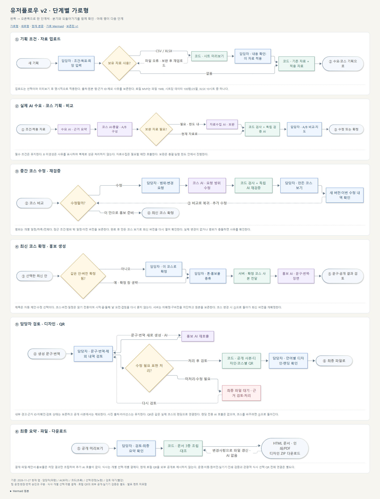
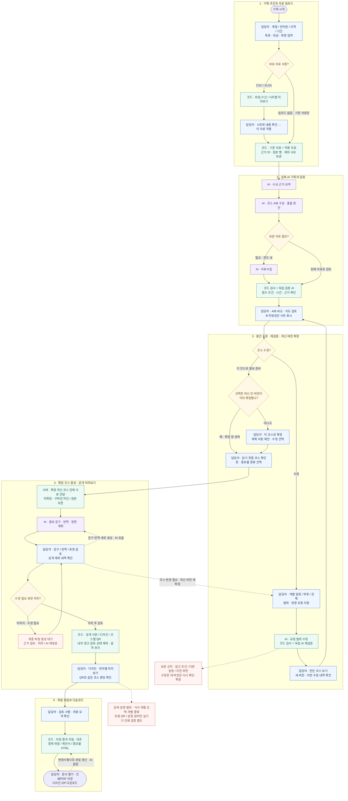

# 유저플로우 v2 — 담당자용 체류 기획 에이전트

- 최초 작성: 2026-11-17 / 현재 앱 기준 갱신: 2026-11-27
- 범위: 담당자 화면의 조건·자료 입력부터 코스 수정, 홍보·QR, 최종 파일까지.
- 상태: 사용자 요청에 따른 **현재 구현과 확인 범위**다. 팀 공통 운영 정책·현장 검증·사람의 승인 완료를 대신하지 않는다.
- 종전 v1.2의 시작·종료/E7 재선택, 식비 포함 여부, 경고를 제출 파일에 그대로 붙이는 흐름은 현재 앱 경로에서 아래 내용으로 대체한다. 과거 합의와 제안의 이력은 [반영 목록](반영사항/유저플로우_미정항목_결정및반영시점_1122.md)에 보존한다.
- 관련 기준: [MVP 범위와 검증](MVP_시연기준과_기관데이터_연결_1125.md), [작업현황](../app/작업현황.md).

## 1. 현재 사용 흐름

조건·목표·희망 입력 → 자료 업로드·내용 확인·적용(선택) → 실제 AI 기획 → A/B 비교·지도 검토 → 필요한 코스 수정·재검증 → 사용할 최신 안·버전 확정 → 홍보 디자인 설정·실제 AI 생성 → 문구·번역·공개 제외 내역 검토 → 공개 미리보기·QR → 최종 요약 확인·파일 생성·다운로드.

| 구간 | 담당자가 하는 일 | 코드·AI 처리와 결과 |
|---|---|---|
| 1. 기획 조건 | 계절·언어권·지역·당일/1박2일, 목표와 희망을 입력 | 필수 조건과 조정 가능한 희망을 구분한다. 지역·언어권·계절·기간을 AI가 임의 변경하지 않는다. 대상·동행은 현재 목표 문구에 입력한다 |
| 2. 수요 근거 | 자료가 있으면 파일·시트를 골라 미리보기 후 적용. 없으면 기존 자료로 시작 | 코드는 조건별 자료 선택·근거표·경고·원본 위치를 보존하고 AI는 수요를 요약한다. 별도 ‘없음’ 체크나 매 단계 진행 동의를 반복하지 않는다 |
| 3. 코스 검토 | A/B 차이·이유·일정·지도·검토 사항을 확인 | A는 요청 우선, B는 필수 조건 안에서 부담을 줄인 대안. 코드 검사·독립 AI 검증·총괄 보완을 거친다. 실질적인 B가 없으면 사유를 표시한다 |
| 3-1. 중간 수정 | 수정 범위·일정·요청을 지정하고 수정 실행 | 실제 코스 AI와 재검증으로 새 버전을 만든다. 이전 버전을 보존하고 선택 범위 밖 일정의 변경을 검사한다 |
| 3-2. 코스 확정 | 사용할 안의 최신 버전을 확인·확정. 제목 수정은 선택 | 제목은 자동 제안한다. 선택한 안·버전을 저장하며 운영·계약·번역 승인으로 취급하지 않는다 |
| 4. 홍보 검토 | 톤·홍보물 종류를 고르고 생성 후 문구·번역·제외 내역 검토 | 홍보 AI가 실제 코스의 장면·문구·번역을 작성한다. 코드는 반영된 시안에 배치하고 같은 코스의 QR 랜딩을 만든다 |
| 5. 산출물 | 검토 사항과 최종 요약을 확인하고 문서·디자인을 열어 다운로드 | 저장 결과를 코드로 결재 파일·제안서·홍보물 묶음에 조립하고 대조한다. 추가 AI가 코스나 사실을 새로 만들지 않는다 |

기획자 화면은 `/plan/`이며 `/admin/`은 서비스 운영자의 읽기 전용 로그다. 기획자에게 관리자 수정 폼 사용을 요구하지 않는다.

## 2. 자료 업로드와 근거 전달

- UTF-8 CSV·XLSX를 지원한다. 현재 로컬 MVP 제한은 파일 1MB, 시트당 데이터 100행·25열, XLSX 10시트다. 팀 공통 서비스 상한 합의와 구분한다.
- 기본 열은 `출처,기간,지역,대상,항목,값,단위,표본수`, 선택 열은 `세부항목`이다. 사용할 시트 하나의 표와 메타정보를 확인한 뒤 **내용 확인 · 이 자료 적용**을 누른다.
- PDF·HWP·이미지·구형 XLS·암호 파일·임의 복잡한 보고서를 자동 해석하는 기능은 없다. 수식은 값으로 저장한 자료를 사용한다.
- 기존 자료와 업로드 자료의 원본·시트·행·출처·기간·대상·지역·단위·표본을 구분하고 별도 근거 ID로 전달한다. 다른 지역·계절 등 제외 행은 이유를 남긴다.
- 서로 다른 조사 수치를 단순 평균하거나 같은 조사의 복사본을 독립 근거로 세지 않는다. 모든 업로드 행을 코스에 채택했다고 표시하지 않는다.
- 수요 요약·A/B 구성·보완·부분 수정에 채택한 근거와 한계를 이어 전달한다. 설문의 음식 선호는 특정 식당의 메뉴·운영·예약 가능성 증명이 아니다.

## 3. 코스 비교·지도·중간 수정

- **지도 크게 보기 ↗**에서 일정·지도·장소 설명을 함께 보고 **← 코스 비교**로 돌아온다. 지도는 대표 위치를 이용한 코스 이해용이며 실시간 내비게이션이나 현장 이동 검증이 아니다.
- 시각·체류시간은 권장·가정·미정 상태를 구분한다. 실제 예약·이용권의 고정 시간은 지키고 미정 숙소·혜택·픽업·교통편을 자동 확정하지 않는다.
- **코스 수정하기 · 바꾸고 싶은 부분이 있나요?**에서 개별 일정/하루/전체 코스를 고른다. 자유 요청·장소 교체·일정 제외/추가·방문 순서·머무는 시간·식사 구성을 지원한다.
- **요청대로 수정하기** 후 진행 상태를 확인하고 완료되면 **만든 코스 보기**를 다시 눌러 최신 버전과 **이번 수정 내역**을 확인한다. 생성 중 보이는 이전 코스를 수정 완료본으로 보지 않는다.
- 잠근 조건·선택하지 않은 일정·이전 버전을 보존한다. 범위 충돌이나 실질적 변경 없음은 사유를 표시하며 임의 요청의 성공을 보장하지 않는다.
- 기존 관광상품 겹침은 [보유 목록](../지침/3_코스검토/9_기존_상품_목록.md)을 이용한 검토 참고다. 실시간 상품 검색이나 겹침 자체의 판매 금지가 아니다. 연속 3곳 등 판정값은 시험·제안과 팀 합의를 구분한다.

### 식사와 자율 구간

식사는 제공하지 않으며 **개별 선택·개별 결제**로 안내한다. 치킨은 저녁 선택 옵션·스토리 요소이며 낮 식사의 고정 메뉴가 아니다. 담당자는 점심 시간·권역을 보존하며 후보 묶음을 구성하고, 관광객의 개인 선택은 공통 코스를 바꾸지 않는 원칙이다. 직원용 후보 구성·개인 지도 미리보기와 QR 랜딩의 관광객 선택 UI 연결 완료는 구분한다. 후자의 전체 연결·공개 검증은 남아 있다.

## 4. 확정 코스를 홍보로 전달

1. **A/B안으로 홍보 준비**에서 미확정이면 **이 코스로 확정 · 홍보 준비**를 거친다. 같은 안·버전이 이미 확정됐다면 창을 반복하지 않는다.
2. 홍보 설정은 선택한 코스·안·버전·일정의 읽기 전용 요약과 톤·홍보물 종류다. 언어는 앞서 고른 조건을 따른다.
3. **코스 시작·끝, 둘째 날 오전, 기존 관광상품 겹침을 홍보 단계에서 다시 묻지 않는다.** 서버도 옛 클라이언트의 해당 일정 입력을 사용하지 않는다.
4. 서버는 명시적으로 확정한 최신 코스 전체를 그대로 복사한다. 원본의 미정·확정조건·겹침 선택·담당자 결정을 바꾸거나 코스 기록을 재저장하지 않는다.
5. 미확정·구버전·다른 선택안은 새 홍보 생성에 사용할 수 없다. 코스를 수정하면 새 버전을 확인·확정하고 홍보·산출물을 다시 검토한다. 과거 결과는 보존한다.

## 5. 홍보 AI·공개 자료·다시 만들기

| 기능 | 현재 동작 |
|---|---|
| 홍보 실제 생성 | 홍보 검토 AI가 확정 코스에 맞춘 문구·번역·장면 계획을 생성. 번역은 검토 전 초안 |
| 디자인·랜딩 | 코드가 최신 반영 SVG 시안·HTML·이미지에 실제 생성 내용을 배치. 고정 예시 코스를 넣지 않으며 랜딩 전용 AI 호출은 없음 |
| QR | 해당 코스 토큰의 랜딩으로 연결. 한국어·일본어 등 생성 언어와 같은 코스 내용을 사용 |
| 문구·번역 새로 생성 | 이전 디자인 설정을 유지하며 최신 확정 코스로 AI를 다시 호출. 코스 자체를 다시 짜거나 매번 새 그림을 생성하는 기능은 아님 |
| 변경사항으로 파일 갱신 | 저장된 내용을 코드로 다시 조립. AI 호출 없음. 내용 변경이 없으면 본문도 사실상 같음 |
| 수정이 필요한 홍보 표현 | 근거 없는 최상급·수치·역사 단정·픽업·식사 제공 약속 등을 담당자가 검토. 재생성만으로 해결을 보장하지 않음 |

근거 ID·경고·미확인·표현 검토·번역 상태는 내부 기록과 담당자 검토 화면에 보존한다. 관광객용 홍보물·QR·내려받는 공개 JSON·제출 문서에는 그대로 싣지 않는다. 미확인 주장은 공개 사본에서 대응 번역·장소·대응표와 함께 제외하고 담당자에게 제외 내역을 보여 준다. 제외를 사실 확인 완료로 바꾸지 않는다. 필요한 안내가 빠졌다면 원래 코스·문구를 수정하고 다시 검토한다.

사진 출처·라이선스는 유지한다. 결재·제안서에 필요한 자료는 읽을 수 있는 참고자료명·링크로 정리하며 내부 R/W 코드를 붙이지 않는다.

## 6. 진행·대기와 변경 영향

| 상황 | 현재 앱 기준 |
|---|---|
| 필수 조건 누락·업로드 형식 오류 | 입력·파일을 보완한다. 업로드는 미리보기만으로 적용되지 않음 |
| 자료 부족·운영 미확인·대표 좌표 | 담당자에게 한계 표시. 코스 초안 생성·선택을 현장 검증 완료로 바꾸지 않음 |
| B 미생성 | 원인·대안 불가 사유 표시. A 복제로 B 성공을 꾸미지 않음 |
| 코스 미확정·수정 전 버전 | 최신 안·버전 확인·확정 후 홍보 진행 |
| 표현 미처리·수정 필요 | 검토·처리 전 새 최종 파일 생성 차단. 근거 없는 ‘그대로 사용’ 승인 금지 |
| 조건·근거 변경 | 코스와 이후 결과를 새 조건으로 다시 생성·검토 |
| 코스 변경 | 최신 버전 확정 후 홍보·번역·최종 파일 재검토. 이전 승인 자동 승계 금지 |
| 문구·번역 변경 | 공개 미리보기·최종 파일 다시 확인 |

## 7. 단계 사이의 실제 전달

| 넘김 | 보존·전달할 내용 |
|---|---|
| 조건 → 수요 | 필수 조건·목표·희망, 적용한 업로드·선택 시트, 기존 자료 범위 |
| 수요 → 코스 | 전체 근거 행·근거 ID·경고와 적용 근거, 원출처·한계. 장소와 근거의 연결은 코스 단계에서 판단 |
| 코스 수정 → 최신 안 | 원본 참조·수정 범위·요청·변경 이유·검사 결과·새 버전, 이전 버전 |
| 코스 → 홍보 | 선택·확정된 최신 코스 전체 사본·안·버전·제목, 장면 근거·남은 내부 검토 사항 |
| 홍보 → 산출물 | 저장 문구·번역·장면·디자인 설정·검토 기록과 공개 사본. 새 사실 생성 없이 조립·대조 |
| 내부 → 공개 | 내부 원본을 보존한 채 공개 허용 항목만 내보냄. 내부 `5단계_묶음.json`과 공개 `코스와_문구.json`을 구분 |

## 8. 최종 결과와 남은 범위

현재 결재 파일·제안서·홍보물 묶음은 HTML 문서 3종으로 열고 브라우저 인쇄/PDF 저장을 이용한다. 디자인 ZIP은 언어별 SVG·랜딩·공개 코스/문구 등을 묶는다. 기관 HWP 양식 업로드·네이티브 HWP 생성은 구현되지 않았다. 제안서에는 가격·수수료 칸을 넣지 않는다. 결재·발주·판매는 사람이 한다.

2026-11-27 분리 시연에서는 가상 엑셀 13행 적용, 실제 에이전트 실행, A/B 비교·지도, 체류 60→45분 수정·재검증, A3 확정, 실제 홍보 생성, 한국어·일본어 랜딩, 문서 3종·ZIP 다운로드까지 확인했다. 이는 모든 신규 코스의 품질이나 운영 확인 완료를 보장하지 않는다.

남은 범위는 실제 방문일 운영·이동 확인, 원어민 검토, 외부 공개 주소·휴대전화 실기기·최종 인쇄, 관광객 식사 선택의 QR 연결, 문구 직접 편집·디자인 전용 편집기다. 표본·변동 경고 기준, 통계 사용 정책(G5·G17), 서비스 언어·형식 확장, 기관 양식과 운영 정책의 팀 합의는 별도다. 시식권·쿠폰은 현행 기능으로 표시하지 않는다.

## 9. v1 보존 · v2 가로/세로 그림

v1의 MD·HTML·PNG는 Git 이력의 원본(v1.2, 2026-11-22)을 복원해 보존한다. 현재 구현과 이전 규칙은 같은 파일에서 섞지 않는다. 11/27 최신 내용은 v2로 분리했다. 복원 기준 커밋은 `8b1817f`다.

- [가로 그림 HTML](유저플로우_v2.html) · [가로 PNG](유저플로우_v2.png) · [단계별 가로 Mermaid](유저플로우_v2_가로.md)
- [세로 그림 HTML](유저플로우_v2_세로.html) · [세로 PNG](유저플로우_v2_세로.png) · [세로 Mermaid 원본](유저플로우_v2.mmd)
- [보존한 v1 본문](유저플로우_v1.md) · [v1 그림](유저플로우_v1.html)

가로형은 단계별 정상 흐름·분기·되돌아가기를 한 행에서 읽는 보기다. 여섯 행은 코스 수정과 확정을 나눈 화면상 묶음이며 업무 단계 1~5를 늘린 뜻이 아니다. 세로형은 전체 연결을 추적하는 보기다. 두 보기 모두 같은 현재 구현을 설명한다.

### 전체 연결 · 세로 Mermaid

기존 v1.1(11/18)·v1.2(11/22)의 팀 검토 이력은 v1과 반영 목록에 남긴다. v2는 이후 사용자 요청·실제 구현을 통합한 현재 앱 설명이며 팀 운영 합의·현장 검증·판매 승인을 대신하지 않는다.
