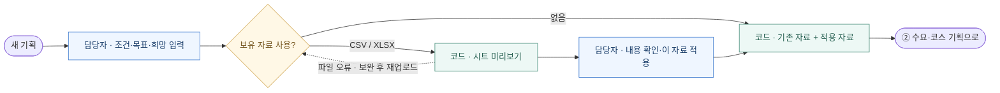
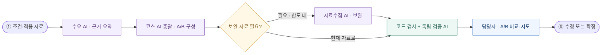
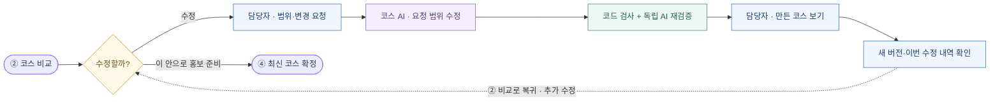
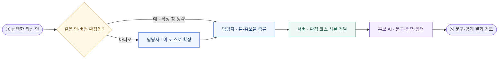
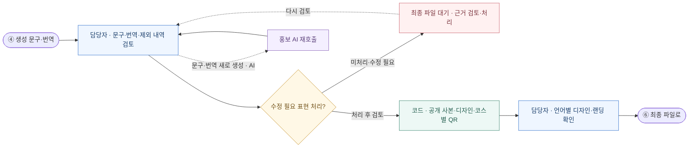

# 유저플로우 v2 — 단계별 가로 Mermaid

- 기준: 2026-11-27 현재 앱 구현. [상세 본문·세로 Mermaid](유저플로우_v2.md)
- [가로 그림 HTML](유저플로우_v2.html) · [가로 그림 PNG](유저플로우_v2.png) · [세로 그림](유저플로우_v2_세로.html)
- 한 단계는 왼쪽에서 오른쪽으로 읽고 다음 단계는 아래 행에서 이어 본다. ‘다음 단계’ 표식은 자동 승인이나 별도 입력 화면을 뜻하지 않는다.
- 담당자=선택·검토, AI=기획·판단·생성, 코드=자료·검사·버전·조립. 실제 에이전트는 순차·조건부 실행한다.

## ① 기획 조건 · 자료 업로드

업로드는 선택이며 미리보기 후 명시적으로 적용한다. 출처·원본 행·근거 ID·제외 사유를 보존한다. 로컬 MVP는 파일 1MB, 시트당 데이터 100행/25열, XLSX 10시트 중 하나다.

## ② 실제 AI 수요 · 코스 기획 · 비교

필수 조건은 유지한다. B 미생성은 사유를 표시하며 복제로 성공 처리하지 않는다. 자료수집은 필요할 때만 호출한다. 보완은 총괄·실행 한도 안에서 진행한다.

## ③ 중간 코스 수정 · 재검증

범위는 개별 일정/하루/전체다. 잠근 조건·범위 밖 일정·이전 버전을 보존한다. 완료 후 **만든 코스 보기**로 최신 버전을 다시 열어 확인한다. 실제 변경이 없거나 범위가 충돌하면 사유를 확인한다.

## ④ 최신 코스 확정 · 홍보 생성

제목은 자동 제안·수정 선택이다. 코스·버전·일정은 읽기 전용이며 시작·끝·둘째 날 오전·겹침을 다시 묻지 않는다. 서버는 미확정·구버전을 차단하고 원본을 보존한다. 코스 변경 시 ③으로 돌아가 최신 버전을 재확정한다.

## ⑤ 담당자 검토 · 디자인 · QR

내부 경고·근거 ID·미확인·검토 상태는 보존하고 공개 사본에서는 제외한다. 사진 출처·라이선스는 유지한다. QR은 같은 실제 코스의 랜딩으로 연결한다. 랜딩 전용 AI 호출은 없으며, 코스를 바꾸려면 ③으로 돌아간다.

## ⑥ 최종 요약 · 파일 · 다운로드

결재 파일·제안서·홍보물은 저장 결과만 조립하며 추가 AI 호출이 없다. 식사는 개별 선택·개별 결제다. 현재 로컬 QR을 외부 공개로 제시하지 않는다. 운영·이동·원어민·실기기·인쇄 검증과 관광객 식사 선택 QR 전체 연결은 별도다.
