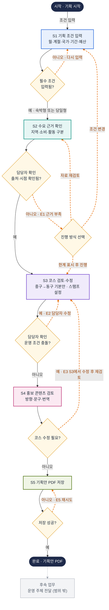

# 유저 플로우 — 공공 관광기관 담당자 기획 서비스 (v0)

> 기준: 2026-11-13. 화면 5개(S1~S5)와 예외 경로(E1·E2·E3·E5)를 담은 순서도입니다. 화면 설명과 예외 상세는 `유저플로우_초안_v0.html`을 봅니다.

## 기호

| 기호 | 뜻 |
| --- | --- |
| 둥근 상자 | 시작·끝 |
| 사각 상자 | 화면 하나 (번호 S1~S5) |
| 마름모 | 분기 (예 / 아니오 질문) |
| 실선 화살표 | 정상 진행 |
| 주황 점선 화살표 | 예외·수정 경로 (라벨에 E 번호) |
| 화살표 라벨 | 사용자의 행동 또는 분기 조건 |

**확정과 설계 제안의 구분:** 운영 조건 충돌과 근거 확인은 담당자가 확인하는 단계입니다. 시스템이 자동으로 판별하는 기능은 아직 합의되지 않아 순서도에 넣지 않았습니다.

## 예외 경로 요약

| 번호 | 발생 지점 | 경로 |
| --- | --- | --- |
| E1 | S2 근거 확인 | 조건 변경 → S1 · 자료 재검토 → S2 · 한계 표시 후 진행 → S3 |
| E2 | S3 운영 조건 충돌 | 담당자가 S3에서 수정 |
| E3 | S4 코스 수정 필요 | S3에서 수정한 뒤 S4 재검토 |
| E5 | S5 PDF 저장 실패 | S5에서 재시도 |

**미정 (순서도에 넣지 않음):** 자동 판별과 진행 차단, 저장 제한 조건, 코스 초안 생성 방식, 번역 언어와 범위, 캐릭터·영상 활용 범위, PDF 생성 방식, 운영 주체 전달 방식 (후속 업무).
