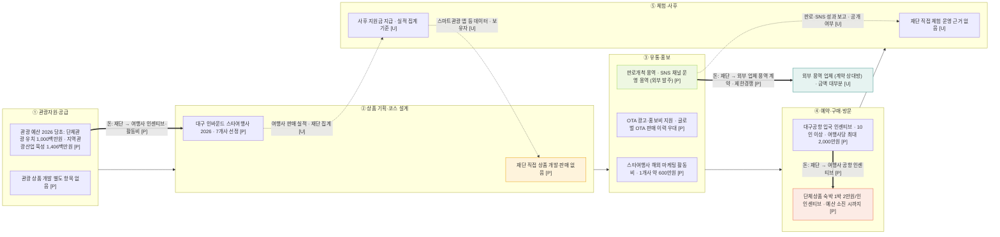

# 밸류체인 v0 — 대구관광재단 (대구문화예술진흥원 관광본부)

> 팀 내부 공유용. 재단은 자체 상품을 팔지 않고 여행사·외부 업체를 지원하거나 발주하는 쪽입니다. 그래서 각 단계에 "재단이 하는 일"을 배치했습니다. 공공 용역 수익모델과의 연결은 7절에 따로 적었습니다.

- 기준일: 2026-11-12
- **명칭 주의:** "대구관광재단"은 현재 독립 법인이 아니다. 관광 업무는 재단법인 **대구문화예술진흥원 관광본부**가 맡는다 (언론 기준 [U]). 2026-07 대구시 조직개편안은 진흥원을 문화·관광·공연재단과 미술관으로 나누는 방향이다 [U]. 이 파일의 "재단"은 관광본부를 가리킨다.
- 출처 기반: `하나투어ITC_관광재단_인바운드_조사.md` (2장 재단, 4장 종합, 6장 알리오·대구시 예산서·나라장터 재조사), `수익모델_공공용역_초안_26.11.11.md` (7절 연결)
- 체인 틀: 1109 산업 분석 치킨 관광상품 5단계 (`valuechain_통합.md`와 동일) — ① 관광자원·공급 → ② 상품 기획·코스 설계 → ③ 유통·홍보 → ④ 예약·구매·방문 → ⑤ 체험·사후
- 표기: **[P]** 원문 열람 확인 · **[U]** 미확인 (검색 요약 기준) · **[I]** 해석 · **[추정]** 나라장터 추정가격 · **[가설]** 검증 전 값 · **없음** 자료에서 확인되지 않음

## 0. 먼저 읽을 규칙

1. **재단은 판매 주체가 아니다.** 재단 직접 패키지·패스 판매는 **없음** [P]. 여행사 위탁 판매도 **없음** [P]. 수수료도 **없음** (정액 인센티브) [P].
2. **재단이 하는 일은 세 가지다.** ① 여행사 인센티브·활동비 지원 ② 외부 업체에 판로개척·SNS 용역 발주 ③ 예산 편성 (예산서 기준). 상품 기획은 재단이 아니라 여행사가 한다 [I].
3. **금액은 추정하지 않는다.** 용역 추정금액은 대부분 확인되지 않았다 ([U]). 예산은 예산서 항목 금액만 쓰고, 실제 집행액은 확인하지 못했다.
4. **발주처 명칭을 맞춘다.** 나라장터에서 "대구관광재단" 명의 발주는 0건이고, "재단법인 대구문화예술진흥원" 명의 관광 발주는 확인된다 (7절 참고).

## 1. Mermaid v0 — 재단의 위치 (지원·발주 구조)

**읽는 법:** 실선 `-->`는 단계 순서다. `==>`는 재단이 돈을 내보내는 방향이다. 괄호 안은 자료 등급이다. `-.->`는 미확인 연결 후보다.

## 2. 단계별 표

| 단계 | 재단(관광본부) 활동 | 출처 | 상태 |
| --- | --- | --- | --- |
| **① 관광자원·공급** | 관광 업무 주체 = 진흥원 관광본부 [U] (언론). 2026 예산서 (당초): 단체관광객 유치 활성화 **1,000백만원** (2025 422, +137%) · 지역관광산업 육성 **1,406백만원** (해외 650 · 국내 710 · 콘텐츠 46) · 해외 현지 관광마케팅 **323백만원** · 교통홍보 매체 활용 홍보 74백만원 · 대구경북관광 특별전 60백만원. 진흥원 운영비 18,470,000천원 (-4.0%, 관광 부분 분리 **없음**). 관광상품 개발 별도 항목 **없음** | 사업설명서 1권 pp.101–102, 2권 pp.646–669, 748–750 | [P] |
| **② 상품 기획·코스 설계** | 재단 직접 기획 **없음** [P]. 여행사 상품 지원: 대구 인바운드 스타여행사 (2026, 7개사 선정, 2026.6.23) [P]. 2025는 5개사 · 2022~2025 4개년 최대 440만원 (언론) [U]. 패스 상품 **없음** [P]. 2025 스마트관광 애플리케이션 운영·활성화 용역 (재단 발주) [P 목록] | culture.go.kr 공고 · 나라장터 목록 | [P]·[U] |
| **③ 유통·홍보** | 여행사 해외 마케팅 활동비 지원 (1개사당 약 600만원, 2026) [P]. 공고 우대: "글로벌 OTA 상품 등록 또는 판매 이력", OTA 광고·홍보비 지원 항목 [P]. 외부 발주 용역: 판로개척 · SNS 채널 운영 (아래 표). 대구마라톤 스포츠관광 상품 대만·홍콩 여행사 협업, 외국인 러너 101명 (여행사명·날짜 **없음**) | 정부 포털 공고 · 나라장터 · 관광 데이터랩 인용 기사 | [P]·[U] |
| **④ 예약·구매·방문** | 재단 직접 판매 **없음** [P]. 단체상품 인센티브: 숙박 1박 2만원/인 (2026, 예산 소진 시까지), 전세기 편당 300~500만원 [P]. 공항 입국 인센티브 (한국공항공사 공동): 10인 이상, 3.1~예산 소진 시 [P]. 예약·결제 주체는 여행사 [I] | visitdaegu.or.kr/insentibeu2/1 · insentibeu4/1 | [P] |
| **⑤ 체험·사후** | 재단 직접 체험 운영 근거 **없음** [U]. 사후 지원금 지급 방식 [P]. 방문객·실적 집계 방식 **없음** [U]. 2026 대구세계마스터즈 관광프로그램 운영 대행 (조직위 발주, 재단 아님) [P 목록] | 나라장터 목록 | [P]·[U] |

### 재단 발주 용역 목록 (대구 관광, 나라장터 기준)

| 공고명 | 공고번호 | 발주기관 | 공고일 | 마감일 | 계약방법 | 추정금액 | 상태 |
| --- | --- | --- | --- | --- | --- | --- | --- |
| 온라인 플랫폼 활용 대구 관광상품 판로개척 지원 용역 (2026년) | R25BK01234821 | 재단법인 대구문화예술진흥원 | 2025/12/17 | 2026/01/07 | 제한경쟁 | 확인 안 함 [U] | 마감 [P] |
| 2026년 대구관광 국내외 SNS채널 운영 용역 | R25BK01239897 | 재단법인 대구문화예술진흥원 | 2025/12/18 | 2026/01/19 | 제한경쟁 | 확인 안 함 [U] | 마감 [P] |
| 2025년 온라인 플랫폼 활용 대구 관광상품 판로개척 지원 용역 | R25BK00707126 | 재단법인 대구문화예술진흥원 | 2025/03/13 | — | — | 확인 안 함 [U] | 전년도 동일 과업 [P] |
| 2025 대구 스마트관광 애플리케이션 운영·활성화 | R25BK00634744 | 재단법인 대구문화예술진흥원 | 2025/02/11 | — | — | 확인 안 함 [U] | [P] |

- 두 공고는 **재단이 발주한 용역**이다. 재단이 상품을 직접 팔지 않고 **온라인 플랫폼 판로 개척과 SNS 운영을 외부 업체에 맡기는 구조**다 [P].
- 과업지시서(RFP) 원문은 **확인하지 못했다** [U]. 나라장터 첨부파일을 직접 내려받아야 한다.
- 나라장터 전체 검색 28건 중 상위 10건만 확인했다. 나머지는 **미확인**이다.
- R26BK01424947 (2026 대구 관광프로그램 용역)은 **취소 공고**다.

## 3. 돈 흐름 (재단 기준, 금액은 원문 표기)

| 항목 | 금액 | 주체 | 상태 |
| --- | --- | --- | --- |
| 단체관광객 유치 활성화 (외국인 단체 인센티브) | 1,000백만원 (2026 당초) | 관광과 관광마케팅팀 | [P] |
| 지역관광산업 육성 | 1,406백만원 (2026 당초, 2025 1,240) | 관광과 | [P] |
| 해외 현지 관광마케팅 | 323백만원 (2026 당초) | 관광과 | [P] |
| 진흥원 운영비 (출연금, 관광 업무 포함) | 18,470,000천원 (2026 당초) | 문화예술정책과 | [P] · 관광 부분 **없음** |
| 스타여행사 | 1개사 약 600만원 · 총예산 **없음** | 재단 | [P] |
| 인센티브 한도 | 여행사별 월 2,000만원 (단체) · 연 3,000만원 (특수목적) · 전세기 한도 없음 (자매도시 추가 연 3,000만원) | 재단 | [P] |
| 공항 공동 인센티브 | 여행사별 최대 2,000만원 | 재단·한국공항공사 | [P] |
| 용역 (판로개척·SNS) | 추정금액 **확인 안 함** | 재단 | [U] |
| 2026 인센티브 전체 예산 · 연간 외국인 유치 총예산 | **없음** | — | — |
| 국제노선 항공사 지원 | 예산서 **없음** (언론은 7억원) | — | [U] |

**돈 흐름 판단:** 재단의 돈은 여행사로 나가는 지원금과 외부 업체로 나가는 용역 계약금이다. 재단이 돈을 받는 구조는 자료에서 확인되지 않았다 [P]. 용역 금액을 확인한 건은 적고, 확인된 건 중에도 재단 용역의 금액은 없다.

## 4. 판매·수수료

- 재단 직접 판매: **없음** [P]
- 여행사 위탁 판매: **없음** (여행사가 직접 기획·판매·운영하고, 재단은 사후 지원금 지급) [P]
- 수수료 구조: **없음** (정액 인센티브, 판매 수수료 없음) [P]
- 용역 계약 구조: 재단 → 외부 업체, 제한경쟁 [P]. 계약 금액 [U].

## 5. 데이터 흐름

| 데이터 | 보유자 | 표기 |
| --- | --- | --- |
| 인센티브 신청·지급 실적 | 재단 | 기록 방식 [U] |
| 판로개척 온라인 플랫폼 판매 데이터 | 플랫폼·수행 업체 | 재단 공유 여부 [U] |
| SNS 채널 운영 성과 (조회·팔로워 등) | 수행 업체 → 재단 보고 | 보고 형식 [U] |
| 스마트관광 앱 이용 데이터 (2025 용역) | 재단·수행 업체 | 보유·공유 [U] |
| 리뷰·재구매 | 플랫폼·소비자 | [U] |

**데이터 판단:** 재단이 방문객·매출 데이터를 보유하는지 확인하지 못했다. 스마트관광 앱과 SNS 성과 보고가 데이터 후보이나 모두 [U]다. 발표 전에 보고서 형식을 확보해야 한다.

## 6. 병목·비용·기회 후보 (단계당 최대 2개)

| 구분 | 단계 | 후보 | 관측 근거 | 해석 | 상태 |
| --- | --- | --- | --- | --- | --- |
| 병목 B1 | ② | 재단 상품 기획 기능 없음 → 기획은 여행사 7개사에 의존 | 스타여행사 공고 [P] · 재단 직접 기획 없음 [P] | 재단 지원은 선정된 여행사에만 도달 [I] | [P] |
| 병목 B2 | ③ | 판로·SNS 용역의 판매 성과 공개 없음 | 공고 목록만 확인 | 용역 결과가 다음 발주의 근거인지 불명 [I] | [U] |
| 비용 C1 | ④ | 인센티브는 예산 소진 시 종료 | "예산 소진 시까지" 조건 [P] | 시기가 불확실하고 예산 규모에 묶임 [I] | [P] |
| 기회 O1 | ③ | 판로개척·SNS 용역의 반복 발주 (2025~2026) | 공고 4건 [P] | 같은 과업이 해마다 나온다 [I] | [P] |
| 기회 O2 | ② | 스타여행사 선정 구조 → 여행사 상품에 코스 설계 연결 | 공고 [P] | 여행사 상품의 입력 자료로 제안 [가설] | [가설] |

## 7. 수익모델 (공공 용역) 참고

`수익모델_공공용역_초안_26.11.11.md`의 1순위 수익(관광 콘텐츠·코스 기획 용역 계약금)과 연결해 정리했다. **수익모델 파일은 수정하지 않았다** (팀원 파일 — 수정 전 공유 필요).

1. **근거 보강 [P] — 발주 사례 확인:** 재단법인 대구문화예술진흥원이 판로개척·SNS 운영 용역을 2025~2026년 반복 발주했다 (R25BK01234821, R25BK01239897 등). 수익모델 §2·§5의 "관광 부서나 재단이 발주하는 관광 콘텐츠·코스 기획 용역"과 방향이 맞는다.
2. **정정 필요 [P] — 발주처 명칭:** 수익모델 §4 "대구관광재단 발주 0건 (나라장터 검색 기준)"은 명칭 기준 차이다. 같은 조직(진흥원 관광본부)의 관광 용역은 4건 확인된다. 수익모델 §4 문구를 "'대구관광재단' 명의 0건, 진흥원 명의 관광 용역 4건"으로 고치는 것을 제안한다.
3. **예산 근거 상향 [P]:** 수익모델 §3 "지역관광산업 육성 약 12~14억 원"은 예산서 2026 당초 1,406백만원 (2025 1,240백만원)과 맞는다 (사업설명서 2권 pp.646–648). **[U] → [P]로 올릴 수 있다.** 같은 표의 "대구관광안내소 운영 약 11억 원"은 이 자료에 없어 [U] 그대로 둔다.
4. **발주 방식 일부 확인 [P]:** 수익모델 §7의 "재단 발주 방식 (수의계약 여부)"은 아직 모른다. 다만 확인된 2건은 **제한경쟁**이었다. 수의계약 여부는 여전히 [U]다.
5. **산출물 연결 [가설]:** 판로개척 용역은 온라인 플랫폼에서 상품을 파는 일이다. 수익모델 §5의 코스 설계서·패스 운영안이 그 상품화의 입력으로 쓰일 수 있는지 검증이 필요하다. SNS 용역은 콘텐츠 산출물과 맞는다. 둘 다 계약 연결은 가설이다.
6. **쓰지 말 것 (수익모델 §6):** 추정금액이 없으므로 계약 예상액을 쓰지 않는다. 스타여행사 600만원은 **여행사 지원금**이지 우리 계약금 근거가 아니다. 두 금액을 섞어 쓰지 않는다.
7. **현재 신청 가능한 공모 없음 [P]:** 확인된 2026 인바운드 공모는 모두 마감됐다. 수익모델 §7의 "대구시·재단 관광 발주 공고 추가 탐색"이 다음 할 일이다.
8. **2순위 에이전트 구독 [I]:** 재단은 판매 구조가 없으므로 재단 쪽 구독 수요의 근거가 되지 않는다. 구독은 여행사 쪽 수요로 따로 검증한다 [가설].

## 8. 확인 필요 항목

1. **대구 조직개편 결과** [U] — 2026-07 개편안 (관광재단 분리 방향), 2026-09 관광본부장 공모. 결과 확인 전 "관광재단"이라는 이름을 기관명으로 쓰지 않는다.
2. **발주처 명칭 통일** — "대구관광재단" 0건 vs 진흥원 명의 관광 용역 4건 (수익모델 §4 정정 필요).
3. **판로개척·SNS 용역 추정금액과 과업지시서(RFP)** — 나라장터 첨부파일을 직접 내려받아 확인 [U].
4. **나라장터 전체 검색 28건 중 나머지 18건** — 미확인.
5. **수성구 협약 연도** — 게시일 10월 22일만 확인. 연도 **없음** (notice_ko/143).
6. **국제노선 항공사 지원 7억원** — 언론 보도 (2025-11). 예산서 PDF에서 미확인.
7. **대구마라톤 대만·홍콩 여행사 협업** — 여행사명·날짜 **없음**. 관광 데이터랩 인용 기사 기준.
8. **2025 스타여행사 5개사 · 2022~2025 최대 440만원** — 언론 기준. 공고 원문 확인 필요.
9. **재단의 방문객·인센티브 실적 데이터** — 공개 여부 [U].

## 9. 다음 단계

1. 이 파일을 `valuechain_하나투어ITC.md`와 함께 팀 내부 공유.
2. 확인 필요 1~9 처리. 특히 1번(조직개편)과 3번(RFP 원문)이 수익모델 근거를 좌우한다.
3. 수익모델 §3·§4·§7 정정 사항(7절 2·3·4번)은 수익모델 파일 담당자와 먼저 공유한 뒤 반영.
4. 커밋·푸시는 요청 시 진행.
