# 밸류체인 v0 — 하나투어ITC (방한 외국인 인바운드 DMC)

> 팀 내부 공유용. 하나투어ITC 한 곳의 활동을 치킨 관광상품 5단계에 배치합니다. 공공 용역 수익모델과의 연결은 7절에 따로 적었습니다.

- 기준일: 2026-11-12
- 출처 기반: `하나투어ITC_관광재단_인바운드_조사.md` (1장 하나투어ITC, 3장 공공 공고, 6장 알리오·나라장터 재조사), `수익모델_공공용역_초안_26.11.11.md` (7절 연결)
- 체인 틀: 1109 산업 분석 치킨 관광상품 5단계 (`valuechain_통합.md`와 동일) — ① 관광자원·공급 → ② 상품 기획·코스 설계 → ③ 유통·홍보 → ④ 예약·구매·방문 → ⑤ 체험·사후
- 표기: **[P]** 원문 열람 확인 · **[U]** 미확인 (검색 요약 기준) · **[I]** 해석 · **[추정]** 나라장터 추정가격 · **[가설]** 검증 전 값 · **없음** 자료에서 확인되지 않음 (추측으로 채우지 않음)

## 0. 먼저 읽을 규칙

1. **모회사 수치는 ITC 수치가 아니다.** 하나투어ITC는 하나투어의 자회사다. 하나투어 IR·사업보고서의 수수료 비중은 참고치로만 쓴다.
2. **1박2일 판매 상품은 없다.** 2025 강원 팸투어(2025-12)는 상품 발굴용 답사였고 판매 상품이 아니다. 상품 기획 실적으로 쓰지 않는다.
3. **ITC 수수료율은 없다.** 공개 자료가 없다. 네이버 연동 수수료 조건도 확인되지 않았다 (역할만 보도됨).
4. **대구 실적은 1건이다.** 수성구 연계 상품이 있으나 게시 연도가 확정되지 않았다. 수성구는 팀 검증 범위(중구·동구) 밖의 예시이므로 대구 운영 실적으로 과장하지 않는다.
5. **지역 귀속은 보류다.** 본사 소재지가 자료에 없다 ([U]). 통합 파일 기준(본사 소재지)을 적용할 수 없어 판단을 미룬다.

## 1. Mermaid v0 — 활동 흐름 (단일 기업)

```mermaid
flowchart LR
  subgraph S1["① 관광자원·공급"]
    I1["방한 외국인 대상 DMC · 하나투어 100% 자회사 [P]"]
    I1b["지자체 전담여행사: 강원 2021·2023, 광주 2025 [P]"]
  end
  subgraph S2["② 상품 기획·코스 설계"]
    I2["경북 4일 상품 2025 공모 선정 (20개 중 1개) [P]"]
    I2b["광주 연계 · 대구 수성구 연계 상품 [P]"]
    I2c["1박2일 판매 상품 없음 · 팸투어는 답사 [P]"]
  end
  subgraph S3["③ 유통·홍보"]
    I3["네이버 인바운드 예약 연동 K-Culture 상품 2025-11 [P]"]
    I3b["IN THE SOOP 패키지 · 하이브 협업 2023 [P]"]
    I3c["모회사 대리점 B2B·B2C 판매 · ITC 명시 없음 [U]"]
  end
  subgraph S4["④ 예약·구매·방문"]
    I4["Discover Korea 패키지 4일·7일 상시 판매 [P]"]
    I4b["Check-in Korea with Jeju Island 16일 USD 4,500 [P]"]
  end
  subgraph S5["⑤ 체험·사후"]
    I5["IN THE SOOP 평창 촬영지 투어 · 2025.6 방문객 2,200명 회사 발표 [P]"]
    I5b["리뷰·재구매 데이터 [U]"]
  end

  I1 --> I2 --> I3 --> I4 --> I5

  I4 ==>|"돈: 패키지 판매가 · 수수료 구조 없음 [U]"| I3
  I4b ==>|"돈: 판매가 USD 4,500 · 원가 없음 [U]"| I3

  I1b -.->|"지자체 공모 실적 · 계약 금액 없음 [U]"| I2
  I5 -.->|"방문객 집계 · 보유 범위 [U]"| I2
  I3 -.->|"예약 데이터 보유·공유 [U]"| I5b

  classDef bottleneck fill:#FEF3DC,stroke:#E89B00
  classDef cost fill:#FCEBE5,stroke:#E8603C
  classDef opp fill:#EEF7E2,stroke:#9BD24B
  classDef team fill:#E6F3F1,stroke:#2e8c85
  class I1b opp
  class I2c bottleneck
  class I4 team
  class I3c cost
```

**읽는 법:** 실선 `-->`는 단계 순서이고 `==>`는 돈의 흐름이다. 괄호 안은 자료 등급이다. `-.->`는 미확인 연결 후보다.

## 2. 단계별 표

| 단계 | 하나투어ITC 활동 | 출처 | 상태 |
| --- | --- | --- | --- |
| **① 관광자원·공급** | 방한 외국인 대상 투어·체험·패키지 기획·공급·운영 (DMC). 2021 강원 "트렌디평창 / 뉴양양 / 디스커버강원" 3종. 2023 강원 외국인 관광객 유치 전담여행사. 2025 광주광역시 전담여행사. 본사 소재지 **없음** | 공식 사이트 회사소개 (`hanatouritc.com/tour/about-us`), notice_ko/92·95·175 | [P] (소재지 [U]) |
| **② 상품 기획·코스 설계** | 2025 "Discover Eastern Korea in 4 Days" 경북권 특화 상품 (문체부·한국방문의해위원회 공모 선정, 14개사 20개 상품 중 1개) [P]. 광주 연계 "Discover Korea Tour" (2025-05-07) [P]. 대구 수성구 연계 상품 (한국전통문화체험관 다식 체험 포함, 게시 연도 **미확정**) [P]. 2025-12 강원 팸투어 1박2일은 답사, 판매 상품 아님 [P]. 1박2일 판매 상품 **없음** | notice_ko/176·175·143·207 | [P] |
| **③ 유통·홍보** | 네이버 인바운드 예약 연동 K-Culture 상품 공급 (2025-11) [P]. IN THE SOOP 패키지 (하이브 협업, 2023) [P]. 2026 클투 런트립·와그 연계·K-메디컬 개발 중 (언론) [U]. 모회사 사업보고서: 대리점 B2B·B2C 판매, 알선수수료 구조 (ITC 명시 없음) [U]. 네이버 연동 수수료 조건 **없음** | notice_ko/202, hankyung 202508200138g · 202607229335g | [P]·[U] |
| **④ 예약·구매·방문** | 2026 Discover Korea 패키지 4일·7일 상시 판매 [P]. "Check-in Korea with Jeju Island" 16일, 판매가 USD 4,500 [P]. 예약 채널별 구성·정산 방식 **없음** [U]. 수수료율 **없음** | `tour/best_seller`, `shop/PG00019` | [P]·없음 |
| **⑤ 체험·사후** | IN THE SOOP BTS 평창 촬영지 투어, 2025년 6월 방문객 2,200명 (회사 페이지 기재) [P]. 방문 후 리뷰·재구매 데이터 **없음** [U] | about-us | [P] (회사 발표) |

## 3. 지자체·공공 협력 실적

| 연도 | 기관 | 내용 | 출처 | 상태 |
| --- | --- | --- | --- | --- |
| 2021 | 강원도 | 강원 외국인 관광객 유치 전담여행사 활동 개시 | notice_ko/95 | [P] |
| 2023 | 강원도청·강원관광재단 | 2023 강원 외국인 관광객 유치 전담여행사 | notice_ko/92 | [P] |
| 2025 | 광주광역시 | 2025 광주광역시 전담여행사 선정 | notice_ko/175 | [P] |
| 2025 | 문체부·한국방문의해위원회 | 경북권 특화 상품 공모 선정 (14개사 20개 상품 중 1개) | notice_ko/176 | [P] |
| 연도 **없음** | 대구 수성문화재단·대구문화예술진흥원 관광본부 | 수성구 관광 진흥 업무협약 (게시일 10월 22일) | notice_ko/143 | [P] (추정 금지) |
| 2026 | 지자체 연계 스포츠 테마 상품 (계획) | 언론 보도 | news.mtn.co.kr | [U] |

- 2026년 강원 외국인 전담 여행사 여부: **없음** (확인 못 함)
- 2025 K-컬처 특화 상품 공모 (선정 15개, 운영사 14개사)에 ITC가 포함됐는지: **없음** (원 공고 미확인)

## 4. 돈 흐름

| 시작점 (결제) | 중간 차감 | 끝점 (ITC에 남는 몫) | 지역에 남는 몫 | 근거 |
| --- | --- | --- | --- | --- |
| 외국인 고객의 패키지 결제 (예: 16일 USD 4,500) [P] · 판매 채널 (네이버 연동·대리점) [U] | 수수료·정산 구조 **없음**. 모회사 참고치 (ITC 아님): 판매 수수료 PKG GMV 대비 5.0% (2026-09 IR), 여행비지급수수료 4.9% (2026-11 IR) [U] | 마진 금액 **없음** | 본사 소재지 **없음** → 판단 보류 | 조사 1-4 |
| 지자체 전담·공모 선정 | 지원금·계약 금액 **없음** [U] | 실적 (금액 없음) | 광주·경북·강원 현지 상품 운영 [P] | 조사 1-3, 1-4 |

## 5. 데이터 흐름

| 회사 | 생성 데이터 | 보유자 | 표기 |
| --- | --- | --- | --- |
| 하나투어ITC | 패키지 판매·예약 (네이버 연동 포함) | ITC · 네이버 | 보유·공유 범위 [U] |
| 하나투어ITC | 촬영지 투어 방문객 수 (2,200명) | ITC | [P] 회사 발표 |
| 하나투어ITC | 팸투어 답사 결과 (상품 발굴) | ITC | 기록 형태 [U] |
| 공통 | 리뷰·재구매 | 플랫폼·소비자 | [U] |

**데이터 판단:** ITC의 예약·방문 데이터가 어디까지 남는지 확인하지 못했다. 데이터 연결을 주장하려면 보강이 필요하다.

## 6. 병목·비용·기회 후보 (단계당 최대 2개)

| 구분 | 단계 | 후보 | 관측 근거 | 해석 | 상태 |
| --- | --- | --- | --- | --- | --- |
| 병목 B1 | ② | 1박2일 판매 상품 없음 | 판매 상품 목록 확인 [P] | 체류 연장형 상품 공백 [I] | [P] |
| 병목 B2 | ④ | 판매 수수료·정산 구조 미확인 | ITC 수수료 **없음** | 수익 배분 계산 불가 | [U] |
| 기회 O1 | ② | 지자체 전담·공모 실적 (강원·광주·경북) | notice_ko/92·95·175·176 [P] | 공공 발주처와 이미 거래한 DMC 실적 | [I] |
| 비용 C1 | ③ | 모회사 판매 구조 (대리점 B2B·B2C) | 사업보고서 기재, ITC 명시 없음 | 판매 대가 구조 불명 | [U] |

## 7. 수익모델 (공공 용역) 참고

`수익모델_공공용역_초안_26.11.11.md`의 1순위 수익(관광 콘텐츠·코스 기획 용역 계약금)과 연결해 정리했다.

1. **경쟁 또는 협력 후보 [I]:** ITC는 지자체 전담여행사와 공모 선정 실적이 있는 DMC다. 대구 발주 공고에서 실적 있는 DMC는 경쟁자이자 협력 후보가 된다. 대구 응찰·협력 여부는 **[U]**.
2. **실적 쌓기 경로 [I]:** 수익모델 §4는 "입찰 자격과 실적 필요"를 제약으로 적었다. ITC의 경로 (2021 강원 → 2023 강원 → 2025 광주·경북 공모)는 실적이 쌓이는 순서의 한 예시다. 계약 방식·금액은 **없음**이라 실적의 가치를 금액으로 환산하지 않는다.
3. **산출물 연결 [가설]:** 수익모델 §5의 산출물(코스 설계서·패스 운영안)은 ITC의 ②단계(상품 기획)에 해당한다. ITC처럼 판매 주체가 상품화할 수 있는 형태로 넘기는 협력 구조를 검증해야 한다.
4. **쓰지 말 것 (수익모델 §6):** 하나투어 모회사 수수료 4.9~5.0%는 ITC 수수료가 아니다. 공공 용역 근거로 쓰지 않으며, 쓴다면 "모회사 기준 참고"로만 표기한다.
5. **2순위 에이전트 구독과의 관계 [I]:** ITC의 판매는 패키지 판매가 중심이고 판매 수수료 구조가 공개되지 않았다. 구독 수요의 근거로 쓰지 않는다.

## 8. 확인 필요 항목

1. **본사 소재지** [U] — 지역 귀속 판단이 보류 상태다. 사업자 정보 또는 공시로 확인한다.
2. **"100% 자회사" 지위 표기 불일치** — 조사 파일 §0은 공식 홈페이지 기준 [P]로, §1-1 표는 IR 참고 [U]로 적었다. 공식 페이지 기준으로 통일 필요.
3. **ITC 수수료율·판매 수수료 구조** — 공개 자료 없음. 필요 시 직접 문의.
4. **2025 K-컬처 공모 선정 여부** — 원 공고 확인 필요 [U].
5. **네이버 연동 수수료·정산 조건** — 역할만 보도됨 [U].
6. **수성구 연계 상품 게시 연도** — 미확정 (notice_ko/143).
7. **2026 클투 런트립·와그 연계·K-메디컬** — 언론 기준 [U].
8. **IN THE SOOP 방문객 2,200명** — 회사 페이지 기재 수치. 외부 발표 전 원문 확인.

## 9. 다음 단계

1. 이 파일을 `valuechain_관광재단.md`와 함께 팀 내부 공유.
2. 확인 필요 1~8 처리 (본사 소재지, 공식 페이지 기준 통일이 먼저).
3. 수익모델 §4·§7의 정정 사항은 `valuechain_관광재단.md` 7절 참고 (수익모델 파일은 팀원 파일이라 수정 전 공유).
4. 커밋·푸시는 요청 시 진행.
