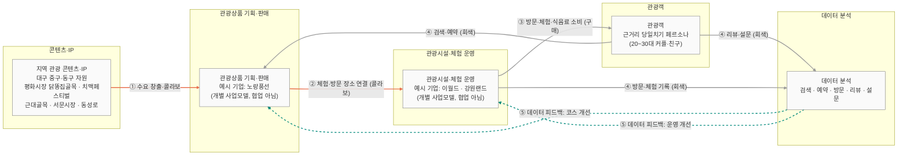

# 산업 연결도 — 대구 체류형 미식관광 (교재 8페이지 구조 적용)

- 작성일: 2026-11-05
- 프로젝트: 대구 관광자원 + 치킨·닭요리를 연결한 체류형 미식관광 상품 기획 AI 서비스 (트랙: AX 크리에이티브, 콘텐츠)
- 실습 페르소나: 근거리 당일치기 관광객 (README 기준, 담당자 초안)
- 기업 예시: 노랑풍선 · 이월드 · 강원랜드 (`research/company/candidates.md` 기준, 확정 후보 3곳)

**중요**: 이 도식은 **산업 간 연결 구조**를 보여준다. 세 기업이 서로 협업하거나 대구 치킨 관광상품을 운영한다는 뜻이 아니다. 기업은 각 산업의 **예시**로만 배치했고, 기업 사이를 잇는 화살표는 그리지 않았다.

**확인 범위**: 교재 8페이지는 Day 09 강의자료(p.8)로 확인했다 (아래 대조표). 화살표 색과 의미는 요청에 명시된 대로 적용했다. 교재 원문과 다르면 수정한다.

---

## 1. 산업 연결도 (Mermaid)

---

## 2. 화살표 의미

| 번호 | 연결 | 선 종류·색 | 의미 | 우리 프로젝트 해당 여부 |
|---|---|---|---|---|
| ① | 콘텐츠·IP → 관광상품 기획·판매 | 코랄 실선 | 지역 관광 콘텐츠(닭똥집골목, 치맥페스티벌, 낮 관광지)가 여행상품 수요를 만드는 과정 | **해당** — README Top3 자산이 상품 기획의 출발점 |
| ② | 관광상품 기획·판매 → 관광시설·체험 운영 | 코랄 실선 | 관광상품에 실제 체험과 방문 장소를 연결하는 과정 (콜라보) | **부분 해당** — 대구 낮 관광지를 체험 장소로 연결할 수 있는지 확인 필요 `[I]` |
| ③ | 관광시설·체험 운영 → 관광객 | 회색 실선 | 방문·체험·식음료 소비가 발생하는 과정 (구매) | **해당** — 근거리 페르소나의 낮 관광과 저녁 식음료 소비 |
| ④ | 관광객 → 데이터 분석 | 회색 실선 | 검색·예약(상품 쪽), 방문·체험 기록(시설 쪽), 리뷰·설문(관광객 쪽)이 쌓이는 과정 | **해당** — 현재 프로젝트의 A/B 설문 방법과 연결 |
| ⑤ | 데이터 분석 → 관광상품 기획 (그리고 운영) | 청록 점선 | 수집된 데이터로 다음 관광 코스를 개선하는 피드백 | **해당** — 설문 결과를 코스 설계에 반영하는 구조 |
| (미사용) | 물류·수출 | 파랑 | 해외 판매·송객, 물류 | **해당 없음** — 대구 국내 체류형 상품 범위 밖. 노랑풍선 해외 거점 연결은 질문뱅크에서 별도 조사 |

**화살표 ③과 ④의 구분**: ③은 관광객이 시설에서 돈을 쓰는 흐름이고, ④는 관광객이 남기는 데이터가 분석으로 가는 흐름이다. 두 흐름은 같은 회색 계열이지만 역할이 다르다.

**교재 8페이지 대조 (2026-11-05, `Day09_1105_K라이프스타일_산업_구조_v3 (1).pdf` p.8 · L.L.M Academy Day 09 Lifestyle 8)**

| 항목 | 교재 범례 | 이 도식 | 판단 |
|---|---|---|---|
| 코랄 화살표 | 콘텐츠가 만든 관심이 뷰티·푸드 수요로 이어지는 흐름 (콜라보·굿즈·캐릭터 식품) | ① 콘텐츠 → 상품 기획, ② 상품 기획 → 시설 (콜라보) | ① 일치. ② 는 교재에 직접 대응 없음 → `[I]` 우리 프로젝트 해석 |
| 블루 화살표 | 상품이 물류를 타고 소비자·해외로 나가는 흐름 (출하·수출·배송) | 사용하지 않음 | 관광 서비스는 실물 배송이 없어 해당 없음 |
| 틸 점선 | 구매·리뷰·검색·팬 활동 데이터가 네 산업으로 되돌아가는 피드백 | ⑤ 데이터 → 기획·운영 (틸 점선) | ⑤ 일치. 교재는 피드백이 네 산업 전체로 돌아간다고 함 |
| 회색 화살표 | 교재 범례에 없음 | ③ 시설 → 관광객 (구매), ④ 관광객 → 데이터 (구매·리뷰·검색) | **차이.** 교재는 구매·리뷰·검색 데이터 흐름을 틸 점선으로 그림. 요청 사양(회색 = 구매·리뷰·검색)을 따랐으므로 색 규칙 결정 필요 |

- 교재 주석: 화살표 굵기는 흐름 종류 구분이며 규모를 뜻하지 않는다. 도식은 개념도이며 실측 데이터가 아니다.
- 교재의 "기업 리서치 질문": 우리 기업은 이 그림의 어느 화살표에서 돈을 버는가. 노랑풍선·이월드·강원랜드 각각에 이 질문을 적용하는 것은 질문뱅크에서 이어서 다룬다.

---

## 3. 기업 예시 배치 방식

| 산업 | 예시 기업 | 배치 근거 | 주의 |
|---|---|---|---|
| 관광상품 기획·판매 | 노랑풍선 | 여행상품 직접판매, 온라인 예약 채널 (`candidates.md` 기준) | 노랑풍선과 대구 치킨 상품을 운영하거나 협업한다는 의미가 아님 |
| 관광시설·체험 운영 | 이월드 | 대구 소재 테마파크 (달서구 — 검증 범위 밖) | 대구 치킨 상품과 연결된 사례가 아님 |
| 관광시설·체험 운영 | 강원랜드 | 복합 레저·체류 시설 운영 (정선) | 근거리 당일 상품과 직접 연결되지 않음. 비교 기준으로만 배치 |
| 콘텐츠·IP | (기업 배치 없음) | 우리 프로젝트의 지역 자산 (README Top3) | 기업 예시를 억지로 넣지 않음 |
| 데이터 분석 | (기업 배치 없음) | 우리 프로젝트의 설문·데이터 설계 | 기업 데이터 활용 사례는 확인되지 않음 |

**협업 표현 금지**: 세 기업 노드 사이에는 화살표가 없다. 기업 노드는 각 산업의 예시일 뿐이다.

---

## 4. 우리 프로젝트에 해당하지 않는 연결

- **물류·수출 (파랑)**: 대구 국내 체류형 상품이 범위이므로 그리지 않았다. 노랑풍선의 일본 법인 거점은 질문뱅크(`question_bank_norang.md`) Q5-2, Q1-3에서 따로 확인한다.
- **강원랜드 ↔ 관광상품 기획**: 카지노 중심 시설이라 근거리 당일 상품과 직접 연결하지 않았다. 체류 시설 운영 사례로만 본다.

---

## 5. 확인 필요 항목

1. 교재 범례와 색 규칙이 다르다: 교재는 구매·리뷰·검색 데이터를 틸 점선으로 그리고, 회색 화살표는 범례에 없다. 요청 사양을 따를지 교재를 따를지 결정이 필요하다.
2. ② 관광상품 → 시설 연결: 노랑풍선이나 다른 여행사가 대구 낮 관광지와 실제로 연결한 사례는 확인되지 않았다. 해당 여부는 조사 후 판단.
3. ④ 데이터 수집: 기업이 검색·예약·리뷰 데이터를 어떻게 쓰는지는 사업보고서만으로 확인이 어렵다. 공식 홈페이지·IR 자료 추가 조사 필요.
4. ⑤ 데이터 피드백: 우리 프로젝트의 설계 항목이며, 기업의 실제 피드백 운영 사례는 확인되지 않았다.

---

## 6. 출처

| ID | 자료 | URL 또는 파일 | 확인 상태 |
|---|---|---|---|
| C1 | 노랑풍선 2025 사업보고서 (KIND) | https://kind.krx.co.kr/external/2026/03/18/001693/20260318007839/11011.htm | 본문 열람 (앞부분) |
| C3 | 노랑풍선 2025 사업보고서 (DART) | https://dart.fss.or.kr/dsaf001/main.do?rcpNo=20260318001206 | Aside 열람 (2026-11-05) |
| D1 | 이월드 2025 사업보고서 기재정정본 (DART) | https://dart.fss.or.kr/dsaf001/main.do?rcpNo=20260319000675 | Aside 열람 (2026-11-05) |
| D2 | 강원랜드 2025 사업보고서 (DART) | https://dart.fss.or.kr/dsaf001/main.do?rcpNo=20260323000917 | Aside 열람 (2026-11-05) |
| L1 | Day 09 K라이프스타일 산업 구조 강의자료, p.8 "산업 간 연결" (`Downloads\Day09_1105_K라이프스타일_산업_구조_v3 (1).pdf의 사본`) | 로컬 파일 (교재) | pypdf로 텍스트 추출하여 확인 (2026-11-05). 도식 이미지 자체는 미확인 |
