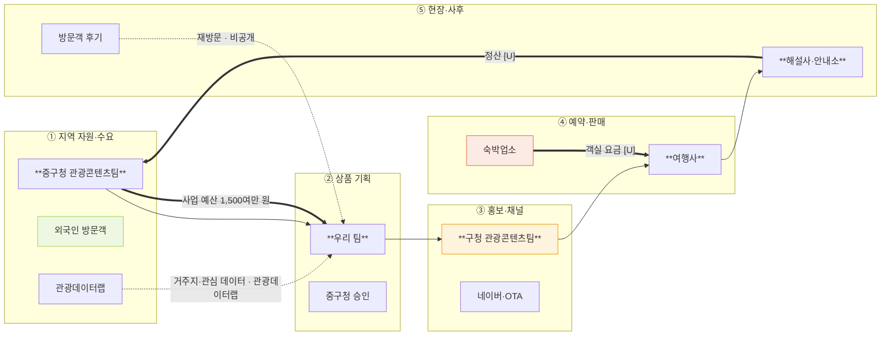

# 대구 체류 기획 도구 밸류체인 v0

- 단계: ① 지역 자원·수요 → ② 상품 기획 → ③ 홍보·채널 → ④ 예약·판매 → ⑤ 현장·사후
- 이해관계자 상세: `stakeholders.md`
- 표기 규칙
  - 상품·활동 흐름: 실선 `-->`
  - 돈 흐름: 굵은 선 `==>` (라벨: 수수료·정산·예산)
  - 데이터 흐름: 점선 `-.->` (라벨: 데이터 이름·보유자)
  - 병목 (B): 노란색 · 기회 (O): 초록색 · 비용 (C): 주황색
- 주의: 이 흐름도는 보조 자료다. 본 맵은 사례 페이지의 HTML 맵을 쓴다.

