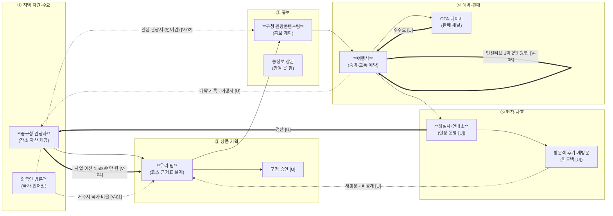

# 대구 체류 기획 도구 밸류체인 v0 (Mermaid)

- 상태: v0 초안. 숫자는 출처 번호(V-ID)가 있는 것만 적었다. 없는 것은 [U].
- 단계: ① 지역 자원·수요 → ② 상품 기획 → ③ 홍보 → ④ 예약·판매 → ⑤ 현장·사후
- 표기: 굵게 = 하는 사람, 괄호 = 영향 주는 사람. 상품 흐름 `-->`, 돈 흐름 `==>`, 데이터 흐름 `-.->`.

## 단계별 근거

| 단계 | 노드 | 근거 (출처 번호) | 상태 |
|---|---|---|---|
| ① 지역 자원·수요 | 중구청 관광과 | 중구 장소·안내소 (V-04, V-05) | 확인 |
| ① 지역 자원·수요 | 외국인 방문객 | 거주지 국가 비율 대만 31.3%, 중국 10.4%, 일본 10.0% (V-01) | 확인 |
| ② 상품 기획 | 우리 팀 | 기획 역할 (역할분담_v2) | 확인 |
| ② 상품 기획 | 사업 예산 | 1,500여만 원 (V-04) | 확인 |
| ③ 홍보 | 구청 관광콘텐츠팀 | 영문 팸플릿만 (V-04, V-05) | 확인 |
| ③ 홍보 | 관심 관광지 | 언어권 4종 (V-02) | 확인 |
| ④ 예약·판매 | 여행사 | 인센티브 1박 2만 원/인 (V-06) | 확인 |
| ④ 예약·판매 | 수수료 | 공개 자료 없음 | [U] |
| ⑤ 현장·사후 | 해설사·안내소 | 실제 운영 1회, 참여 2명 (V-04) | 확인 |
| ⑤ 현장·사후 | 피드백 | 실적 공개 없음 | [U] |
