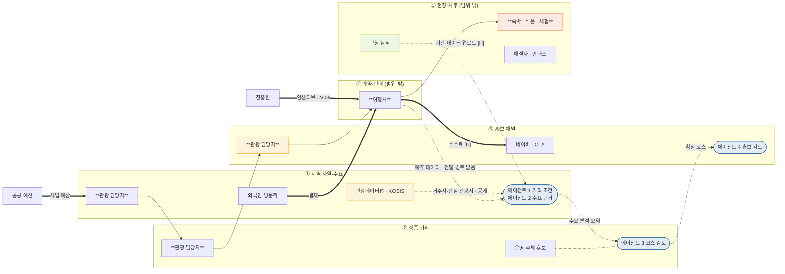

# 대구 체류 기획 도구 밸류체인 v3 (초안)

- 상태: 초안 v3.0 (2026-11-18). 팀 검토 전. 커밋 전.
- 기준: 담당자 · 에이전트 역할표 1~4단계 (WBS P.4), `inventory/유저플로우_v1.md`
- 이어받는 문서: `valuechain_v0.md`(5단계 흐름도), `inventory/밸류체인_v2.0.md`(7단계 · 단계별 근거), `stakeholders.md`, 01~05 노트
- 출처: 이 문서의 사실은 `00_출처_대장.md`의 V-ID로만 연결한다. 새 출처는 추가하지 않았다.
- 표기: `[P]` 원문 확인 · `[U]` 미확인 · `[I]` 해석 · `[H]` 가설 (README 4절)

---

## 0. v3에서 바로잡는 방향

v0 · v2.0은 "우리 팀이 기획안을 만들어 구청에 납품한다"는 구조였다. 역할표 기준으로는 **담당자가 단계마다 고르고 확인하고, 에이전트는 그 단계를 보조**한다. v3는 이 차이를 맵에 반영한다.

| 항목 | v0 · v2.0 | v3 |
|---|---|---|
| 기획하는 사람 | 우리 팀 (기획안 납품) | **관광 담당자** (에이전트가 보조) |
| 고객 | 중구청 관광콘텐츠팀 고정 | **대구 관광 담당자 전반** (구 · 군청, 대구시, 관광재단). 중구청은 MVP 검증 사례 |
| 단계 체계 | v0 5단계 / v2.0 7단계로 갈림 | **5단계 하나** (v2.0 7단계는 아래 1절 표로 흡수) |
| 단계 순서 | v2.0은 홍보(정보·영감)가 기획보다 앞 (관광객 시점) | **기획 → 홍보** (상품을 만드는 쪽 시점. 담당자 도구이므로) |
| 우리 위치 | ③ 상품 기획 "주도" | ①~③에 **에이전트 1~4단계가 들어감**, ④⑤는 범위 밖 |
| 예산 · 발주 · 자격 | 밸류체인 관점 페이지로 정리 | 맵에는 **돈 흐름 화살표만** 남기고, "우리가 받을 수 있는 돈"은 BM(P.6)으로 넘김 |
| 치킨의 위치 | 초기 방향은 치킨 메인 → v2.0에서 음식 선택지로 | **저녁 선택 옵션 + 코스 곳곳의 요소**(해설 · 스토리 · 체험). 고정하지 않음 (아래 "치킨 결정" 참고) |
| 성과 측정 | 우리가 측정 방법 설계 (05 노트) | 에이전트 범위 밖. 담당자가 2단계에 기관 데이터를 올리는 것이 피드백 경로가 됨 `[H]` |

### 치킨 결정 (2026-11-18, 사람1)

- 처음에는 치킨을 메인으로 하려 했으나, 대구에 치킨 관련 인프라(체험 · 전용 공간 등)가 아직 부족하다고 봤다 `[I]`.
- 치킨 수요도 아주 높지는 않다. 외국인 추천 음식에서 치킨 1·2순위 합계 3.8% (V-13, `[U]` 원표 재확인 필요).
- 그래서 저녁 치킨을 **고정이 아닌 선택 옵션**으로 두고, 치킨은 코스 곳곳에 **요소**로 넣는다 (예: 장소 해설 · 스토리 · 체험이 있으면 포함).
- 3단계 코스 검토의 기본 코스에서도 저녁은 선택지 중 하나로 다룬다. 팀 `CLAUDE.md` 1절("저녁 = 치킨 기본값")은 이 결정과 다르므로 팀에 알린 뒤 고친다.

---

## 1. 5단계와 v2.0 7단계 대응

| v3 단계 | v2.0 7단계에서 가져온 것 | 활동 |
|---|---|---|
| ① 지역 자원 · 수요 | ① 수요·동기 | 어떤 관광객이 언제 오는지, 쓸 수 있는 자료가 있는지 |
| ② 상품 기획 | ③ 상품 기획·패키징 + ⑤ 이동(동선 근거) | 낮 · 저녁 · 숙박 코스, 휴무 · 이동 시간 확인, 운영 주체 후보 |
| ③ 홍보 · 채널 | ② 정보·영감 | 국가 · 언어권별 문구, 홍보물, 채널 |
| ④ 예약 · 판매 | ④ 유통·예약 | 여행사 상품화, 예약 · 결제 |
| ⑤ 현장 · 사후 | ⑥ 현지 체류 + ⑦ 사후·성과 | 숙박 · 식음 · 체험, 해설 · 안내, 실적 집계 |

---

## 2. 단계별 맵 (역할표 1~4단계 배치)

| v3 단계 | 하는 사람 | 에이전트 단계 | 에이전트가 하는 일 | 돈 | 데이터 |
|---|---|---|---|---|---|
| ① 지역 자원 · 수요 | 관광 담당자, (관광데이터랩 · KOSIS) | **1 기획 조건 · 2 수요 근거** | 조건에 맞는 자료 고르기, 기관 데이터 비교, 근거표 · 경고 | — | 거주지 국가 · 관심 관광지 (V-01, V-02 `[P]`), 방문율 (V-03 `[U]`) |
| ② 상품 기획 | 관광 담당자 | **3 코스 검토** | 기본 코스(저녁 치킨은 선택 옵션), 휴무 · 영업시간 · 이동 시간 충돌 표시, 대체안, 장소별 근거 · 운영 주체 후보 | 공공 사업 예산 (금액은 다루지 않음) | 이동 시간 (V-15, V-16 `[U]`), 객실 수 (V-10) |
| ③ 홍보 · 채널 | 관광 담당자, (홍보 대행 · 플랫폼) | **4 홍보 검토** | 장면별 문구 · 번역 초안, 시안, 근거 없는 표현 걸러 내기 | 홍보비 `[U]` | 외국어 홍보물 현황 (V-04 `[P]`) |
| ④ 예약 · 판매 | 여행사, (네이버 인바운드 · OTA) | 범위 밖 | — (5단계 산출물이 여행사에 넘어가는 지점, 이번 범위 제외) | 관광객 결제 → 여행사, 인센티브 (V-06, V-07, V-08 `[P]`), 수수료 `[U]` | 예약 · 판매 기록 (여행사 보유, `[U]`) |
| ⑤ 현장 · 사후 | 숙박 · 식음 · 체험 업체, 해설사 · 안내소, 구청(실적) | 범위 밖 | — | 숙박 · 현장 소비 | 실적 (안내소 방문자 · 투어 인원 · 스탬프, 구청 보유 `[U]`) |

- 해석 `[I]`: 에이전트는 **산업 흐름의 앞쪽(①~③)에서 담당자의 판단 시간을 줄이는 도구**다. 판매 · 현장(④⑤)은 여행사와 현장이 맡고, 에이전트는 그쪽에 넘길 근거를 정리하는 데서 멈춘다.

---

## 3. 흐름도

- 실선 `-->` 상품 · 활동, 굵은 선 `==>` 돈, 점선 `-.->` 데이터, `-.-x` 단절 (v0 표기 유지)
- 파란 둥근 상자: 에이전트 단계. 사람이 하는 일을 대신하지 않고 옆에 붙는다.

---

## 4. 마커 → 에이전트 단계 연결

| 마커 | 내용 | 근거 | 받는 에이전트 단계 |
|---|---|---|---|
| B 병목 | 조건별(계절 · 국가 · 숙박형)로 나뉜 자료가 적다. 구별 외국인 숙박 위치 자료 없음 | v2.0 6절, `지침/공통/데이터_목록.md` | 1단계 알림 · 2단계 경고 |
| B 병목 | 외국어 홍보물 부족 (영문만 있는 투어 · 안내소). 중간체 · 중번체 `[U]` | V-04 `[P]` | 4단계 문구 · 번역 초안 |
| B 병목 | 휴무 · 영업시간 · 이동 시간을 담당자가 일일이 확인 `[H]` | V-15, V-16 `[U]` (이동 시간 값) | 3단계 충돌 표시 · 대체안 |
| C 비용 | 현장 체크인 · 스탬프 운영 비용 (방식에 따라 다름) | 04 노트, V-11 · V-18 | 범위 밖 (3단계는 운영 주체 후보만) |
| O 기회 | 담당자가 실적 데이터를 2단계에 올리면 다음 기획의 근거가 됨 | 05 노트 4절 | 2단계 비교 확인 `[H]` |
| ✕ 단절 | 여행사 예약 · 판매 데이터가 기획 쪽으로 돌아오지 않음 | v2.0 5절 | 범위 밖 (확인 필요 유지) |

---

## 5. 기존 자료를 어디로 보내나

| 자료 | v3에서 | 비고 |
|---|---|---|
| 01 수요 · 홍보 | ① · ③ 근거 (1 · 2 · 4단계) | 그대로 사용 |
| 02 상품 · 이동 · 체류 | ② 근거 (3단계) | 이동 시간은 WBS 1.5 장소 운영 정보 시트로 연결 |
| 03 유통 · 인센티브 | ④ 근거 (범위 밖 설명용) | 여행사 = 실행 파트너. 3단계 운영 주체 후보에 일부 사용 |
| 04 스탬프 운영 | ⑤ 근거, 운영 주체 후보 | WBS 2.2 운영 주체 후보 지식으로 넘김 |
| 05 성과 측정 | ⑤ → ① 피드백 경로만 | 측정 설계는 에이전트 범위 밖으로 표시 |
| `stakeholders.md` | 단계별 이해관계자 | 아래 6절대로 고침 (별도 커밋) |
| `pages/viewpoints/` 예산 · 발주 · 자격 | **BM(P.6)으로 넘김** | 맵에는 돈 흐름 화살표만. 수익 판단은 BM 문서에서 |
| `pages/viewpoints/` 수요 · 운영 · 파트너 | ① · ⑤ · ④ 설명 보조 | 그대로 연결 |
| `onepagers/` 9건 | 사례 근거 | 3단계 운영 주체 후보 · 4단계 홍보 사례로 사용 |

---

## 6. 따라 고칠 곳 (이 초안에서는 고치지 않음)

1. `stakeholders.md`: ② 상품 기획의 "하는 사람"을 우리 팀 → 관광 담당자로. "중구청 관광콘텐츠팀"은 "구 · 군청 관광 부서 (MVP 사례: 중구청)"로.
2. `valuechain_v0.md`: "v3로 대체됨" 표시. 지우지 않는다.
3. `inventory/밸류체인_v2.0.md`: 7단계 표 위에 "v3 5단계로 흡수" 표시.
4. `pages/index.html` 허브: v3 링크 추가, 예산 · 발주 · 자격 관점에 "BM 근거" 표시.

---

## 7. 확인 필요

1. **치킨 결정 공유**: 0절 "치킨 결정"을 팀에 알리고, `CLAUDE.md` 1절과 3단계 코스 검토 지침(사람2)에 반영한다. — 담당: 사람1(공유), 사람2(3단계 반영)
2. **사업 예산 금액은 다루지 않음**: v0 흐름도의 "사업 예산 1,500여만 원"은 출처 대장에 V-ID가 없고, 금액은 밸류체인에서 고려하지 않기로 했다(2026-11-18). 맵에는 "공공 예산 → 담당자" 흐름만 남긴다.
3. **피드백 경로** `[H]`: 담당자가 올리는 기관 데이터에 실적(안내소 방문자 · 투어 인원 · 스탬프)이 포함되는지 2단계 `입력.md`와 맞춰 본다. — 담당: 사람1
4. V-03, V-10, V-13 원표 재확인 (00 대장 메모 유지).
