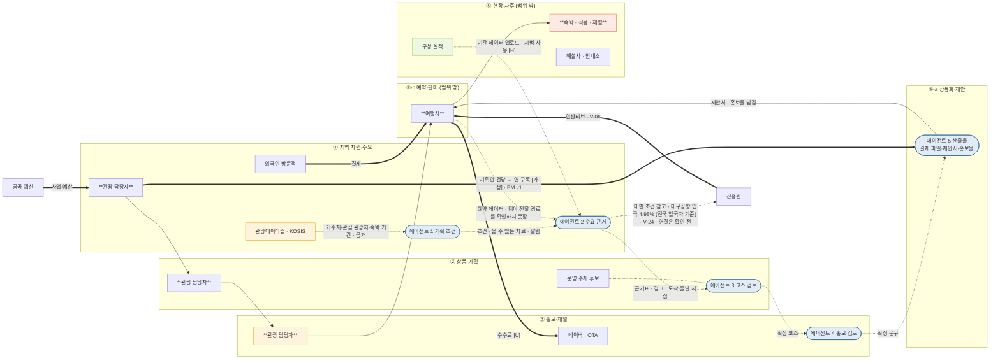

# 대구 체류 기획 도구 밸류체인 v3 (초안)

- 상태: 초안 v3.2 (2026-11-20, 사람1 보완). 팀 검토 전.
- v3.2 바뀐 점: ① 이 문서의 주장 범위를 "문서상 필요한 업무를 확인했고, 그 업무를 돕는 도구를 만들어 시험한다"로 정함 (4-0) ② 산업 단계(사람이 하는 일)와 에이전트 단계(도구가 하는 일)를 구분하고 ④를 ④-a 상품화 · 제안 / ④-b 예약 · 판매로 쪼갬 (2 · 3절) ③ 과업 문서 3건의 원문 문장과 쪽수를 직접 확인해 업무 옆에 붙임 (4-1) ④ 병목 제목을 단정하지 않는 업무 이름으로 바꾸고 사실 / 해석 / 가설을 나눔 (4-2) ⑤ 1 · 2단계 필요성을 보유 통계의 문제 3가지로 설명 (4-3) ⑥ 1 · 2단계 시험 계획 (4-6) ⑦ 현재 기능과 효과 구분 (4-7) ⑧ 7절 8번 추가
- v3.1 바뀐 점: ④에 에이전트 5단계(산출물 넘김) 배치 · ① 데이터에 사람1 근거(V-20~V-22) · 병목에 피치 1장 근거(과업 문서 원문 · PP-2a/3a/4a) · BM v1 돈 흐름 연결 · 피드백 경로를 시범 사용과 연결 (`발표/1118_피치구조_근거점검.html` 지적 반영)
- 기준: 담당자 · 에이전트 역할표 1~5단계 (WBS P.4), `inventory/유저플로우_v1.md`
- 이어받는 문서: `valuechain_v0.md`(5단계 흐름도), `inventory/밸류체인_v2.0.md`(7단계 · 단계별 근거), `stakeholders.md`, 01~05 노트
- 출처: 이 문서의 사실은 `00_출처_대장.md`의 V-ID로만 연결한다. v3.1에서 V-20~V-25를 추가했다.
- 표기: `[P]` 원문 확인 · `[U]` 미확인 · `[I]` 해석 · `[H]` 가설 (README 4절)

---

## 0. v3에서 바로잡는 방향

v0 · v2.0은 "우리 팀이 기획안을 만들어 구청에 납품한다"는 구조였다. 역할표 기준으로는 **담당자가 단계마다 고르고 확인하고, 에이전트는 그 단계를 보조**한다. v3는 이 차이를 맵에 반영한다.

| 항목 | v0 · v2.0 | v3 |
|---|---|---|
| 기획하는 사람 | 우리 팀 (기획안 납품) | **관광 담당자** (에이전트가 보조) |
| 고객 | 중구청 관광콘텐츠팀 고정 | **대구 관광 담당자 전반** (구 · 군청, 대구시, 관광재단). 중구청은 MVP 검증 사례 |
| 단계 체계 | v0 5단계 / v2.0 7단계로 갈림 | **5단계 하나** (v2.0 7단계는 아래 1절 표로 흡수) |
| 단계 순서 | v2.0은 홍보(정보·영감)가 기획보다 앞 (관광객 시점) | **기획 → 홍보** (상품을 만드는 쪽 시점. 담당자 도구이므로) |
| 우리 위치 | ③ 상품 기획 "주도" | ①~③에 **에이전트 1~4단계**, ④에 **5단계 산출물**(결재 파일 · 제안서 · 홍보물을 넘기는 데까지). 예약 · 판매 자체와 ⑤는 범위 밖 |
| 예산 · 발주 · 자격 | 밸류체인 관점 페이지로 정리 | 맵에는 **돈 흐름 화살표만** 남기고, "우리가 받을 수 있는 돈"은 BM(P.6)으로 넘김 |
| 치킨의 위치 | 초기 방향은 치킨 메인 → v2.0에서 음식 선택지로 | **저녁 선택 옵션 + 코스 곳곳의 요소**(해설 · 스토리 · 체험). 고정하지 않음 (아래 "치킨 결정" 참고) |
| 성과 측정 | 우리가 측정 방법 설계 (05 노트) | 에이전트 범위 밖. 담당자가 2단계에 기관 데이터를 올리는 것이 피드백 경로가 됨 `[H]` |

### 치킨 결정 (2026-11-18, 사람1)

- 처음에는 치킨을 메인으로 하려 했으나, 대구에 치킨 관련 인프라(체험 · 전용 공간 등)가 아직 부족하다고 봤다 `[I]`.
- 치킨 수요도 아주 높지는 않다. 외국인 추천 음식에서 치킨 1·2순위 합계 3.8% (V-13, `[U]` 원표 재확인 필요).
- 그래서 저녁 치킨을 **고정이 아닌 선택 옵션**으로 두고, 치킨은 코스 곳곳에 **요소**로 넣는다 (예: 장소 해설 · 스토리 · 체험이 있으면 포함).
- 3단계 코스 검토의 기본 코스에서도 저녁은 선택지 중 하나로 다룬다. 팀 `CLAUDE.md` 1절("저녁 = 치킨 기본값")은 이 결정과 다르므로 팀에 알린 뒤 고친다.

### 장기 목표: 치킨 비중은 인프라에 따라 올린다 `[H]`

- 최종 목표는 "대구 치킨" 하면 바로 떠오르게 하는 것이다. 지금 치킨을 선택지로 두는 이유는 인프라가 부족해서다.
- 치킨 비중은 단계로 올린다: ① 지금 — 요소 + 저녁 선택지 중 하나 → ② 상시 체험 · 상품이 늘면 — 저녁 추천 1순위(담당자가 바꿀 수 있음) + 낮 체험 후보 추가 → ③ 인지도가 생기면 — 치킨이 코스의 주제, 단 치킨 식사는 하루 1번까지.
- 어느 단계에서도 고정하지 않는다. 바뀌는 것은 추천 순서와 빈도뿐이고, 고르는 것은 늘 담당자다.
- 이 도구가 ② 상품 기획 단계에서 빈칸에 체험 · 해설을 제안하고 담당자가 실행하면 인프라가 늘고, 다음 단계로 올라간다. 단계를 넘어가는 기준 수치는 정하지 않았다.
- 축제 연계 (보류): 치맥페스티벌(달서구 두류공원) 연계 방식 후보는 ① 저녁 교체 ② 낮 방문 ③ 별도 연계 코스 세 가지다. 어느 방식이든 고른 구 밖 일정이다. 주관처 협의 필요 · 나중 검토.

---

## 1. 5단계와 v2.0 7단계 대응

| v3 단계 | v2.0 7단계에서 가져온 것 | 활동 |
|---|---|---|
| ① 지역 자원 · 수요 | ① 수요·동기 | 어떤 관광객이 언제 오는지, 쓸 수 있는 자료가 있는지 |
| ② 상품 기획 | ③ 상품 기획·패키징 + ⑤ 이동(동선 근거) | 낮 · 저녁 · 숙박 코스, 휴무 · 이동 시간 확인, 운영 주체 후보 |
| ③ 홍보 · 채널 | ② 정보·영감 | 국가 · 언어권별 문구, 홍보물, 채널 |
| ④ 예약 · 판매 | ④ 유통·예약 | 여행사 상품화, 예약 · 결제 |
| ⑤ 현장 · 사후 | ⑥ 현지 체류 + ⑦ 사후·성과 | 숙박 · 식음 · 체험, 해설 · 안내, 실적 집계 |

---

## 2. 단계별 맵 (역할표 1~5단계 배치)

**두 가지를 구분해서 읽는다.** 산업 단계 ①~⑤는 **사람이 하는 일**이고, 에이전트 1~5단계는 **도구가 하는 일**이다. 에이전트는 사람의 일을 대신하지 않고 옆에서 자료와 초안을 준다 (v3 0절).

| 산업 단계 (사람이 하는 일) | 담당 | 에이전트 단계 (도구가 하는 일) | 도구가 내놓는 것 |
|---|---|---|---|
| ① 지역 자원 · 수요 파악 | 담당자 | 1 기획 조건 · 2 수요 근거 | 볼 수 있는 자료 · 알림 / 근거표 · 경고 |
| ② 상품 기획 | 담당자 · 용역사 | 3 코스 검토 | 코스 · 충돌 표시 · 대체안 · 장소별 근거 |
| ③ 홍보 · 채널 | 담당자 · 홍보 대행 | 4 홍보 검토 | 장면별 문구 · 번역 초안 · 검토 필요 표시 |
| ④-a 상품화 · 결재 · 제안 | 담당자 · 여행사 | 5 산출물 | 결재 파일 · 제안서 · 홍보물 묶음, 세 파일 일치 검사 |
| ④-b 예약 · 결제 · 판매 | 여행사 · OTA | **없음 (범위 밖)** | — |
| ⑤ 현장 운영 · 사후 | 현장 운영 주체 · 구청 | **없음 (범위 밖)** | — |

- 경계 `[I]`: 5단계는 완성한 문서를 담당자 · 여행사에 넘기는 데서 끝난다. 결재 · 발주 · 예약 · 결제 · 판매는 하지 않는다 (`지침/5_산출물/출력.md` 96행과 같은 뜻).

아래 표는 위 구분에 돈 · 데이터를 더한 상세 맵이다 (v3.1 표를 ④-a / ④-b로 나눔).

| v3 단계 | 하는 사람 | 에이전트 단계 | 에이전트가 하는 일 | 돈 | 데이터 |
|---|---|---|---|---|---|
| ① 지역 자원 · 수요 | 관광 담당자, (관광데이터랩 · KOSIS) | **1 기획 조건 · 2 수요 근거** | 1: 조건(계절 · 언어권 · 지역 · 체류 기간)에 맞는 자료가 있는지 알림. 2: 기관 데이터 비교, 근거표(출처 · 연도 · 표본 · 한계) · 경고, 3단계로 대구 도착 · 출발 지점 넘김 | — | 거주지 국가 · 관심 관광지 (V-01, V-02 `[P]`), 방문율 (V-03 `[U]`), 무박 비율 — 6~8월 18.7% vs 다른 시기 6.2~6.6%, 중국 26.9%(n=141) · 일본 3.4%(n=83) (V-20 `[P]`), 평균 체류 2.3일 · 숙박 1.3박 (V-21 `[P]`), 입국 공항 비율 — 한국 입국 외국인 중 대구공항 0.72%(2024), 대만 4.98% · 일본 0.42% · 중국 0.28% (V-24 `[P]`, 분모는 전국 입국자), 대구 진입 교통수단 (V-25 `[U]`) |
| ② 상품 기획 | 관광 담당자 | **3 코스 검토** | 기본 코스(저녁 치킨은 선택 옵션), 휴무 · 영업시간 · 이동 시간 충돌 표시, 대체안, 장소별 근거 · 운영 주체 후보 | 공공 사업 예산 (금액은 다루지 않음) | 이동 시간 (V-15, V-16 `[U]`), 객실 수 (V-10) |
| ③ 홍보 · 채널 | 관광 담당자, (홍보 대행 · 플랫폼) | **4 홍보 검토** | 장면별 문구 · 번역 초안, 시안, 근거 없는 표현 걸러 내기 | 홍보비 `[U]` | 외국어 홍보물 현황 (V-04 `[P]`) |
| ④-a 상품화 · 결재 · 제안 | 관광 담당자(결재 · 발주), 여행사(제안 받는 쪽) | **5 산출물** | 1~4단계 결과를 결재 파일 · 제안서 · 홍보물로 묶고 세 파일의 코스 · 수치 · 경고를 대조. 새 수치 · 장소 · 문구는 만들지 않음 | 사업 예산 → 담당자(결재 · 발주). 건당 → 연 구독 `[가정]` (BM v1) | 결재 · 발주 문서 |
| ④-b 예약 · 결제 · 판매 | 여행사, (네이버 인바운드 · OTA) | 범위 밖 | — | 관광객 결제 → 여행사, 인센티브 (V-06, V-07, V-08 `[P]`), 수수료 `[U]` | 예약 · 판매 기록 (여행사 보유, `[U]`) |
| ⑤ 현장 · 사후 | 숙박 · 식음 · 체험 업체, 해설사 · 안내소, 구청(실적) | 범위 밖 | — | 숙박 · 현장 소비 | 실적 (안내소 방문자 · 투어 인원 · 스탬프, 구청 보유 `[U]`) |

- 해석 `[I]`: 에이전트는 **산업 흐름의 앞쪽(①~③)에서 담당자의 판단 시간을 줄이는 도구**다. ④에서는 5단계 산출물을 넘기는 데서 멈추고, 판매 · 현장은 여행사와 현장이 맡는다.
- 사실 `[P]`: 2024년 한국에 들어온 외국인의 67.3%가 인천공항, 7.2%가 김해공항으로 들어왔고 대구공항은 0.72%다 (V-24, 분모는 전국 입국자). 해석 `[I]`: 이 비율만으로 대구 방문 외국인이 어느 공항 · 교통수단으로 대구에 들어오는지는 판단할 수 없다. **대구 방문객의 실제 진입 경로는 미확인**이다 (대구까지의 교통수단은 V-25 `[U]`). 그래서 2단계는 **대구 도착 · 출발 지점**(동대구역 · 서대구역 · 대구공항 · 고속버스터미널)을 값이 있으면 넘기고, 없으면 "미확보"로 표시한다. 3단계는 이 지점으로 코스의 첫 · 마지막 구간을 정하되, 값이 없으면 가정이라고 표시한다.
- 사실 `[P]`: 대만 입국자의 4.98%가 대구공항으로 들어오고(다른 국적은 0.5% 미만), 김해공항도 24.6%다 (V-24, 2024). 한계: 분모가 대구 방문자가 아니라 전국 입국자다. 해석 `[H]`: 이 값이 ④의 대구공항 입국 인센티브(V-07)와 연결되는지, 대만 조건에서 연결이 의미 있는지는 **확인 전**이다. 다른 언어권에서는 피치에서 강조하지 않는다.

---

## 3. 흐름도

- 실선 `-->` 상품 · 활동, 굵은 선 `==>` 돈, 점선 `-.->` 데이터, `-.-x` 단절 (v0 표기 유지)
- 파란 둥근 상자: 에이전트 단계. 사람이 하는 일을 대신하지 않고 옆에 붙는다.

---

## 4. 업무 · 병목 · 기회 → 에이전트 단계 연결

읽는 법: 한 줄은 **업무 → 확인한 사실 → 팀의 해석 → 우리 기능 → 아직 확인하지 못한 것** 순서로 잇는다. "확인한 사실"은 `[P]` `[U]`, "팀의 해석"은 `[I]`, "확인할 가설"은 `[H]`다. 문서에서 확인한 업무와 담당자에게 물어야 할 불편을 섞지 않는다. 항목 이름은 확인된 문제처럼 보이지 않게 업무 이름으로 쓴다.

### 4-0. 이 문서가 주장하는 범위

서비스 기능을 제안하려고 "담당자가 힘들어한다"를 입증할 필요는 없다. 이 문서는 아래만 주장한다.

> 공개 과업 문서와 보유 자료에서 관광 기획에 필요한 조사 · 검토 업무와 자료의 기준 차이를 확인했다. 실제 담당자가 느끼는 어려움과 업무 우선순위는 직접 확인하지 못했다. 이번 MVP에서는 해당 업무를 재현한 과업으로 근거 정확성 · 누락 · 수행 시간을 시험하며, 결과는 팀원 대리 수행 범위로 한정한다.

- 과업 문서는 **해야 하는 업무와 절차**를 보여 준다. 불편의 정도, 기존 방식의 비효율, 도구의 유용성은 문서만으로 입증되지 않는다 (별도 확인 필요).
- 따라서 이 문서에서 "담당자가 어려워한다"는 `[H]`로만 쓴다.

### 4-1. 과업 문서에서 확인한 업무 (원문 확인 `[P]`)

PDF 원문을 직접 열어 문장과 쪽수(문서 하단 쪽번호)를 확인했다 (2026-11-20, 사람1). 파일은 이예진 브랜치 `정리본/나라장터/`에 있다. 세 문서 안에서만 확인했고, 다른 공고는 이 표에 없다.

| 문서 (쪽) | 원문 문장 (짧게) | 뒷받침하는 업무 | 우리 기능 | 이 문장이 뒷받침하지 않는 것 |
|---|---|---|---|---|
| 2025 동성로 타임워프 페스타 과업요청서 (p.5) | "세부 운영계획은 중구와 협의하여 최종 확정" | 용역사가 낸 운영계획을 발주처와 협의해 확정하는 업무 (p.8 "모든 축제 운영에 관한 사항은 발주처와 협의하여 결정 및 추진", p.9 의견이 다르면 "발주처의 의견을 우선") | 3 코스 검토 | 협의에 시간이 많이 든다는 것 |
| 같은 문서 (p.4, p.6) | "외국인 관광객 유치를 위한 홍보방안 외국인 맞춤형 콘텐츠 마련", "외국인 대상 참여 유도 문구 다국어 제작 및 안내요원 배치" | 외국인 대상 홍보 · 다국어 문구를 요구하는 업무 | 4 홍보 검토 | 번역이 어렵다는 것 |
| 2025 중구 SNS 홍보관리 및 운영용역 제안요청서 (p.6) | "담당자의 검수 후 제작을 완료하며 사업수행자는 담당자의 수정요구가 있을 경우 수정, 보완을 거쳐 제작 완료함" | 담당자가 제작물을 검수하고 수정을 요구하는 업무. **이 문장은 모바일 소식지 제작 항목(p.6)에 속한다.** 모든 홍보물에 적용되는지는 이 문서에서 확인하지 못했다 | 4 홍보 검토 (검토 필요 표시) | 검수에 시간이 많이 든다는 것, 모든 홍보물이 같은 절차라는 것 |
| 2025 대구 스마트관광 애플리케이션 운영 및 활성화 과업이행요청서 (p.2, p.5) | "5개 언어 지원(한국어, 영어, 일어, 중문간체 및 번체)", 다국어(한국어 · 영어 · 일본어 · 중국어 간체 · 번체) 문의 대응 | 언어별 관광 정보와 문의 응대를 운영하는 업무 (앱 운영 사업) | 4 홍보 검토 (언어권별 문구) | 이 사업이 관광정보를 "관리"하는 업무까지 요구하는지는 텍스트에서 해당 문구를 찾지 못했다 (미확인) |

- 위 문서들은 "다국어 홍보를 요구한다 · 협의 · 검수 절차가 있다"는 **업무의 존재**를 보여 준다. 담당자가 번역 때문에 어려움을 겪는다거나 기존 방식이 비효율적이라는 증거는 아니다.
- 이예진 브랜치 `AsIs_ToBe_비교표_v1_초안.md` 3-2의 인용문과 대조했다. 그 표의 "운영계획은 중구와 협의하여 최종 확정"은 원문의 "세부 운영계획은 중구와 협의하여 최종 확정"에서 "세부"가 빠진 인용이다. 이 문서는 원문대로 쓴다.
- 나머지 공고(동구 봄축제, 동구 유튜브 과업지시서, 빛 축제 등)의 문구는 아직 원문을 열지 않았다 (V-22의 해당 부분은 2차 인용 상태).

### 4-2. 업무별 연결 (B 병목)

| 업무 | 확인한 사실 `[P]/[U]` | 팀의 해석 `[I]` | 우리 기능 (단계) | 확인하지 못한 것 `[H]` | 검증 상태 |
|---|---|---|---|---|---|
| **조건별 자료 비교** (PP-2a) | 4-3의 보유 통계 문제 3가지. 숙박 유형 n=898 · 선택 이유 n=822로 대상이 다르다 (원본 확인 2026-11-20). 보고서 값과 원자료 계산값이 어긋난 사례는 확인 전 (`지침/2_수요근거/경고.md`). 기관별 방문객 산정 기준 차이: V-23 PP-2a `[U]` | 출처 · 기간 · 대상 · 단위가 달라 한 표로 맞추는 작업이 필요하다 | 2단계 근거표(출처별 병기) · "쓰지 않는 수치" 목록 · 경고 | 실제 담당자가 이 작업에 어려움을 느끼는지. 근거표가 확인 시간을 줄이는지 | 문제 일부 확인. 기능은 11/19에 2회 실행 (4-7). 시간 절감은 측정 전 |
| **조건을 좁힌 수치의 표본 확인** | 근거 대부분이 2024 한 해(n=1,010). 중국 응답자 n=141, 무박 비율 26.9% (V-20 `[P]`, 원문 미재확인). 일본 거주 숙박자 n=80 (11/19 실행) | 141 × 26.9% ≈ 38명은 **계산값**이다. 사례수가 가중치 값이면 실제 무박 응답자 수와 다를 수 있어 **실제 무박 응답자 수는 확인 전**이다 | 2단계 표본 표시 · "표본 작음" 경고 (100명 미만은 **시험값**, 팀 확정 전) | 연도별 자료나 기관 실적을 모은다고 표본을 바로 합칠 수는 없다. 조사 대상 · 질문 · 방식이 같은지 확인하는 것이 먼저다 (7절 5번) | 경고 기준값 미확정 |
| **기존 상품과의 겹침 확인** (PP-3a) | 일부 보도에서 비비드 동성로 투어의 참여 인원 2명과 노선 중복 · 홍보 부족을 언급했다 (V-04, 원페이지). 참여 실적은 다른 기사와 상충하고 구청 실적은 미확보 (`발표/1118_피치구조_근거점검.html` E-04). **중구청 공식 페이지(확인일 2026-11-16)**: 골목투어 1~5코스 정기투어는 매월 토요일 오전 · 오후만 확인되고 야간 표기는 없다. 최소 인원 기준이 코스 페이지(10명)와 1 · 2코스 페이지(15명)에서 다르다 (`research/place_tour/중구_골목투어_코스_신청.md`). 근대골목 스탬프는 현행 운영 여부 · 운영 기간 · 완주 기준 · 기념품이 `[U]`이고 할인 기준은 2023년 자료 (`onepagers/jung_stamp_tour.md`) | **부진 원인은 확정하지 않았다.** 노선 중복 때문에 참여자가 2명이었다는 인과는 확인되지 않았다. 공개 페이지에 정보가 없는 것과 구청 내부에 없는 것은 다르다 | 3단계 겹침 경고(E7) | 이 업무를 담당자가 어려워하는지. 중구 외 구 · 군 상품은 확인하지 않았다 | 사례 보도 확보, 실적 · 원인 확인 필요. 공개 정보의 운영 기간 공백은 중구 골목투어 · 스탬프 범위에서만 확인 |
| **언어권별 홍보 정보 확인 · 작성** (PP-4a) | 4-1의 과업 문서가 다국어 · 외국인 대상 홍보를 요구한다. 일부 투어 · 안내소는 영문 팸플릿만 있다 (대구일보 2026.06.11, V-04). 중구청 골목투어 1~5코스 페이지에 언어 지원 표기가 없고 외국인 대상 신청 절차도 명시가 없다 (확인일 2026-11-16). 한국관광공사의 영 · 일 · 중 투어 안내(2차)는 조건이 달라 확정 언어 지원으로 쓰지 않았다. 중간체 · 중번체 홍보물 유무는 미확인 | "표기가 없다"는 "지원하지 않는다"가 아니다. 지원 여부는 중구청 확인이 필요한 미확인 항목이다 | 4단계 문구 · 번역 초안 · 미검토 번역 표시 | 번역 초안을 사람이 어디까지 고치는지. 이 업무가 어렵다는 것 | 업무 존재는 문서로 확인. 실제 언어 지원 여부는 중구청 문의 필요 |
| **운영시간 · 이동시간 확인** | 운영정보 자료는 있다: `research/place_tour/중구_관광지_운영정보.md` (이번에 내용을 다시 열지는 않음). 이동 시간 값(V-15, V-16)은 `[U]` | 정보가 있느냐(보유 자료로 확인할 문제)와 담당자가 이 확인에 어려움을 겪느냐(인터뷰 등으로 확인할 가설)는 다른 문제다 | 3단계 휴무 · 영업시간 · 이동 시간 충돌 표시 · 대체안 | **담당자의 불편은 확인 전**이다. "담당자가 어려워한다"를 사실로 쓰지 않는다 | 운영정보 보유는 확인 필요(내용 미재확인) / 담당자 불편은 가설 |

### 4-3. 1 · 2단계가 필요한 이유 — 보유 통계에서 확인된 문제

담당자의 감정이 아니라 보유 통계자료의 구조로 설명한다 (모두 KOSIS 대구관광실태조사 2024 외국인 정리본 · 원본 확인).

| 문제 | 확인한 내용 | 1 · 2단계가 하는 일 |
|---|---|---|
| 자료별 조사시기와 지역 범위가 다르다 | 조사시기는 4~5월(1기) · 6~8월(2기) · 9~10월(3기) · 11~12월(4기)로 나뉘어 3월 값이 없다 (`지침/공통/데이터_목록.md`). 지역은 대구 전체만 있고 구 구분이 없다 | 1단계가 조건에 맞는 자료와 빠진 곳(예: 3월 없음, 구 구분 없음)을 알린다 |
| 국가별 · 시기별 값은 있지만 두 조건을 함께 나눈 값은 없다 | `category`별(조사시기 · 거주국가 · 체류 여부 등)로 따로 나뉘어 있고, 예컨대 "봄 일본인"처럼 교차한 값은 없다 | 2단계가 두 조건을 한 값으로 합치지 않고 따로 병기하며 한계를 적는다 |
| 질문마다 표본 수가 다르다 | 숙박 유형 n=898 (숙박자 전체), 숙박 선택 이유 n=822 (친척/친구집만 이용한 경우 제외). 일본 거주 숙박자는 둘 다 n=80 | 2단계가 자료마다 해당 표본을 따로 표시하고 통일하지 않는다 |

### 4-4. 비용 · 기회 · 단절

| 마커 | 내용 | 근거 | 받는 에이전트 단계 |
|---|---|---|---|
| C 비용 | 현장 체크인 · 스탬프 운영 비용 (방식에 따라 다름) | 04 노트, V-11 · V-18 | 범위 밖 (3단계는 운영 주체 후보만) |
| O 기회 `[H]` | 담당자가 실적 데이터를 2단계에 올리면 다음 기획의 근거가 됨. 중구 시범 사용 1건(피치 7장 요청)이 첫 확인 기회 | 05 노트 4절 | 2단계 비교 확인 |
| O 기회 `[가정]` | 5단계 산출물이 담당자의 결재 · 발주 문서가 되어 사업 예산 → 우리 도구 돈 흐름(BM v1 건당)의 근거가 됨 | `정리본/BM_v1_초안.md` 2 · 5장 | 5단계 |
| 전달 경로 미확인 `[U]` | 팀이 확인한 자료에서는 여행사 예약 · 판매 데이터가 기획 쪽으로 전달되는 경로를 확인하지 못했다 (v2.0 5절, 원문 재확인 전). 기관 내부에서 실제로 활용하는지는 별개이며 확인하지 않았다 | v2.0 5절 | 범위 밖 (확인 필요 유지) |

### 4-5. 우리 서비스의 역할 (받는 것 · 주는 것)

실제 항목은 `지침/` 각 단계 파일과 `지침/공통/단계_넘김.md` 초안을 따른다.

| 단계 | 앞 단계에서 받는 것 | 담당자가 추가하는 것 | 도구가 주는 것 | 하지 않는 것 |
|---|---|---|---|---|
| 1 기획 조건 | (처음 단계) | 계절 · 언어권 · 지역 · 체류 기간 | 볼 수 있는 자료 · 부족한 자료 · 진행 전 알림 | 수치 해석 |
| 2 수요 근거 | 선택 조건 · 자료 목록 · 알림 | 기관 데이터(CSV · XLSX) 또는 "없음" | 근거표(출처 · 연도 · 표본 · 한계) · 경고 | 코스 · 장소 선택 |
| 3 코스 검토 | 확정 조건 · 근거표 · 경고 | 시작 · 종료 지점과 시각, 치킨 선택 여부 | 시간별 코스 · 충돌 · 대체안 · 장소별 근거 | 업체 섭외 · 계약 |
| 4 홍보 검토 | 확정 코스 · 장소 근거 · 경고 | 언어 · 톤 | 장면별 문구 · 번역 초안 · 검토 필요 표시 | 새 사실 만들기 |
| 5 산출물 | **확정 조건 · 근거 · 코스 · 문구 · 경고 전체** (4단계 문구만이 아니라 앞 단계의 확정 결과를 모두 묶는다) | 받는 쪽 · 양식 | 결재 파일 · 제안서 · 홍보물, 세 파일 일치 검사 | 결재 · 발주 · 예약 · 판매 |

### 4-6. 1 · 2단계 시험 계획 (팀원 대리 수행)

사람1 담당 1 · 2단계만 먼저 시험한다. 각 과업의 **정답과 주의사항을 시험 전에 적어 두고** 직접 자료를 찾는 방식과 도구를 쓰는 방식을 비교한다. 아래 정답은 보유 정리본 CSV 기준 초안이며, 시험 전에 원표로 다시 확인한다.

| 시험 과업 | 정답 (초안) | 확인할 결과 · 주의사항 |
|---|---|---|
| 일본 관련 숙박 수치 찾기 | 일본 거주 숙박자 n=80: 숙박 유형 관광호텔 93.6%, 선택 이유 동반자 유형 및 규모 48.9% · 교통 및 접근성 30.1% (KOSIS 2024) | 수치 · 표본 · 출처 위치가 맞는가. 표본 80으로 작고 2024 한 해 · 대구 전체라는 한계를 같이 적는가 |
| 봄 자료와 일본 자료 비교하기 | 봄은 `4~5월(1기)` (숙박 유형 n=205, 선택 이유 n=170, 3월 값 없음), 일본은 거주국가 n=80. 두 조건을 함께 나눈 값은 없다 | "봄 일본인" 교차통계처럼 합치지 않는가. 3월 없음을 알리는가 |
| 중구 숙박 자료 요청하기 | 외국인 숙박 실태 자료는 대구 전체만 있고 구 구분이 없다 | 대구 전체 값을 중구 값으로 제시하지 않고 한계를 알리는가. 중구의 다른 숙박 자료(숙박업 목록 등)는 외국인 숙박 수치가 아니므로 섞지 않는가 |

**기록은 세 가지만**: ① 완료까지 걸린 시간 ② 틀리거나 빠진 항목 ③ 사람이 고쳐야 했던 내용.

**순서 · 익숙함 기록**: 같은 사람이 같은 문제를 두 번 풀면 두 번째가 빨라질 수 있다. 시험한 사람이 자료를 이미 알고 있었는지, 직접 방식과 도구 방식 중 무엇을 먼저 했는지, 과업별로 순서를 번갈아 했는지 함께 적는다.

**범위 한정**: 소규모 시험 결과를 실제 담당자 전체의 효과로 확대하지 않는다. 팀원 대리 수행이므로 "담당자의 시간 절감"은 측정하지 않고 미확인으로 유지한다.

### 4-7. 현재 기능과 이후 효과

"한 번 실행됐다"와 "기능이 검증됐다"는 다르다. 실행 범위와 검증 범위를 나눠 적는다.

| 구분 | 상태 (2026-11-20) | 기록 위치 |
|---|---|---|
| 1 · 2단계 실행 기록 | 11/19 조건 세트 A(봄 · 일본어 · 중구 · 1박2일)로 **2회 실행**. Claude Code 채팅의 단계별 에이전트로 했고 `app/` 오케스트레이터로는 아직 실행하지 않았다 (로그인 만료) | 1회차 `inventory/참고/1119_MVP실행_조건세트A_사람1.md`, 2회차 `발표/1119_피칭데이/1119_MVP결과화면_2회차_사람1.html` · `1119_하루하루_MVP실행결과.pdf` (신민지 브랜치) |
| 원표 대조 | 1회차 수치 중 **2건**을 사람이 원자료와 대조해 일치. 나머지(치킨 3.8% 등)는 정리본 확인 단계 | 발표자료 11장 |
| 오류 발견과 수정 | 1회차에서 "숙박 유형 · 선택 이유에 체류 여부 행 없음" 오류를 사람이 발견, 2회차에서 에이전트가 원인을 짚음. 지침 수정 완료 (`a9dfb57`, 2026-11-20) | `지침/1_기획조건/자료_고르기.md` |
| 수정 후 재시험 | **대기** (로그인 문제) | — |
| 웹 연결 | 현재 코드는 터미널 실행(`app/`). 웹 연결 상태는 이 문서 작성 시점에 확인하지 못했다 (사람1 확인 필요) | — |
| 3 · 4 · 5단계 | 지침 작성 중 · 실행 전 | — |
| 1 → 2 → 3 연결 | 넘김 형식 초안 (`지침/공통/단계_넘김.md`) | 설계 단계 |

| 효과 | 확인 방법 | 시기 · 상태 |
|---|---|---|
| 근거 확인 시간이 줄어드는가 | **팀원 대리 수행**에서 같은 과업을 기존 방식과 도구 방식으로 수행해 시간 비교 (4-6) | 시나리오 테스트(이번 범위), 측정 전. **실제 담당자의 시간 절감은 측정하지 않으며 미확인** |
| 코스를 보고 숙박하고 싶어지는가 | 이후 관광객 설문으로 의향 확인 | 이후, 방법 미확정 |
| 실제 체류 · 숙박이 늘었는가 | 이후 시범 운영의 실제 행동 자료 | 이후 |
| 실적 데이터가 다음 기획의 근거로 돌아오는가 | 중구 시범 사용 1건(피치 7장 요청) | 가설 `[H]` |
| 수익 (BM) | 건당 → 연 구독 | 가정 |

- 설문에서 의향이 높아져도 실제 체류 증가가 확인된 것은 아니다. 이번 범위는 시범 운영을 하지 않는다 (기획서 10장).
- 발표 · 문서에서 시간 절감 · 체류 증가 · 실적 피드백을 현재 기능처럼 쓰지 않는다. 현재 기능은 "1 · 2단계 2회 실행, 일부 수치 대조, 재시험 대기"까지다.

---

## 5. 기존 자료를 어디로 보내나

| 자료 | v3에서 | 비고 |
|---|---|---|
| 01 수요 · 홍보 | ① · ③ 근거 (1 · 2 · 4단계) | 그대로 사용 |
| 02 상품 · 이동 · 체류 | ② 근거 (3단계) | 이동 시간은 WBS 1.5 장소 운영 정보 시트로 연결 |
| 03 유통 · 인센티브 | ④ 근거 (범위 밖 설명용) | 여행사 = 실행 파트너. 3단계 운영 주체 후보에 일부 사용 |
| 04 스탬프 운영 | ⑤ 근거, 운영 주체 후보 | WBS 2.2 운영 주체 후보 지식으로 넘김 |
| 05 성과 측정 | ⑤ → ① 피드백 경로만 | 측정 설계는 에이전트 범위 밖으로 표시 |
| `stakeholders.md` | 단계별 이해관계자 | 아래 6절대로 고침 (별도 커밋) |
| `pages/viewpoints/` 예산 · 발주 · 자격 | **BM(P.6)으로 넘김** | 맵에는 돈 흐름 화살표만. 수익 판단은 BM 문서에서 |
| `pages/viewpoints/` 수요 · 운영 · 파트너 | ① · ⑤ · ④ 설명 보조 | 그대로 연결 |
| `onepagers/` 9건 | 사례 근거 | 3단계 운영 주체 후보 · 4단계 홍보 사례로 사용 |

---

## 6. 따라 고칠 곳 (이 초안에서는 고치지 않음)

1. `stakeholders.md`: ② 상품 기획의 "하는 사람"을 우리 팀 → 관광 담당자로. "중구청 관광콘텐츠팀"은 "구 · 군청 관광 부서 (MVP 사례: 중구청)"로.
2. `valuechain_v0.md`: "v3로 대체됨" 표시. 지우지 않는다.
3. `inventory/밸류체인_v2.0.md`: 7단계 표 위에 "v3 5단계로 흡수" 표시.
4. `pages/index.html` 허브: v3 링크 추가, 예산 · 발주 · 자격 관점에 "BM 근거" 표시.

---

## 7. 확인 필요

1. **치킨 결정 공유**: 0절 "치킨 결정"을 팀에 알리고, `CLAUDE.md` 1절과 3단계 코스 검토 지침(사람2)에 반영한다. — 담당: 사람1(공유), 사람2(3단계 반영)
2. **사업 예산 금액은 다루지 않음**: v0 흐름도의 "사업 예산 1,500여만 원"은 출처 대장에 V-ID가 없고, 금액은 밸류체인에서 고려하지 않기로 했다(2026-11-18). 맵에는 "공공 예산 → 담당자" 흐름만 남긴다.
3. **피드백 경로** `[H]`: 담당자가 올리는 기관 데이터에 실적(안내소 방문자 · 투어 인원 · 스탬프)이 포함되는지 2단계 `입력.md`와 맞춰 본다. 중구 시범 사용 1건(피치 7장 요청)에서 실제로 받을 수 있는지 확인한다. — 담당: 사람1
4. **도착 경로**: (2026-11-19) V-24로 입국 공항 비율은 확인했다 (대구공항 0.72%, 대만 4.98%). 남은 것: ① 대구 방문 외국인 기준 비율이 아니라는 한계 — 대구관광실태조사에 입국 공항 문항이 있는지 KOSIS에서 찾기 ② 대구 진입 교통수단(V-25) 자료 찾기. 없으면 "자료 없음"으로 둔다. 3단계 `2_입력.md` 5장의 "출입국 경로" 항목 이름을 "대구 도착 · 출발 지점"으로 맞추도록 사람2에게 알린다. — 담당: 사람1
5. **데이터 구분과 표본 경고는 별개** `[H]`: 지금 근거는 거의 2024 실태조사 한 해(n=1,010)라 조건을 나누면 대부분 표본이 작다 (V-20 예: 중국 응답자 n=141). ① **표본 경고** — 응답자 수가 작은 값에 "표본 작음"을 단다 (기준값은 시험값, 팀 확정 전). ② **데이터 구분** — 자료를 고정 데이터(한 번 발표된 자료, "참고용") · 누적 데이터(해마다 · 달마다 새로 나오는 자료) · 사용하며 쌓는 데이터(담당자가 올리는 실적)로 나눠 상태로 표시한다. 두 가지는 서로 대신하지 않는다. **연도별 자료를 합쳐 표본을 키울 수 있는지는 확인 전**이다. 조사 대상 · 질문 · 방식이 같은지 확인한 뒤에야 판단하며, 확인되지 않은 자료는 합치지 않는다. 2단계 근거표 · 경고 지침에 반영할지 팀 결정. — 담당: 사람1
6. **과업 문서 원문 인용(V-22)**: 타임워프 · 중구 SNS(2025) · 스마트관광 과업 문서 3건은 PDF 원문과 쪽수를 직접 확인했다 (4-1, 2026-11-20). 나머지 공고는 예진 As-Is 비교표 3-2의 인용을 옮긴 것이며 PDF 원문은 재확인 전이다. 인터뷰가 아니므로 "담당자 목소리"가 아니라 **과업 문서 근거**로 부른다 (인터뷰 = 1차 근거, 과업 문서 = 2차 근거).
7. V-03, V-10, V-13 원표 재확인 (00 대장 메모 유지).
8. **v3.2 확인 필요** — 담당: 사람1
   - V-22: 타임워프 · 중구 SNS(2025) · 스마트관광 과업 문서 3건은 PDF 원문과 쪽수를 직접 확인했고 `00_출처_대장.md` V-22 행에 반영했다 (2026-11-20). 나머지 공고(동구 봄축제 · 유튜브 · 빛 축제 등)는 아직 2차 인용 상태다.
   - V-04 · V-20 · V-23 원문은 이번에도 다시 열지 않았다.
   - "담당자가 어려워한다"는 인터뷰 또는 시범 사용 전에는 `[H]`로 둔다. 불편의 정도와 도구의 유용성은 과업 문서를 더 모아도 입증되지 않는다.
   - 4-6 시험 계획의 정답 초안은 시험 전에 원표와 다시 대조한다.
   - 표본 작음 기준(100명 미만 · 연도별 2배)은 시험값이며 팀 확정 전.
