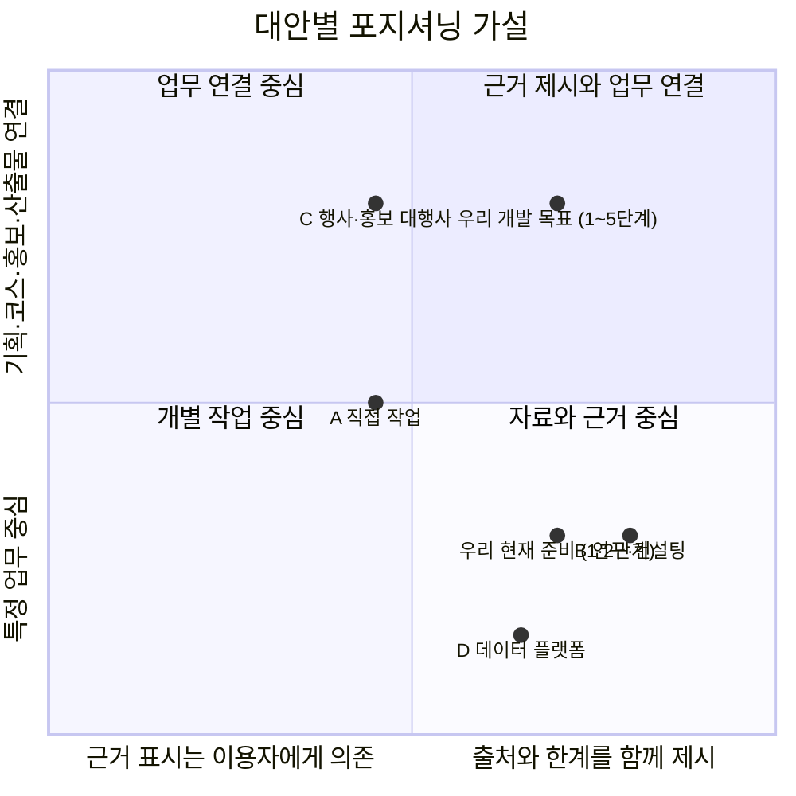

# 시장 검증 v1.1 초안 — 경쟁 비교 · 포지셔닝 · SOM

> **복사본 안내**
> - 원본: 이예진 브랜치 `정리본/시장검증_v1_초안.md`
> - 원본 커밋: `615aabd` (2026-11-18 17:37:45 +0900, "시장검증 초안에 대구시 예산 원문 대조 결과 반영")
> - 원작성자: JJi_ning (문서 담당 표기 "사람2")
> - 복사 · 수정: 신민지 브랜치, 사람1, 2026-11-18. 원본은 고치지 않았습니다.
> - v1.1에서 바꾼 곳: (1) 기준을 1~5단계로, (2) 2장 비교표에 산출물 행 추가, (3) 3장 포지셔닝 맵을 4분면(가운데 0, 양 끝 −/+)으로 다시 그리고 Y축을 "기획 → 코스 → 홍보 → 산출물"로, 점 위치를 2장 판정 점수로 매김, (4) 5-1 N에 대구전통시장진흥재단 각주(N은 11 유지), 8장에 재단 발주기관 여부의 문서 간 차이 추가, (5) 2026-11-19: 3장을 "검증할 포지셔닝 가설"로 바꿈 — 3-4 그림을 발표용 정성 배치(우리 현재 준비 1·2단계 → 개발 목표 1~5단계, 대행사 위쪽)로 바꾸고 3-2 우리 점수 행을 뺌, 3-5 "왜 비어 있나" 표 · 3-6 발표용 비교표 추가, 8장에 검증 질문 · 판정 기준 추가. 나머지 장은 원본 그대로입니다.

- 상태: **초안**. 팀 검토 전.
- 작성일: 2026-11-18 (기획서 P.7, 6~8일차 작업을 먼저 시작)
- 담당: 사람2
- 쓰는 곳: 피치 3장(시장). BM(P.6, 사람1)과 단가 · 수익 방식을 맞춰야 함
- 기준: 우리 서비스 = **대구 관광 담당자가 쓰는 체류 기획 도구**(1~5단계: 기획 조건 → 수요 근거 → 코스 검토 → 홍보 검토 → 산출물). 관광 상품 자체가 아님. 그래서 경쟁 상대도 "관광 상품"이 아니라 **담당자가 지금 기획을 해내는 방법**입니다.
- 근거 표시: [P] 원문 확인 · [F] 팀 자료 기재(원문 미대조) · [I] 해석 · [H] 가설 · [U] 미확인 · [가정] 팀이 정할 값을 임시로 둔 것
- 금액: 공고 문서 기재값 그대로. 추정가격 · 배정예산 · 사업금액 · 기초금액은 서로 다른 기준이라 구분해서 적었습니다. 실제 계약금액이 아닙니다.

> **이 문서의 한계:** 담당자의 구매 의향과 지불 의사는 아직 한 번도 확인하지 않았습니다(인터뷰 0건). 아래 시장 규모는 "지금 이 일에 돈이 얼마나 쓰이는가"이고, "우리 도구를 살 것인가"는 아닙니다.

## 0. 한눈에 보기

| 질문 | 지금 답 | 근거 수준 |
|---|---|---|
| 누가 이미 이 일을 하나? | 담당자 직접 작업, 연구 · 컨설팅 용역, 행사 · 홍보 대행사, 공공 데이터 플랫폼 | 2장 표. 발주 문서 [P], 비교 판단은 [I] |
| 빈자리는 어디인가? | **가설:** 근거(출처 · 한계)를 붙인 채로 기획 → 코스 → 다국어 홍보 초안까지 잇는 도구가 없다. 빈자리가 기회인지 과잉인지는 아직 검증 전 (3-5) | [H] |
| 돈이 쓰이는 곳은? | 대구 구 · 기관의 관광 홍보 · 축제 · 운영 용역 2026년 확인분 12건, 사업당 5,000만~3억 원 | 4장 [P · F] |
| 우리가 얻을 몫(SOM)은? | 계산식은 세움. 단가와 채택률은 팀 결정 전이라 범위로만 제시 | 5장 [가정] |

---

## 1. 담당자가 지금 기획을 해내는 방법 (경쟁 대안)

| # | 대안 | 누가 | 비용 단서 | 근거 |
|---|---|---|---|---|
| A | 담당자 직접 작업 | 관광과 · 문화 부서 담당자 | 내부 인건비 (금액 미확인) | 업체 계획을 "협의하여 최종 확정", 콘텐츠 "검수 후 … 수정요구" [P 과업 문서] |
| B | 연구 · 컨설팅 용역 | 한국문화관광연구원, 대학 산학협력단, 컨설팅사 | 문체부 2026 관광 연구용역 4,000만~18억 원대 (추정가격) | `공공예산_용역발주_조사_2026.md` 2장 [F]. 예: K-푸드로드 문화관광 활성화 추진방안 연구 54,545,455원, 관광분야 민관협력 사례조사 40,909,090원 |
| C | 행사 · 홍보 대행사에 기획까지 맡김 | 축제 대행사, SNS · 영상 운영사 | 사업당 5,000만~3억 원 (4장) | 축제 용역이 "외국인 참가자 유치를 위한 홍보방안 마련", "다국어 홍보 방안"을 업체 제안으로 요구 [P]. 같은 업체가 여러 홍보 용역에서 반복 1위 (피앤알커뮤니케이션) [F] |
| D | 공공 데이터 플랫폼 직접 조회 | 담당자가 한국관광 데이터랩 등을 조회 | 이용 무료. 2026 데이터랩 운영 용역 추정가격 3,506,500,000원 | `공공예산_용역발주_조사_2026.md` [F] |
| E | 범용 생성형 AI | 담당자 개인 | 개인 구독 (미확인) | 담당자 사용 여부 근거 없음 [U]. 비교를 위해 넣은 후보 [I] |
| (참고) | 관광객용 앱 · 플랫폼 | 대구트립 앱, Klook 등 | 대구트립 운영 · 활성화 기초금액 224,400,000원 [P] | 관광객이 쓰는 도구라 담당자 기획 도구와 직접 경쟁하지 않음 [I]. 장소 데이터(POI DB)를 가진 연계 대상 후보 [I] |

## 2. 경쟁 비교표 (기획 도구 기준)

비교 기준은 페인포인트 문서(`정리본/painpoint_def.md`)의 Top 페인포인트에서 가져왔습니다. 칸의 판단은 대부분 해석 [I]입니다.

| 기준 (관련 PP) | A 직접 작업 | B 연구 · 컨설팅 | C 대행사 제안 | D 데이터 플랫폼 | E 범용 AI | **우리 도구** |
|---|---|---|---|---|---|---|
| 근거에 출처 · 기간 · 표본 · 한계를 붙이는가 (PP-2a) | 담당자 역량에 달림 | 보고서 형태로 붙음 | 평가 항목에 근거 표기 요구 없음 [P 평가표 기준] | 원자료는 주지만 비교 · 한계 판단은 이용자 몫 | 출처 신뢰 보장 안 됨 | 수치마다 붙이고, 약하면 경고(E2 · E3) |
| 데이터 공백을 드러내는가 (PP-2b) | 드러나지 않기 쉬움 | 보고서에 한계로 적힘 | 다루지 않음 | 없는 값은 안 나옴 | 빈칸을 그럴듯하게 채울 위험 | "없음"을 한계로 표시 |
| 운영 조건 충돌을 확인하는가 (PP-3b) | 직접 확인 | 범위 밖인 경우 많음 | 행사장 운영은 확인, 코스 전체는 범위 밖 | 없음 | 보장 안 됨 | 휴무 · 영업시간 · 이동 대조(E4) |
| 기존 상품과의 중복을 확인하는가 (PP-3a) | 담당자 기억 · 내부 협의 | 조사 범위에 따라 다름 | 요구 없음 | 없음 | 없음 | 기존 상품 겹침 표시(E7) |
| 다국어 홍보 초안까지 잇는가 (PP-4a) | 별도 번역 · 발주 | 범위 밖 | 업체 제안에 달림 | 없음 | 번역은 가능, 장소 사실 검증 없음 | 장면별 문구 · 번역 초안 |
| 코스가 바뀔 때 (PP-4b) | 전체를 다시 확인 | 다시 발주 | 담당자가 다시 검수 · 수정요구 [P] | — | 다시 생성 | 바뀐 장면만 표시(E6) |
| 결재 파일 · 제안서 · 홍보물로 묶는가 (5단계, v1.1 추가) | 2장 판정 없음 [U] | 2장 판정 없음 [U] | 2장 판정 없음 [U] | 2장 판정 없음 [U] | 2장 판정 없음 [U] | 세 파일로 묶고 코스 · 수치 · 경고 대조 (`지침/5_산출물/`) [H] |
| 걸리는 시간 | 담당자 업무 시간 | 수개월 (연구 용역 과업기간) [I] | 계약 후 수개월 [P 과업기간 90~210일] | 즉시 (조회만) | 즉시 | 수일 안 (목표) [H] |
| 결정권 | 담당자 | 담당자가 보고서 채택 | 담당자 승인권 [P] | 담당자 | 담당자 | 담당자 (에이전트는 표시 · 제안만) |

**읽는 법 (제안):** 우리 도구는 B(연구)의 "근거 붙이기"와 C(대행사)의 "홍보까지 이어지는 실행 범위"를 담당자가 직접, 짧게 할 수 있게 합니다. B · C를 없애는 것이 아니라, 발주 전 기획과 업체 제안을 검토할 기준을 담당자 손에 쥐여 주는 위치입니다 [I]. 담당자가 업체 제안을 평가하고 검수하는 역할(`정리본/페르소나_v1_초안.md` 1-2)과 이어집니다.

## 3. 검증할 포지셔닝 가설 (축은 팀 결정)

이 장은 **우리가 경쟁에서 앞선다는 지도가 아니라, 검증할 가설**입니다. "근거를 붙인 채로 기획부터 산출물까지 잇는 자리가 비어 있고, 담당자에게 그 자리가 필요하다"는 가설을 그림으로 놓고, 무엇을 확인하면 맞고 틀린지를 3-5와 8장에 적었습니다. 점 위치는 2장 판정을 옮긴 것이고 측정값이 아닙니다.

기획서에 "포지셔닝 축은 팀이 정함"으로 되어 있어 후보 3쌍을 냅니다.

| 후보 | X축 | Y축 | 장점 | 약점 |
|---|---|---|---|---|
| **① (추천)** | 근거 표시 수준 (− 출처 · 한계 표시 없음 ↔ + 수치마다 표시) | 연결 범위 (− 한 단계만 ↔ + 기획 → 코스 → 홍보 → 산출물을 이음) | Top 페인포인트(PP-2a, PP-3a, PP-4a)와 바로 연결 | 두 축 모두 우리가 정의한 기준이라 "유리하게 고른 축"으로 보일 수 있음 |
| ② | 비용 · 기간 (사업 단위 용역 → 상시 도구) | 담당자 통제권 (외주 위임 → 담당자 직접 결정) | 발주 구조(4장)와 이어져 B2G 설득에 좋음 | 우리 도구의 차별점(근거 · 중복)이 안 보임 |
| ③ | 범용 → 대구 특화 데이터 | 자동화 정도 (수작업 → 자동 초안) | 범용 AI와의 차이가 잘 보임 | 대구 특화 데이터 확보가 아직 부분적 |

### 3-1. 점수 매기는 법 (후보 ①)

점 위치는 **2장 비교표의 칸 판정**만으로 정했습니다. 칸마다 아래처럼 점수를 주고 더했습니다. 2장에 판정이 없는 것은 점수에 넣지 않고 `[가정]`으로 따로 적었습니다.

| 칸 판정 | 점수 |
|---|---|
| 그 일을 한다 (예: "보고서 형태로 붙음", "직접 확인") | +1 |
| 경우에 따라 다름 · 일부만 · 사람에 달림 (예: "담당자 역량에 달림", "업체 제안에 달림") | 0 |
| 하지 않음 · 범위 밖 · 없음 · 보장 안 됨의 위험 (예: "없음", "범위 밖", "빈칸을 그럴듯하게 채울 위험") | −1 |
| "—" (해당 없음) | 0 |

- **X (근거 표시 수준)** = PP-2a 행 + PP-2b 행. 범위 −2 ~ +2.
- **Y (연결 범위)** = (PP-3b + PP-3a + PP-4a + PP-4b) ÷ 2. 범위 −2 ~ +2. 코스(3a · 3b)와 홍보(4a · 4b)까지 이어지는지를 본다.
- **산출물(5단계)**: 2장에 "결재 파일 · 제안서 · 홍보물로 묶는가" 행이 없어서 Y 점수에 넣지 않았습니다. 3-3에 따로 적었습니다.
- 가운데(0, 0)는 "판정이 반반이거나 사람에 달림"입니다. 측정값이 아니라 2장 판정을 옮긴 순위입니다 [I].

### 3-2. 점 위치

| 대안 | PP-2a | PP-2b | **X** | PP-3b | PP-3a | PP-4a | PP-4b | **Y** | 근거 |
|---|---|---|---|---|---|---|---|---|---|
| A 직접 작업 | 0 역량에 달림 | −1 드러나지 않기 쉬움 | **−1** | +1 직접 확인 | 0 기억 · 내부 협의 | −1 별도 번역 · 발주 | 0 전체를 다시 확인 | **0** | 2장 [I] |
| B 연구 · 컨설팅 | +1 보고서로 붙음 | +1 한계로 적힘 | **+2** | −1 범위 밖 많음 | 0 조사 범위에 따라 | −1 범위 밖 | −1 다시 발주 | **−1.5** | 2장 [I] |
| C 대행사 제안 | −1 근거 표기 요구 없음 [P] | −1 다루지 않음 | **−2** | 0 행사장만 확인 | −1 요구 없음 | 0 업체 제안에 달림 | 0 다시 검수 · 수정요구 [P] | **−0.5** | 2장 [I] · 3-3 참고 |
| D 데이터 플랫폼 | 0 판단은 이용자 몫 | 0 없는 값은 안 나옴(공백을 따로 알리지는 않음) | **0** | −1 없음 | −1 없음 | −1 없음 | 0 — | **−1.5** | 2장 [I] |
| E 범용 AI | −1 출처 신뢰 보장 안 됨 | −1 그럴듯하게 채울 위험 | **−2** | −1 보장 안 됨 | −1 없음 | 0 번역 가능, 사실 검증 없음 | 0 다시 생성 | **−1** | 2장 [I]. 행 자체가 근거 없음 [U] (1장) |
| 우리 도구 | — | — | — | — | — | — | — | — | **점수를 매기지 않음 (11/19).** 지침이 있다는 것과 실행 결과에서 지켜진다는 것은 다르다. 근거 표시(X)도 1회 실행 전이라 입증되지 않았다. 1단계 결과를 2단계가 받는 연결은 정의돼 있으나 코스 · 홍보까지의 연결과는 구별한다. 위치는 3-4 정성 배치로만 보여 준다 |

- A의 PP-2b "드러나지 않기 쉬움"은 −1, D의 PP-2b "없는 값은 안 나옴"은 지어내지는 않지만 공백을 알리지도 않아 0으로 봤습니다. 이 두 칸은 판단이 갈릴 수 있습니다 [I].
- E의 PP-3b "보장 안 됨"은 E행 전체가 근거 없는 후보라 −1로 두었습니다. E행을 비교표에서 뺄지는 7장 팀 결정입니다.

### 3-3. 2장 판정 밖의 위치 — `[가정]`

| 대안 | 가정 | 맞으면 바뀌는 위치 |
|---|---|---|
| 우리 도구 | 5단계 산출물(결재 파일 · 제안서 · 홍보물 묶음, 세 파일 대조)이 지침대로 동작한다 (`지침/5_산출물/`, 2026-11-18 초안) [H] | 목표 위치(3-4 "우리 개발 목표 (1~5단계)")에 산출물까지 포함한다. 동작은 아직 확인 전 |
| C 대행사 제안 | 대행사는 홍보물을 실제로 만들어 낸다 (1장 C행 "홍보방안 마련" 요구 [P]). 2장에는 "다국어 초안"만 판정돼 있어 0으로 들어감 | 홍보물 제작을 +1로 보면 Y가 −0.5 → 0 근처로 오름. v1 그림에서 C를 위쪽에 둔 근거는 이 가정이었음 `[가정]` |
| A 직접 작업 | 담당자가 결재 문서를 직접 만든다 (과업 문서의 "협의하여 최종 확정" [P]에서 추정) | 산출물 칸을 +1로 보면 Y가 조금 오름 `[가정]` |
| B · D · E | 산출물을 만드는지 2장에 판정 없음 | 위치 변화 없음으로 둠 `[가정]` |

### 3-4. 4분면 그림 — 발표용 가설 배치 (11/19 수정)

아래 좌표는 **팀 자료의 설명을 옮긴 정성 배치이며 측정 점수가 아닙니다.** 3-2의 2장 판정 합산과 다릅니다. 특히 C 대행사는 1장 C행 "홍보방안 마련" 요구 [P]에 따라 v1처럼 위쪽(기획 → 홍보 · 운영 연결)에 둡니다. 우리 목표는 오른쪽 꼭짓점이 아니라 현재 위치에서 위로 올린 자리입니다. Y축 위쪽 끝은 "기획부터 코스 · 홍보 · 산출물까지"이며, 기획서 v0.3대로 5단계 산출물(결재 파일 · 제안서 · 홍보물 묶음)은 이번 범위에 포함합니다.

- 그림 아래 표시 문구: **정성적 가설 배치이며, 구현 성능이나 고객 평가를 측정한 점수가 아님.** 좌표는 팀 자료를 바탕으로 한 임시 배치다.
- 용어: "현재 준비" = 지금 문서 · 지침으로 정해 놓은 1 · 2단계 기능. 전체 개발 범위는 1~5단계. 내일 시연은 1 · 2단계를 한 번 실행한 화면 · 캡처이며, 1~5단계가 모두 작동한다고 말하지 않는다. 실행 결과는 아직 확보 전 [U].
- 그림 설명 멘트: "지금은 조건에 맞는 자료를 고르고 근거와 한계를 정리하는 1·2단계를 준비했습니다. 이를 코스·홍보 검토와 최종 산출물까지 연결하는 것이 개발 목표입니다."
- 읽는 법 [I]: 우리는 오른쪽 아래(조건에 맞는 근거 정리)에서 시작해, 그 근거를 코스 · 홍보 검토와 산출물(결재 파일 · 제안서 · 홍보물)까지 잇는 위쪽으로 넓히는 것이 목표입니다 [H]. E 범용 AI는 근거가 없어 이 그림에서 뺐습니다 (7장 결정 사항).
- Mermaid는 화살표를 그리지 못합니다. 발표 슬라이드에서 "우리 현재 준비 → 우리 개발 목표"를 위쪽 화살표로 잇습니다.

### 3-5. 왜 비어 있나 — 기회인가, 과잉인가

1사분면이 비어 있는 이유를 두 쪽으로 나눠 적었습니다. 근거가 없는 칸은 비워 두었습니다.

| 질문 | 비어 있는 것이 기회라는 근거 | 과잉일 수 있다는 근거 |
|---|---|---|
| 담당자의 일이 단계마다 나뉘어 있나 | 과업 문서 원문: "운영계획은 중구와 협의하여 최종 확정" (2025 동성로 타임워프 페스타 과업요청서), "담당자의 검수 후 제작을 완료" (2025 · 2026 중구 SNS 제안요청서) — 담당자가 업체 계획 · 결과물을 단계마다 따로 확정 · 검수함 [P, 이예진 브랜치 As-Is 비교표 3-2 인용] | |
| 이어지지 않아 실패한 사례가 있나 | 비비드 동성로 투어: 1회 운영 · 참여 2명, 원인은 홍보 부족 · 노선 중복 (언론 [F], `onepagers/vivid_dongseongro_tour.md`) | |
| 이미 묶어서 사는 방법이 있나 | | 축제 용역이 "외국인 참가자 유치를 위한 홍보방안 마련"을 업체 제안으로 요구 [P 과업요청서, 1장 C행] — 대행사 용역 하나로 기획 · 홍보를 이미 묶어 사고 있을 수 있음 [I] |
| 담당자가 연결에 돈을 낼 의사가 있나 | | |

- **담당자 지불 의사 확인: 0건.** 마지막 행은 양쪽 모두 근거가 없어 비워 두었습니다. 이 칸이 채워지기 전까지 3장은 가설입니다.

### 3-6. 발표용 비교표 (그림 대신 권장, 11/19)

2장 비교표를 줄인 것입니다. 새 조사는 없습니다. 근거 없는 좌표를 방어하지 않아도 되므로 **내일 발표에는 그림보다 이 표를 권합니다.**

| 대안 | 활용할 수 있는 강점 | 우리 도구가 검증할 차이 |
|---|---|---|
| 연구 · 컨설팅 | 조사 · 분석과 보고서 | 담당자가 조건을 바꾸며 근거를 다시 확인하는 흐름 |
| 행사 · 홍보 대행사 | 기획과 홍보 · 운영 수행 | 담당자가 발주 전 기획과 업체 제안을 검토하는 기준 |
| 공공 데이터 플랫폼 | 원자료 조회 | 조건에 맞는 자료 선별과 한계 표시 |
| 우리 도구 | 현재 준비: 1 · 2단계 지침과 데이터 | 우선 조건 입력 → 근거표 · 경고 흐름을 1회 실행해 확인 |

- 표 아래 작은 글씨: 기존 대안 평가는 팀 시장검증 초안의 해석이며, 업체별로 다를 수 있음.

## 4. 돈이 쓰이는 곳: 대구 관광 관련 발주 (2026년 확인분)

우리 도구가 바로 대체하는 시장이 아니라, **담당자가 기획 · 홍보를 위해 지금 돈을 쓰는 곳**입니다. 우리 팀 폴더의 공고 문서에서 확인한 것만 넣었습니다.

| 사업 | 발주 | 금액 | 금액 기준 | 출처 |
|---|---|---:|---|---|
| 동구 여름축제 행사 대행 | 동구 | 300,000,000원 | 부가세 포함 | `정리본/작업정리_나라장터_예산_인센티브.md` 3장 [P] |
| 대구관광 국내외 SNS채널 운영 | 대구문화예술진흥원 | 300,000,000원 | 사업금액 (낙찰 285,000,000원) | `수익모델_공공용역_초안_26.11.13.md` [F] |
| 동구 어울림한마당 행사 대행 | 동구 | 220,000,000원 | 과업예산 | 과업요청서 [P] |
| 동성로 타임워프 페스타 제2회 | 중구 | 200,000,000원 | 배정예산 (추정가격 181,818,181원) | 작업정리 3장 [P] |
| 교동 상권 SNS채널 구축 · 운영 | 전통시장진흥재단 | 150,000,000원 | 기초금액 | 수익모델 초안 [F] |
| 동성로 빛 축제 | 중구 | 139,000,000원 | 사업비 | 제안요청서 [P] |
| 온라인 플랫폼 관광상품 판로개척 | 대구문화예술진흥원 | 116,300,000원 | 사업금액 (추정가격 105,727,273원) | 수익모델 초안 [F] |
| 동구 막창축제 행사 대행 | 동구 | 90,000,000원 | 과업예산 | 제안요청서 [P] |
| 동성로 SNS 홍보채널 콘텐츠 | 전통시장진흥재단 | 87,500,000원 | 기초금액 | 수익모델 초안 [F] |
| 동구 블로그 · SNS 운영 | 동구 | 68,000,000원 | 예상사업예산 | 제안요청서 [P] |
| 중구 SNS 홍보관리 · 운영 | 중구 | 60,000,000원 | 사업예산 | 제안요청서 [P] |
| 동구 유튜브 채널 운영 (재공고) | 동구 | 50,000,000원 | 예상사업예산 | 제안요청서 [P] |

- 12건 금액을 단순히 더하면 1,780,800,000원입니다. **기준이 다른 금액을 더한 값이라 시장 규모로 쓰지 않고**, "사업 하나에 5,000만~3억 원이 쓰인다"는 범위로만 씁니다 [I].
- 발주처별로는 중구 3건, 동구 5건, 대구문화예술진흥원 2건, 전통시장진흥재단 2건입니다. 다른 7개 구 · 군은 아직 조사하지 않았습니다 [U].

**기획 · 데이터 성격의 대구시 예산 (단가 참고)** — 2026 본예산, 문화체육관광국 관광과, 단위 천원 [P 2026 본예산 세출예산사업명세서(문화체육관광국), 대구살림통합공개, 2026-11-18 대조]

| 항목 | 2026 | 2025 | 편성목 · 세부 내용 (원문) | 단가 기준으로 쓸 수 있나 [I] |
|---|---:|---:|---|---|
| 대구관광객 실태조사 | 50,000 | 50,000 | 207 연구개발비 › 01 연구용역비 · "2026년 대구관광객 실태조사 용역" | **예.** 연구 · 조사 용역의 연 단가 |
| 제8차 대구권 관광개발계획 수립 | 50,000 | 0 | 401 시설비및부대비 › 01 시설비 · "제8차 대구권 관광개발계획 전략환경영향평가" | **아니오.** 계획 수립비가 아니라 전략환경영향평가 비용 |
| 지역관광 역량강화 사업 | 53,600 | 84,000 | 업무추진비 등 (첫 줄: 203 업무추진비 3,600) | 아니오. 운영 경비 성격 |
| 관광정보 안내시스템 운영(1단계전환) | 50,000 | 55,000 | 201 일반운영비 › 02 공공운영비 · "대구관광안내시스템 운영(전환)" | 참고만. 시스템 운영비 |
| 대구 스마트관광도시 조성 | 90,000 | 340,000 | 201 일반운영비 › 02 공공운영비 · "대구관광 빅데이터플랫폼 유지관리" | 참고만. 데이터 플랫폼 유지비 |
| 야간관광 활성화 사업 (신규) | 150,000 | 0 | 403 자치단체등자본이전 › 01 자치단체자본보조 | **아니오.** 구 · 군에 주는 자본보조 |

- 6개 금액은 모두 기존 정리(`공공예산_용역발주_조사_2026.md` 5장)와 일치합니다 [P]. 다만 편성목을 보니 **기획 용역 단가로 바로 쓸 수 있는 것은 "대구관광객 실태조사 용역 5,000만 원" 하나**입니다. 5-1장 단가 기준점도 이에 맞춰 고쳤습니다.
- 야간관광 1억 5,000만 원은 구 · 군 자본보조라, 구 · 군 쪽에서 야간관광 사업(기획 포함)이 생길 수 있다는 신호로만 봅니다 [I].
- **추경 반영 (P-03 확인):** 2026년 제1회 추경 문화체육관광국 명세서에는 관광 부서 사업이 없어 위 6개 항목 변동 없음 [P]. 제2회 추경에서는 부서명이 **관광산업과**로 바뀌었고, 바뀐 사업은 관광서비스 환경 개선사업(300,000 → 340,000), 지역관광산업 육성(1,406,000 → 1,556,000: 해외관광마케팅 650,000 → 750,000, 국내관광마케팅 710,000 → 760,000), 국고보조금반환금 신규 4,726(2023년 대구 스마트관광도시 서비스 고도화 사업 발생이자 1,589 등)뿐입니다. **위 6개 항목은 변동 없음** [P]. 제3회 추경(안)은 실국별 사업명세서가 아직 공개되지 않음 [U].
- 참고: 제2회 추경 명세서의 관광산업과 부서 합계는 47,785,598천원(기정 47,590,872천원)입니다 [P]. 본예산 관광과 211억 9,800만 원보다 크게 늘어난 이유는 조직개편으로 MICE 기능이 이관된 영향으로 보이나, 내역은 확인하지 않았습니다 [U].
- 맥락: 대구시 관광과 2026년 예산은 "2025년도 예산액 90억 2,800만 원보다 121억 7,000만 원 증액된 211억 9,800만 원"이고, 증가분 대부분은 시설 조성(수성못 스마트여행자거리 63억 7,000만 원, 봉무 쉼표공원 60억 2,000만 원)입니다 [P 대구광역시의회 제321회 제3차 문화복지위원회 2025.12.01 회의록, council.daegu.go.kr/record/main?uid=9705]. 이 값은 상임위 예산안 설명 기준이며, 예결위 이후 확정 본예산과 추경 반영 여부는 [U]. 시설 예산은 우리 시장이 아닙니다.

## 5. SOM 계산식

### 5-1. 식

> **SOM(연) = 발주처 수(N) × 발주처당 연간 기획 건수(n) × 건당 단가(p) × 채택률(r)**

| 변수 | 뜻 | 지금 값 | 근거 · 상태 |
|---|---|---|---|
| N | 도구를 쓸 대구 공공 발주처 | MVP: 1 (중구) / 대구 전체: 11 | 9개 구 · 군(중 · 동 · 서 · 남 · 북 · 수성 · 달서구, 달성 · 군위군) + 대구시 관광산업과(옛 관광과) + 대구문화예술진흥원 관광본부(관광재단으로 분리 예정) [I]. 구 · 군마다 관광 담당 부서가 있는지 [U]. 문화 부서(예: 중구 문화교육과)를 넣을지 [U]. 기관 변화는 5-3 참고. 대구전통시장진흥재단은 N에 넣지 않음[^재단] |
| n | 발주처 하나가 1년에 새로 기획하는 관광 · 체류 사업 수 | [가정] 1~3건 | 중구 2026 확인 3건(SNS, 타임워프, 빛 축제), 동구 2026 확인 5건(유튜브, 블로그, 막창, 어울림, 여름) [P]. 이 중 "체류 코스 기획"에 해당하는 건 수는 [U] |
| p | 우리 도구로 기획안 1건을 만들 때 받는 값 | [가정] 1,500만~5,000만 원 | 아래 단가 기준점. 수익 방식(건당 / 연 구독)은 P.6 BM에서 팀 결정 |
| r | 그중 우리 도구를 쓰는 비율 | [가정] 정하지 않음 | 담당자 인터뷰 0건이라 근거 없음. 피치 7장 "민감도 1위 가정" 후보 |

[^재단]: 대구전통시장진흥재단: 확장 후보 (발주기관 원문 미확인, 서문 야시장 사이트 운영). 서문시장 야시장 공식 사이트(`research/sources.md` S69)의 운영 주체로 확인했을 뿐, 관광 기획 용역을 발주한 원문은 확인하지 않았다. N은 11로 둔다 (v1.1, 2026-11-18 A안 결정).

**단가(p) 기준점**

| 기준점 | 금액 | 근거 |
|---|---:|---|
| 중구 비비드 동성로 투어 사업 예산 | 1,500여만 원 | 밸류체인 원페이지 [F] |
| 문체부 소형 관광 연구용역 | 40,000,000원 ~ 40,909,090원 | 공공예산 조사 2장 [F 추정가격] |
| 대구관광객 실태조사 용역 | 50,000,000원 | 대구시 2026 본예산, 연구개발비 › 연구용역비 [P]. (관광개발계획 항목 5,000만 원은 전략환경영향평가비라 기준점에서 뺌) |

### 5-2. 계산 예 (모두 가정, 채택률 100%일 때의 상한)

| 경우 | N | n | p | SOM 상한 (r = 100%) |
|---|---:|---:|---:|---:|
| MVP (중구만) | 1 | 1 | 15,000,000 | 15,000,000원 |
| MVP (중구만) | 1 | 3 | 50,000,000 | 150,000,000원 |
| 대구 전체 | 11 | 1 | 15,000,000 | 165,000,000원 |
| 대구 전체 | 11 | 3 | 50,000,000 | 1,650,000,000원 |

- 이 표는 식이 어떻게 움직이는지 보여 주는 예입니다. 실제 SOM은 여기에 채택률 r을 곱해야 하고, r은 아직 근거가 없습니다.
- 가장 크게 흔드는 값은 **r(채택률)과 p(단가)**입니다. n과 N은 공고로 일부 확인할 수 있습니다 [I].

### 5-3. 발주처가 바뀌고 있음 (2026-11-18 확인)

| 변화 | 내용 | 출처 |
|---|---|---|
| 대구시 관광 부서 | 민선9기 첫 조직개편에서 "경제국에 있던 MICE산업 지원 기능을 문화체육관광국으로 이관하여 기존 관광과를 관광산업과로 확대 개편" | 대구광역시의회 제327회 제1차 기획행정위원회 2026.07.23 회의록(uid=10142) [P], 연합뉴스 2026-07-03 [P] |
| 2026 본예산서의 부서명 | 대구살림통합공개 2026 본예산 세출예산사업명세서 목록에는 문화체육관광국 아래 "관광과"로 적혀 있음 (예산 편성은 개편 전) | jumin.daegu.go.kr 세입세출예산서 화면 [P] |
| 대구관광재단 | 2022년 대구문화예술진흥원으로 통합됨. 2026년 7월 대구시가 진흥원을 대구문화재단 · 대구공연재단 · 관광재단(가칭) · 대구미술관 4개 기관으로 재편한다고 발표. "기존 관광본부는 관광재단으로 별도 설립" | 매일신문 2026-07-23, 대구MBC 2026-07-24, 대구프레세 2026-07-26, 영남일보 2026-08-02 [P 기사 원문] |
| 관광재단 출범 시점 | 영남일보는 "행정안전부 협의와 조례 제정 등을 거쳐 2028년 1월 출범을 예상"이라고 적었으나, 공연재단 설명 뒤에 나온 문장이라 관광재단에도 해당하는지 [U] | 영남일보 2026-08-02 |

- 의미 [I]: 관광 용역 발주처(지금은 진흥원 관광본부)가 1~2년 안에 관광재단으로 바뀔 수 있습니다. 새 기관이 생기는 시점은 새 발주 관계를 만들 기회이면서, 그 전까지는 발주 담당이 불안정하다는 위험이기도 합니다. 대구시 관광산업과에 MICE 기능이 들어온 것은 "국제회의 · 전시가 체류 · 관광으로 이어지는" 기획 수요와 연결될 수 있습니다.

## 6. 진입 조건과 위험

| 항목 | 내용 | 근거 |
|---|---|---|
| 입찰 자격 | 중구 SNS 용역은 소프트웨어사업자(1469), 대구 소재 등을 요구. 우리 팀은 아직 충족 못 함 | `수익모델_공공용역_초안_26.11.13.md` 7장 · 06_페인포인트 2장 [F] |
| 실적 요구 | 축제 · 홍보 용역 정량 평가에 "최근 3년간 유사행사 수행 실적" 배점 | 빛 축제 제안요청서 [P] |
| 기존 업체 | 같은 업체가 대구 홍보 용역에서 반복 1위 | 수익모델 초안 [F] |
| 예산 변동 | SNS · 유튜브 공고는 "예산확정 전 … 의회 예산심의 결과에 따라 변경될 수 있음" | 제안요청서 [P] |
| 수요 미검증 | 담당자 구매 의향 · 지불 의사 확인 0건 | — |

- 해석 [I]: 입찰로 직접 들어가기보다, 처음에는 **용역 수행 업체나 발주 부서가 쓰는 도구**로 들어가는 길(예: 시범 사용, 대행사와의 협업)이 진입 장벽이 낮을 수 있습니다. BM(P.6)과 함께 정해야 합니다.

## 7. 팀이 정할 것

| 항목 | 선택지 |
|---|---|
| 포지셔닝 축 | 3장 후보 ① / ② / ③ 또는 새 축 |
| N의 범위 | 중구만 / 중구 · 동구 / 대구 전체(11곳). 문화 부서 포함 여부 |
| p의 방식 | 기획안 건당 / 연 구독 / 용역 안에 포함 (P.6 BM과 맞춤) |
| r의 근거 | 담당자 인터뷰 · 시범 사용으로 확인할지 |
| E(범용 AI) 행 | 비교표에 남길지 (근거 없음) |

## 8. 확인 필요

**포지셔닝 가설 검증 (3장, 2026-11-19 추가)**

| 검증 질문 | 판정 기준 |
|---|---|
| 담당자는 단계 사이를 잇는 작업(자료 → 코스 → 홍보 → 결재 문서)에 시간 · 돈을 얼마나 쓰는가? | 연결 작업에 드는 시간 · 돈이 크다고 답하면 → **가설 유지** (1사분면 목표 그대로) |
| 한 단계 도구(데이터 조회, 번역, 대행사 홍보)만으로 충분한가? | "한 단계 도구로 충분하다"면 → **연결 범위 축(Y)을 낮춤**: 목표를 1 · 2단계 근거 도구(4사분면, 현재 위치) 쪽으로 내리고, 축 후보 ② · ③을 다시 검토 |

- 확인 방법: 담당자 인터뷰 · 시범 사용 1건 (피치 7장 요청사항). 지금 확인 0건.

- 나머지 7개 구 · 군(서 · 남 · 북 · 수성 · 달서구, 달성 · 군위군)의 관광 관련 발주 (나라장터 조회)
- 2026 중구 SNS · 타임워프 재등록 · 빛 축제의 개찰 결과와 실제 계약 금액
- 대구시 예산 확인 필요 항목 (`공공예산_용역발주_조사_2026.md` 6장): 이 문서와 관련 있는 P-03 · P-04 · P-07 중 **P-04(부서명)와 P-07(대구관광재단)은 2026-11-18 확인**(5-3). **P-03(2026 추경)은 1회 · 2회 추경 명세서로 확인**(4장, 6개 항목 변동 없음). 3회 추경(안)은 실국별 명세서 미공개. P-01 · P-02 · P-05 · P-06 · P-08은 축제 보조금 항목이라 이 문서에서 쓰지 않음
- 관광산업과 2회 추경 합계(47,785,598천원)가 본예산보다 크게 늘어난 내역 (MICE 이관 여부)
- 범용 AI · 데이터랩을 담당자가 실제로 쓰는지 (인터뷰 질문으로 추가)
- **대구전통시장진흥재단의 발주기관 여부 — 문서 간 차이 (v1.1 추가):** 이 문서 4장은 교동 상권 SNS채널 구축 · 운영(150,000,000원)과 동성로 SNS 홍보채널 콘텐츠(87,500,000원)의 발주처를 "전통시장진흥재단"으로 적었다(근거: `수익모델_공공용역_초안_26.11.13.md`, [F] 원문 미대조). 그런데 이예진 브랜치 `정리본/AsIs_ToBe_비교표_v1_초안.md` 3-1은 같은 두 사업의 발주기관을 "확인하지 못했습니다 [U]"로 적었다. 나라장터 공고 원문(수요기관 · 공고기관)으로 확인하기 전까지 4장의 재단 2건과 "전통시장진흥재단 2건" 집계는 [F]로 두고, 5-1 N에는 넣지 않는다.

## 9. 출처

| 자료 | 위치 |
|---|---|
| 과업 · 제안 문서 원문 | 이예진 브랜치 `정리본/나라장터/` |
| 빛 축제 제안요청서 요약 | 이예진 브랜치 `정리본/나라장터/2026 동성로 빛축제 행사 대행 용역 제안요청서_요약.md` |
| 나라장터 · 예산 · 인센티브 작업 정리 | 이예진 브랜치 `정리본/작업정리_나라장터_예산_인센티브.md` |
| 공공예산 · 용역 발주 조사 | 작업 폴더 `공공예산_용역발주_조사_2026.md` |
| 수익 모델 초안 (정정본) | 작업 폴더 `수익모델_공공용역_초안_26.11.13.md` |
| 비비드 동성로 투어 원페이지 | 밸류체인 브랜치 `research/valuechain/onepagers/vivid_dongseongro_tour.md` |
| 페인포인트 · 페르소나 · As-Is 비교표 | 이예진 브랜치 `정리본/` |
| 대구시 2026 세출예산사업명세서 (문화체육관광국) | 대구살림통합공개 jumin.daegu.go.kr › 예산정보 › 세입세출예산서 › 2026 본예산 / 제1회 · 제2회 추가경정. 파일: `2026_본예산_2_세출예산사업명세서_8_문화체육관광국.pdf`, `2026_추가경정_1회_…_6_문화체육관광국.pdf`, `2026_추가경정_2회_…_7_문화체육관광국.pdf` (2026-11-18 내려받음) |
| 대구시의회 회의록 (관광과 2026 예산) | council.daegu.go.kr/record/main?uid=9705 (제321회 제3차 문화복지위원회, 2025.12.01) |
| 대구시의회 회의록 (조직개편) | council.daegu.go.kr/record/main?uid=10142 (제327회 제1차 기획행정위원회, 2026.07.23) |
| 조직개편 · 진흥원 재편 기사 | 연합뉴스 AKR20260703047500053, 매일신문 2026072316235175750, 대구MBC NewsArticle/852650, 영남일보 20260802021579632 |
